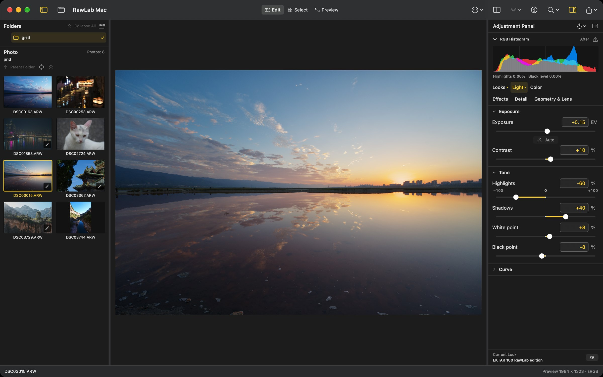
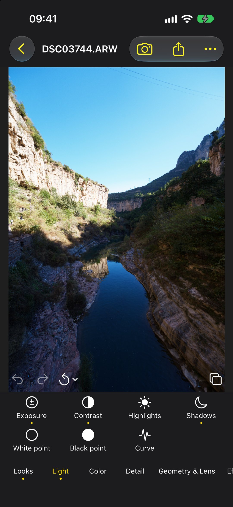
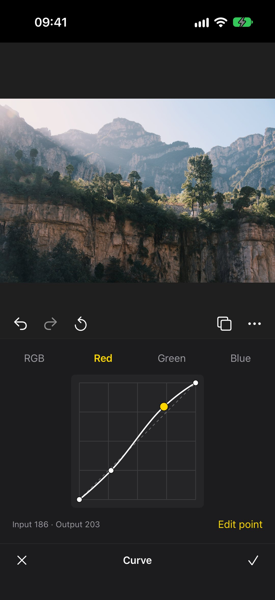
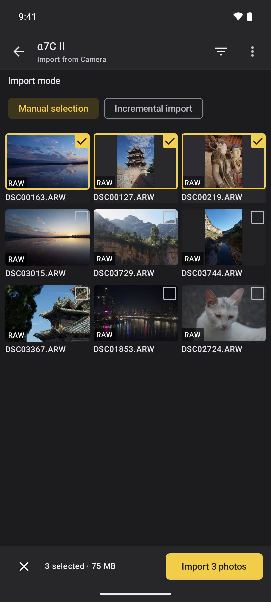
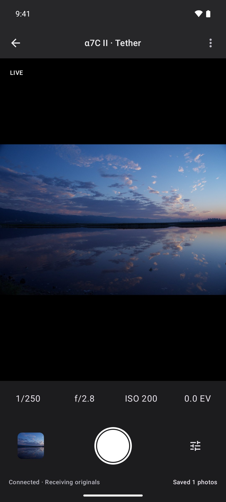
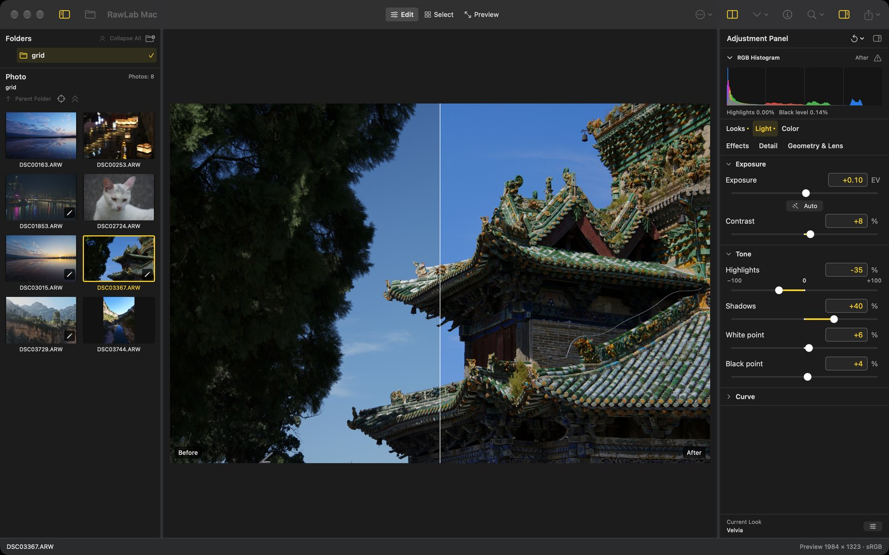
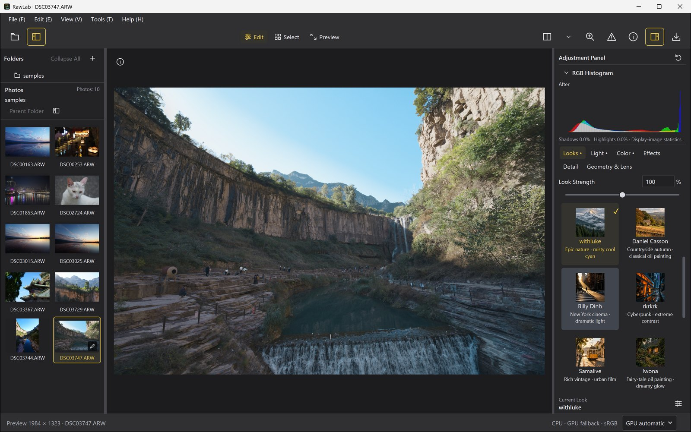
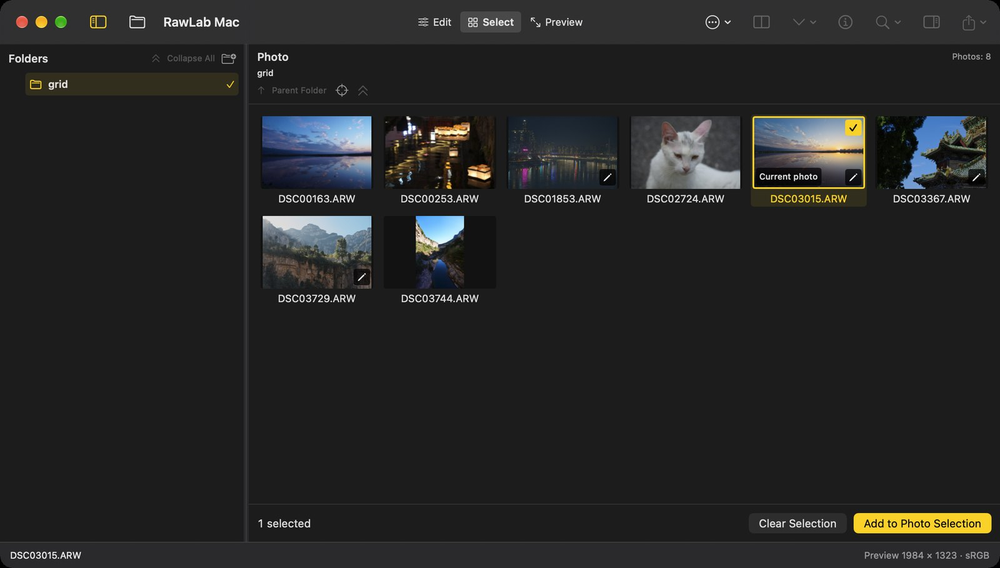
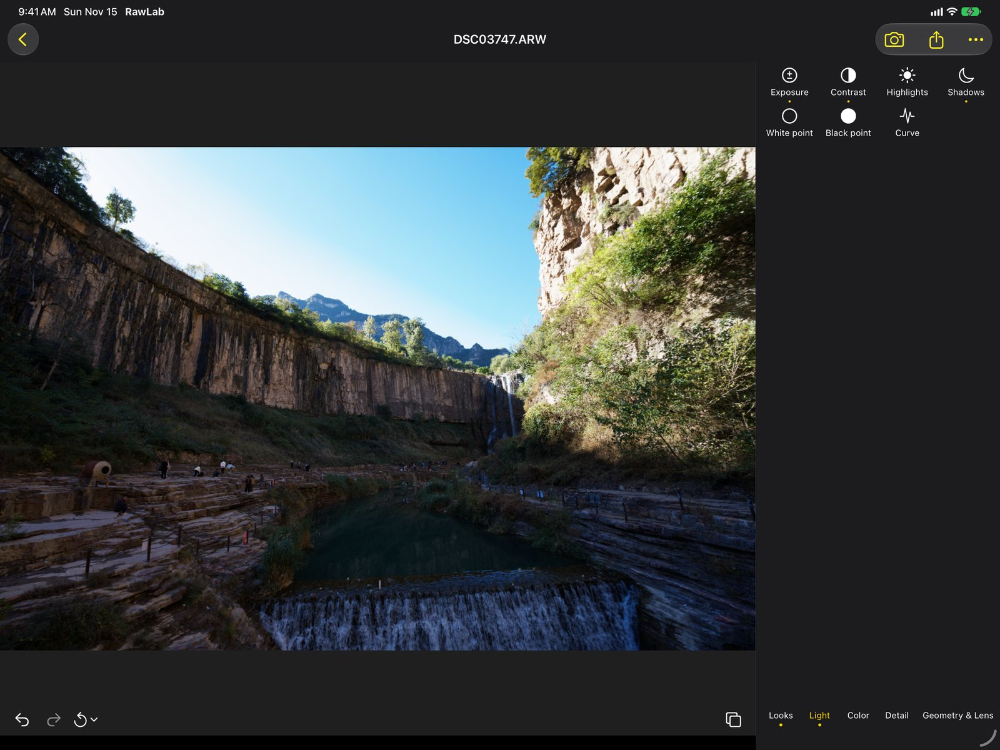

<p align="center">
  
</p>

<h1 align="center">RawLab</h1>

<p align="center">
  <strong>RAW development, film color, and wireless camera workflow — native on every screen.</strong><br>
  Local-illumination tone mapping, RGB channel curves, built-in film looks &amp; master recipes,<br>
  and mobile Sony Wi-Fi transfer — powered by one C++ core on macOS, Windows, iPhone, iPad and Android.
</p>

<p align="center">
  <a href="https://github.com/dancancer/RawLab/releases/latest"></a>
  <a href="LICENSE"></a>
  
  <a href="https://github.com/dancancer/RawLab/actions/workflows/ci.yml"></a>
  <a href="https://github.com/dancancer/RawLab/stargazers"></a>
</p>

<p align="center">
  <a href="https://github.com/dancancer/RawLab/releases/latest"><b>Download</b></a> ·
  <a href="docs/releases/v0.13/v0.13.0.md">What's new in 0.13</a> ·
  <a href="docs/README.md">Documentation</a> ·
  <a href="CHANGELOG.md">Changelog</a> ·
  <a href="docs/README.zh-CN.md">简体中文</a>
</p>

<p align="center">
  
</p>

## Why RawLab

- **Highlight-safe RAW & HDR development.** Develops RAW files from Sony,
  Fujifilm, Canon, Nikon, Panasonic, Pentax, Sigma X3F and other cameras
  supported by LibRaw, alongside phone gain-map HDR, Apple ProRAW and ordinary
  JPEG, PNG, TIFF and HEIF images — non-destructively, with local-illumination
  highlights/shadows and RGB channel curves.
- **Film color without brand lock-in.** Built-in film looks and 14 master
  recipes scale smoothly from 0–200% strength. Import your own CUBE or RLOOK
  LUTs and split-compare against the neutral rendering at any time.
- **Camera-to-editor workflow, one engine everywhere.** Connect wirelessly to
  Sony cameras on Android (**preview** on iOS) for incremental import and
  live-view tethering, while native SwiftUI/AppKit, Compose and WPF apps render
  identically through one shared C++17 core.
- **Local, private and open source.** Licensed under `GPL-3.0-only` with no
  account, no cloud upload and no subscription — every edit runs on your device.

## What's new in 0.11

| | |
| --- | --- |
| 📷 **Sony Wi-Fi camera import** | Browse, preview and import photos straight from a Sony camera on Android (**preview** on iOS). One-tap incremental import brings in only the new shots, resumes after a disconnect, never downloads a photo twice, and supports JPEG resize in both manual and incremental import. |
| 🎯 **Wireless tethering** | Live view, phone shutter, tap-to-focus with live-view focus frames and focus area controls, plus automatic transfer of every new shot (including camera-shutter shots) on Android (**preview** on iOS). Verified with Sony α7C II. |
| 🎚️ **Processing version 3** | Retuned highlights, shadows, contrast, black/white points, vibrance, clarity and dehaze. SDR exposure now covers ±5 EV. Existing edits are validated before upgrading; once saved in 0.11.0, edits **do not support downgrading** to 0.10.x or earlier. |
| ✏️ **Edited-photo previews & 1:1 mobile zoom** | Pencil markers and thumbnails showing your adjustments on all clients, Edited/Unedited filters on mobile, Recently Opened on iOS, and 1:1 native viewport ROI tiling with progressive zoom on iOS and Android. |
| 📱 **Redesigned mobile editor** | Compact tool workspaces with Apply/Cancel for each tool, RGB channel curves, cancellable mobile HDR export progress, and a vignetting-correction switch. |

There are also full-frame Sony 4:3/16:9/1:1 RAW development, more compatible
rendered DNG, staged exports that never damage existing files, support for
images over 128 MP and automatic storage cleanup. See the
[0.11.0 release notes](docs/releases/v0.11/v0.11.0.md) for details, preview
status and known limits.

## Screenshots

<table>
  <tr>
    <td width="25%"></td>
    <td width="25%"></td>
    <td width="25%"></td>
    <td width="25%"></td>
  </tr>
  <tr>
    <td align="center">Compact mobile editor (iPhone)</td>
    <td align="center">RGB channel curves (iPhone)</td>
    <td align="center">Sony Wi-Fi camera import (Android)</td>
    <td align="center">Wireless tethering (Android)</td>
  </tr>
</table>

<table>
  <tr>
    <td width="50%"></td>
    <td width="50%"></td>
  </tr>
  <tr>
    <td align="center">Before/after split on macOS</td>
    <td align="center">Master recipes on Windows</td>
  </tr>
  <tr>
    <td width="50%"></td>
    <td width="50%"></td>
  </tr>
  <tr>
    <td align="center">Select workspace &amp; edited markers on macOS</td>
    <td align="center">Tablet workspace on iPad</td>
  </tr>
</table>

## Features

<details open>
<summary><b>Develop</b></summary>

- Exposure, camera-space white balance, tone, highlights/shadows, black/white
  points, curves (including RGB channels), HSL with on-photo sampling, color
  grading, clarity, dehaze, sharpening and vignette.
- Linear-light wavelet noise reduction with separate luma, chroma and
  coarse-chroma controls, and deterministic grain.
- Lens correction, plus crop, rotate, straighten, flip and perspective
  correction.
- Normal X3F rendering for supported Sigma DP1S, Merrill and Quattro files.
  See [scope and limits](lutools/docs/x3f-rendering.md).
- GPU AI denoising on Apple Silicon macOS and Windows. It requires a hardware
  GPU, and the models have
  [separate noncommercial licenses](docs/reference/licensing.md).

</details>

<details>
<summary><b>Looks and recipes</b></summary>

- Built-in film looks and 14 master recipes with 0–200% strength.
- CUBE/RLOOK import, look categories, search and a Recent list.
- Presets, selective copy/paste and synchronization that show which fields
  will change before they are applied.

</details>

<details>
<summary><b>HDR</b></summary>

- Edit gain-map HDR JPEG/HEIF, camera RAW and Apple ProRAW in HDR on all four
  clients, keeping separate HDR and SDR edits.
- HDR looks, HDR peak limit and separate controls for the SDR base image.
- Export gain-map HDR JPEG, explicit SDR results, or HDR HEIF on macOS/iOS when
  the system supports it. See the [HDR scope](docs/design/hdr-photos/camera-raw.md).

</details>

<details>
<summary><b>Workflow</b></summary>

- Sony Wi-Fi camera import and wireless tethering (with tap-to-focus and focus
  area controls) on Android, with iOS in preview.
- Per-photo edit memory, collections, and resumable batch export with frozen
  settings, cancellation and retry.
- Pencil markers and thumbnails showing your adjustments, 1:1 mobile viewport
  ROI zoom, plus desktop Edit, Select and Preview workspaces.
- System Open With, file drop and photo sharing; multiple photos open as a
  collection.
- Six interface languages: English, 简体中文, 日本語, Deutsch, Español and
  Français.

</details>

<details>
<summary><b>Export</b></summary>

- JPEG on all clients, 16-bit PNG on Windows, macOS and Android, and rendered
  DNG with embedded previews on all clients.
- Original size or long-edge sizing. Readable capture metadata is retained.
- Exports write to a temporary file and replace the target only when complete,
  so a cancelled or failed export never damages an existing file.

</details>

<details>
<summary><b>For developers</b></summary>

- A shared C++17 core with Metal, Direct3D 11 and OpenGL ES acceleration and
  automatic CPU fallback.
- A command-line tool, desktop Agent recipes and an MCP server that use the
  same processing core as the apps. See [Edit JSON and Agent interface](lutools/docs/edit-json.md).
- A [color and rendering contract](lutools/docs/color-contract.md) shared by
  every client.

</details>

## Download

| Platform | Requirements | Get it |
| --- | --- | --- |
| macOS | macOS 14+ (HDR editing needs macOS 15+), Apple Silicon or Intel | [Releases](https://github.com/dancancer/RawLab/releases/latest) · auto-updates via Sparkle |
| Windows | Windows 10/11, x64 | [Releases](https://github.com/dancancer/RawLab/releases/latest) · auto-updates with the Setup installer |
| Android | Android 8.0+, ARM64 or x86_64 | [Releases](https://github.com/dancancer/RawLab/releases/latest) (APK) |
| iPhone / iPad | iOS 18+ | [Releases](https://github.com/dancancer/RawLab/releases/latest) (unsigned IPA, [sign it yourself](docs/guides/ios-installation.md)) |

The Mac packages use a self-signed certificate and are not notarized, so you
may need to allow the app in System Settings the first time you open it. See
the [installation guide](docs/guides/installation.md).

## Build from source

```bash
git clone https://github.com/dancancer/RawLab.git && cd RawLab

# macOS app
bash RawLabMac/build.sh

# Android (from RawLabAndroid/)
./gradlew :app:assembleDebug

# iOS core framework, then open RawLab/RawLab.xcodeproj in Xcode
bash lutools/build.sh ios

# Windows (PowerShell)
./RawLabWindows/build.ps1 -Test
```

Each client has its own prerequisites and options: [macOS](RawLabMac/README.md),
[Windows](RawLabWindows/README.md), [Android](RawLabAndroid/README.md),
[iOS](lutools/platform/ios/README.md) and the [core and CLI](lutools/README.md).

## Documentation

- [Documentation index](docs/README.md): guides, references and design documents
- [Release notes](docs/releases/v0.11/v0.11.0.md) and [changelog](CHANGELOG.md)
- [RAW format support](docs/reference/raw-format-support.md)
- [Product roadmap (Chinese)](docs/architecture/roadmap.md)

## Contributing

Issues and pull requests are welcome. The project uses Gitflow: branch from
`development` and open your PR against `development`. Before you start, read
the [repository guidelines](AGENTS.md), the [CI and verification SOP](docs/process/ci.md)
and the [localization guide](docs/process/localization.md). Pull requests from
forks run on hosted CI.

## Privacy

Editing happens entirely on your device. Anonymous usage statistics are
on by default and can be turned off in the app. They never include photos,
previews, file names, paths or EXIF data. See the
[usage statistics contract](docs/reference/rum-analytics.md).

## License

Copyright (c) 2026 RawLab contributors. The project's original code is licensed
under the [GNU General Public License v3.0 only](LICENSE) (`GPL-3.0-only`), with
a narrow [Alibaba Cloud RUM SDK linking exception](LICENSE-ALIYUN-RUM-EXCEPTION)
under GPLv3 section 7. Third-party libraries, LUTs, AI models and other bundled
assets keep their own licenses; see [licensing and attribution](docs/reference/licensing.md).

RawLab is an independent project. It is not affiliated with or endorsed by
Fujifilm, Sony or any other camera maker, and its film looks do not promise an
exact match with in-camera JPEGs.
