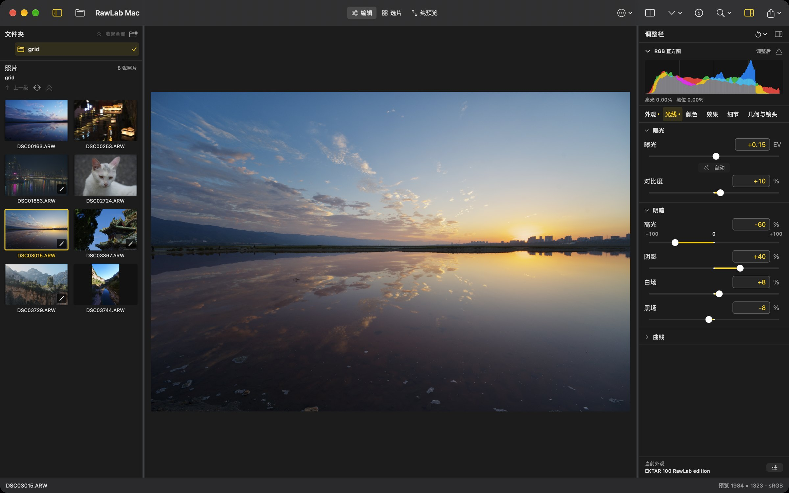
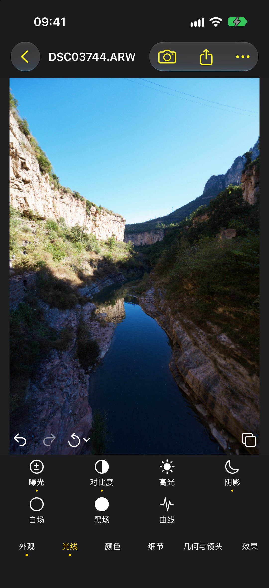
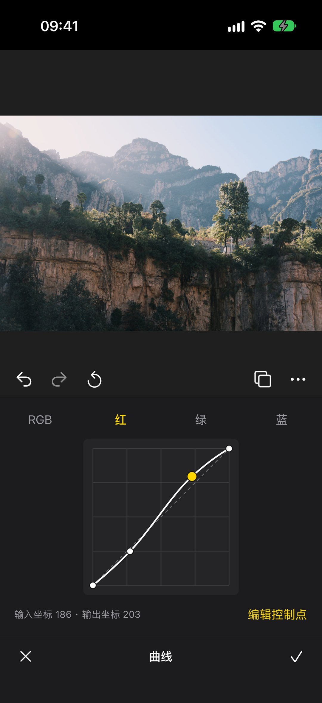
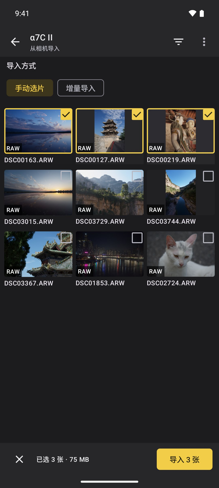
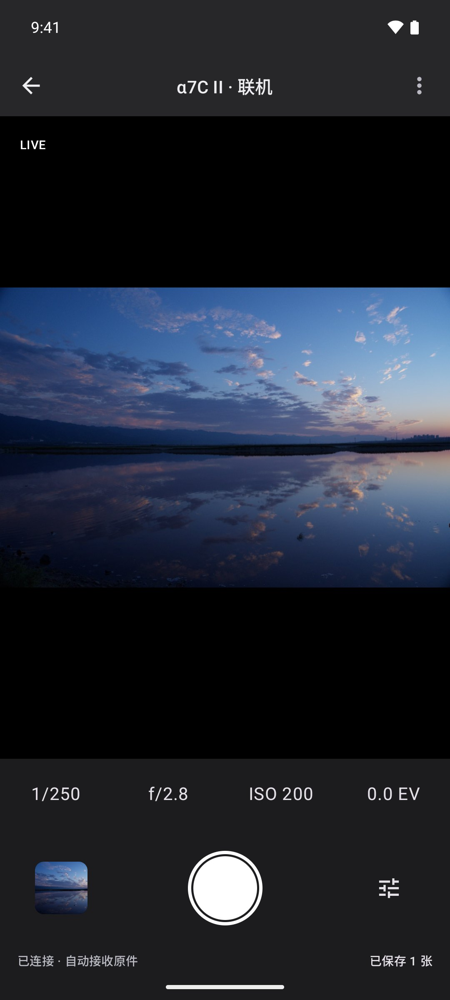
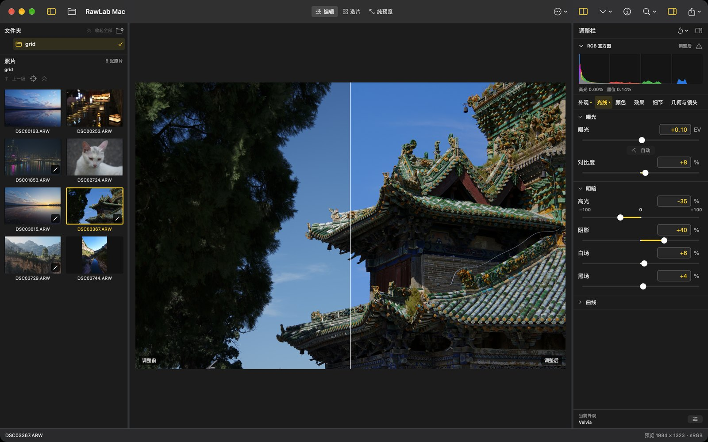
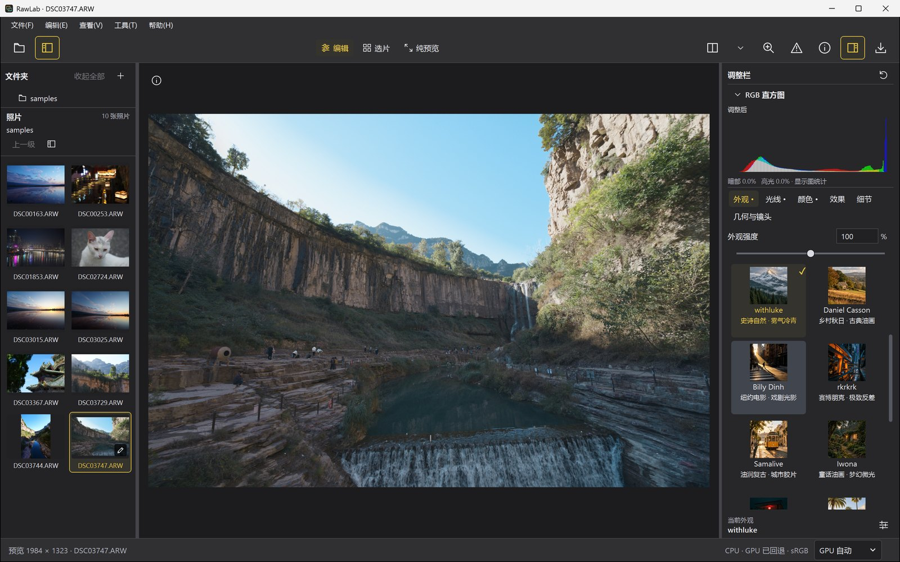
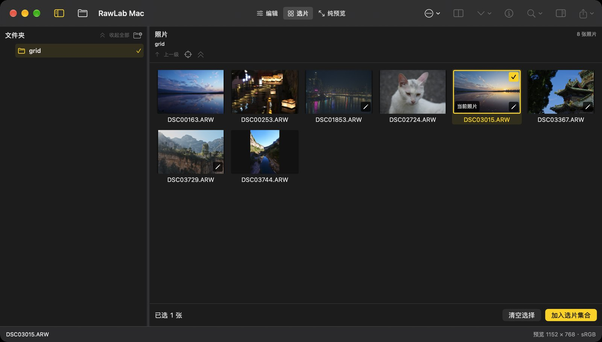
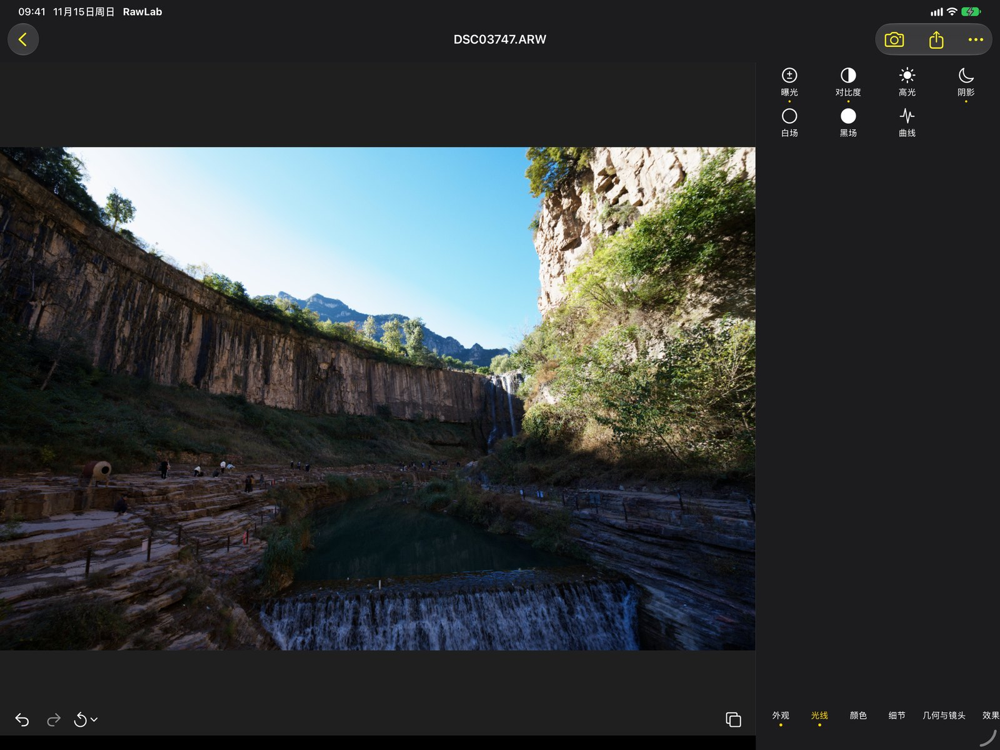

<p align="center">
  
</p>

<h1 align="center">RawLab</h1>

<p align="center">
  <strong>暗房级 RAW 显影 · 胶片调色 · 相机无线直连，五端原生同色。</strong><br>
  局部明暗自适应高光阴影、RGB 分通道曲线、内置胶片外观与大师配方，以及移动端 Sony Wi-Fi 传图联机——<br>
  由同一套 C++17 核心驱动 macOS、Windows、iPhone、iPad 与 Android 原生客户端。
</p>

<p align="center">
  <a href="https://github.com/dancancer/RawLab/releases/latest"></a>
  <a href="../LICENSE"></a>
  
  <a href="https://github.com/dancancer/RawLab/actions/workflows/ci.yml"></a>
  <a href="https://github.com/dancancer/RawLab/stargazers"></a>
</p>

<p align="center">
  <a href="https://github.com/dancancer/RawLab/releases/latest"><b>下载</b></a> ·
  <a href="releases/v0.11/v0.11.0.md">0.11.0 发布说明</a> ·
  <a href="README.md">文档索引</a> ·
  <a href="../CHANGELOG.md">更新日志</a> ·
  <a href="../README.md">English</a>
</p>

<p align="center">
  
</p>

## 为什么选择 RawLab

- **兼顾逆光高光与暗部层次的非破坏显影。** 支持 Sony、Fujifilm、Canon、Nikon、Panasonic、Pentax、Sigma X3F 等 LibRaw 覆盖机型，同时兼容手机增益图 HDR 照片、Apple ProRAW 及 JPEG、PNG、TIFF、HEIF；配备局部明暗自适应高光/阴影与 RGB 分通道曲线，从不改写原始文件。
- **不受机身限制的胶片色彩与大师配方。** 内置胶片模拟与 14 款大师配方，支持 0–200% 强度平滑缩放，可导入兼容的 CUBE / RLOOK LUT，并随时与中性显影效果分割线对比。
- **拍完无线直传，五端原生同核同色。** Android 端**正式支持**（iOS 端为**预览**状态）直连 Sony 相机增量导图与实时联机取景；macOS、iOS/iPadOS、Android 与 Windows 原生界面共用同一套 C++17 核心，跨端呈现一致成片。
- **本机离线运行，自由开源。** 项目源码采用 `GPL-3.0-only` 许可，无账号体系、无云端上传、无订阅门槛，所有显影、调色与导出均在本机完成。

## 0.11 新特性

| | |
| --- | --- |
| 📷 **Sony Wi-Fi 相机直连导图** | Android 端**正式支持**（iOS 端目前为**预览**状态）直连 Sony 相机浏览预览与导图。支持一键增量导入仅新增的照片，断线重连后继续传输且不重复下载，手动与增量导入均支持 JPEG 缩放，只读不改动相机存储卡。 |
| 🎯 **无线联机实拍（Tethering）** | 支持实时取景、手机遥控快门、点按对焦与实时对焦框、对焦区域切换，并在使用相机机身快门拍摄时自动将新照片传入编辑器；Android 端**正式支持**、iOS 端为**预览**状态。已在 Sony α7C II 固件 2.00 实机验证。 |
| 🎚️ **Processing v3 底层重调** | 重新调校高光、阴影、对比度、黑白场、鲜艳度、清晰度与去雾；SDR 曝光调节范围扩展至 ±5 EV；14 款大师配方同步升级。已有编辑记录需校验后迁移；**自 `0.11.0` 起保存的编辑记录不支持降级到 `0.10.x` 或更早版本**。 |
| ✏️ **已编辑效果缩略图与移动端 1:1 缩放** | 全平台文件树/网格统一显示铅笔标记与渲染后效果缩略图；移动端新增「全部 / 已编辑 / 未编辑」筛选与 1:1 原生视口分块缩放，iOS 新增「最近打开」管理。 |
| 📱 **移动端紧凑工具区与分通道曲线** | 重构移动端工具面板，工具操作统一配备应用/取消栏；新增 RGB 与红/绿/蓝分通道色调曲线、可取消的移动端 HDR 导出进度，以及暗角镜头校正开关。 |

此外还包含 Sony `4:3 / 16:9 / 1:1` 全传感器画幅 RAW 显影、兼容性更好的 16 位渲染型 DNG 导出、写前先落临时文件且不损坏现有目标文件的 PNG/JPEG/DNG 导出、128 MP 以上高像素图像支持与自动存储清理。详细条目、预览范围与已知限制请见 [0.11.0 发布说明](releases/v0.11/v0.11.0.md)。

## 界面预览

<table>
  <tr>
    <td width="25%"></td>
    <td width="25%"></td>
    <td width="25%"></td>
    <td width="25%"></td>
  </tr>
  <tr>
    <td align="center">紧凑移动端编辑（iPhone）</td>
    <td align="center">RGB 分通道曲线（iPhone）</td>
    <td align="center">Sony 无线相机导图（Android）</td>
    <td align="center">无线联机实拍（Android）</td>
  </tr>
</table>

<table>
  <tr>
    <td width="50%"></td>
    <td width="50%"></td>
  </tr>
  <tr>
    <td align="center">调整前后分割线对比（macOS）</td>
    <td align="center">大师配方与实时直方图（Windows）</td>
  </tr>
  <tr>
    <td width="50%"></td>
    <td width="50%"></td>
  </tr>
  <tr>
    <td align="center">选片视图与已编辑标记（macOS）</td>
    <td align="center">分栏平板工作区（iPad）</td>
  </tr>
</table>

## 功能特性

<details open>
<summary><b>显影与调色</b></summary>

- 曝光、相机空间白平衡、对比度、高光/阴影、黑白场、多点色调曲线（含 RGB 分通道）、画布取样 HSL、色彩分级、清晰度、去雾、锐化与暗角。
- 线性光域小波降噪（独立控制亮度、色度与粗层色斑）与确定性固定种子颗粒。
- 镜头几何/暗角/畸变校正，以及裁切、旋转、水平拉直、翻转与透视校正。
- 支持 Sigma DP1S、Merrill 与 Quattro 范围 X3F 普通显影；详见 [X3F 显影说明](../lutools/docs/x3f-rendering.md)。
- Apple Silicon macOS 与 Windows 提供仅使用硬件 GPU 的 AI 降噪，不可用时明确提示且模型保留[独立非商用许可](reference/licensing.md)。

</details>

<details>
<summary><b>外观、大师配方与预设</b></summary>

- 内置胶片模拟与 14 款大师配方，支持 0–200% 强度缩放当前参数、HSL 与 LUT。
- 支持导入 CUBE / RLOOK 外观，提供分类浏览、关键词搜索与「最近使用」列表。
- 自定义预设可直接应用，复制、粘贴与批量同步前预览实际即将覆盖的参数字段与数值。

</details>

<details>
<summary><b>HDR 编辑与兼容导出</b></summary>

- 全端支持手机增益图 HDR JPEG/HEIF、相机 RAW 与 Apple ProRAW 的 HDR 编辑，并独立保存 HDR 与 SDR 两组调整。
- 支持 HDR 外观、HDR 亮度上限设置与独立 SDR 底图调节；见 [相机 RAW HDR 范围](design/hdr-photos/camera-raw.md) 与 [ProRAW 说明](design/hdr-photos/proraw.md)。
- 可导出增益图 HDR JPEG 或明确的 SDR 成片；macOS/iOS 在系统支持时还可导出 HDR HEIF。

</details>

<details>
<summary><b>工作流与无线联机</b></summary>

- Sony Wi-Fi 相机导入与无线联机实拍（支持点按对焦与对焦区域切换）在 Android 端**正式支持**，iOS 端处于**预览**状态。
- 逐照片本机编辑记忆、照片集合与参数冻结的可恢复批量导出（支持取消和失败重试）。
- 全平台「已编辑」铅笔标记与效果缩略图，移动端 1:1 原生视口分块缩放，桌面端支持「编辑 / 选片 / 纯预览」三模式工作区。
- 支持系统打开方式、文件拖放与系统分享（多选直接进入集合）。
- 内置六种界面语言：简体中文、English、日本語、Deutsch、Español、Français。

</details>

<details>
<summary><b>导出格式与保护</b></summary>

- 全平台支持 JPEG 与 16 位渲染型 DNG（带内嵌预览图），Windows、macOS 与 Android 另支持 16 位整数 RGB PNG；格式边界见 [色彩与渲染契约](../lutools/docs/color-contract.md#rendered-dng)。
- 支持原始尺寸或指定长边导出，保留可读 EXIF 拍摄元数据并更新成片尺寸与方向。
- 导出过程先写入临时文件，成功完成且未被取消后才替换目标文件。

</details>

<details>
<summary><b>面向开发者与自动化</b></summary>

- 共享 C++17 核心集成 Metal、Direct3D 11 与 OpenGL ES 硬件加速，并在失败或降级环境自动保留 CPU 回退。
- 提供命令行工具 `sony2fuji`、桌面 Agent 配方与 MCP 接口；详见 [Edit JSON 与 Agent 接口](../lutools/docs/edit-json.md) 及 [LUT 准备工具](../lutools/docs/lut-preparation.md)。
- 全端共同遵循统一的 [色彩与渲染契约](../lutools/docs/color-contract.md)。

</details>

## 下载安装

| 平台 | 系统要求 | 获取方式 |
| --- | --- | --- |
| macOS | macOS 14+（HDR 编辑需 macOS 15+），Apple Silicon 或 Intel | [GitHub Releases](https://github.com/dancancer/RawLab/releases/latest) · 内置 Sparkle 自动更新 |
| Windows | Windows 10/11，x64 | [GitHub Releases](https://github.com/dancancer/RawLab/releases/latest) · 安装版支持自动更新 |
| Android | Android 8.0+，ARM64 或 x86_64 | [GitHub Releases](https://github.com/dancancer/RawLab/releases/latest)（APK） |
| iPhone / iPad | iOS 18+ | [GitHub Releases](https://github.com/dancancer/RawLab/releases/latest)（未签名 IPA，[自签名安装教程](guides/ios-installation.zh-CN.md)） |

Mac 分发包使用自签名证书且未经过 Apple 公证，首次打开时可能需要在系统设置中允许运行；详情请参阅[安装与分发说明](guides/installation.md)。

## 从源码构建

```bash
git clone https://github.com/dancancer/RawLab.git && cd RawLab

# macOS 客户端
bash RawLabMac/build.sh

# Android 客户端（于 RawLabAndroid/ 目录运行）
./gradlew :app:assembleDebug

# iOS 核心框架，完成后使用 Xcode 打开 RawLab/RawLab.xcodeproj
bash lutools/build.sh ios

# Windows 客户端（PowerShell）
./RawLabWindows/build.ps1 -Test
```

各端独立依赖与详细参数请参阅：[macOS](../RawLabMac/README.md)、[Windows](../RawLabWindows/README.md)、[Android](../RawLabAndroid/README.md)、[iOS 核心集成](../lutools/platform/ios/README.md) 以及 [共享核心与命令行](../lutools/README.md)。

## 相关文档与架构资料

- [总文档索引](README.md) · [v0.11.0 发布说明（构建 20）](releases/v0.11/v0.11.0.md) · [更新日志](../CHANGELOG.md)
- [RAW 格式支持清单](reference/raw-format-support.md) · [格式契约](reference/formats/) · [镜头校正](reference/platforms/lens-correction.md) · [LUT 来源审计](luts/README.md)
- [产品路线图](architecture/roadmap.md) · [活动架构评审](architecture/architecture-and-performance-review-2026-10-18.md) · [跨相机路线图](architecture/cross-camera-presets-roadmap.md)
- [编辑迭代总需求](design/editing-iteration/requirements.md)与[技术方案](design/editing-iteration/technical-design.md) · [四端设计资产](design/README.md)
- [已编辑预览设计](design/editor-workspace/edited-photo-previews.md) · [HDR 照片技术方案](design/hdr-photos/technical-design.md) · [Android/Windows HDR 范围](design/hdr-photos/android-windows.md)
- [过往发布与集成历史归档](archive/README.md)

## 参与贡献

欢迎提交 Issue 与 Pull Request。仓库采用 Gitflow 工作流：请从最新 `development` 创建特性分支并将 PR 提交至 `development`。提交前请阅读[仓库规范](../AGENTS.md)、[CI 与验证 SOP](process/ci.md)、[迭代协作规范](process/integration-workflow.md)和[多语言维护指南](process/localization.md)。

## 隐私声明

所有照片显影与编辑均在你的设备本地完成。应用默认启用匿名使用统计（可在设置中随时关闭），统计事件绝不包含照片内容、预览图、文件名、路径或 EXIF 信息；详见[使用统计契约](reference/rum-analytics.md)。

## 开源许可

Copyright (c) 2026 RawLab contributors。本项目原创代码采用 [GNU General Public License v3.0 only](../LICENSE)（`GPL-3.0-only`），并依据 GPLv3 第 7 节提供范围明确的[阿里云 RUM SDK 链接例外](../LICENSE-ALIYUN-RUM-EXCEPTION)。第三方依赖库、胶片 LUT、AI 降噪模型与其他附带资源均保留其原有许可证与版权声明，详见[许可与归属说明](reference/licensing.md)。

RawLab 为独立开源项目，与富士（Fujifilm）、索尼（Sony）或其他任何相机厂商均无关联或授权关系，所提供的胶片外观不承诺与相机机身直出 JPEG 完全一致。
