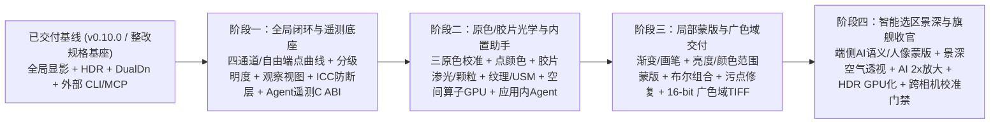

# RawLab 产品路线图

本文更新 **RawLab** 在 **`v0.10.0`（构建 `19`）** 发布之后的中长期产品与技术演进规划，涵盖核心显影与调色引擎、胶片物理光学、定量看色观察层、非破坏性局部与三维范围蒙版、应用内可撤销调色助手（**Agent Mode**）、端侧智能选区与深度控制，以及专业色彩交付能力。

> **基线与协作治理说明**：
> - 本路线图记录规划意图与验收标准，不预设发布版本号或日期，不将计划项视为已实现或已通过设备验收；各平台实际支持范围与限制以对应版本发布说明及实测证据为准。
> - 代码与语义规格整改由 [整改路线图（2026-11-13）](remediation-roadmap-2026-11-13.md) 统筹（确立 `Shared/specs/` 字段规格、传输/重置场景向量、版本登记表与 GPU/CPU 对拍十条不变量）。涉及跨端新参数与调整语义的功能阶段，须建立在该规格层基座之上按 [集成协作规范](../process/integration-workflow.md) 推进。

---

## 一、已交付基线（截至 `v0.10.0`，构建 `19`）

2026-10 规划中的第一阶段、第二阶段主体工作流、桌面端自动更新以及第三/四阶段首期关键能力已随 `v0.10.0` 及此前版本交付（详参 [v0.10.0 发布说明](../releases/v0.10/v0.10.0.md) 与 [Edit JSON 契约](../../lutools/docs/edit-json.md)）：

- **四端原生显影工作区**：覆盖 macOS、Windows、iOS 与 Android，提供分级调整分组、自适应窗口布局、本地编辑记忆、选择性复制粘贴、命名用户预设、批量同步、快捷逐张微调与可恢复批量导出，以及桌面端自动检查/更新发布包机制。
- **核心调色与氛围引擎**：支持解马赛克前相机空间白平衡与多曝光基准、自动曝光估计、引导滤波高光阴影与黑场/白场/鲜艳度控制、PCHIP 单调样条点曲线、8 色域 HSL 混色器（含画面采样探针）、三区颜色分级（色相/饱和度）、清晰度/双向去朦胧、暗角、颗粒、线性小波降噪，以及 54 套内置风格外观与大师配方。
- **几何、HDR 与硬件 AI 能力**：支持裁切/旋转/拉直/翻转与透视校正；支持手机增益图与受支持相机 RAW / Apple ProRAW 的 HDR 编辑与增益图 JPEG /（Apple 端）HDR HEIF 导出；支持受支持 Apple Silicon macOS 与 Windows 硬件 GPU 的 `DualDn` AI 降噪；支持 16-bit PNG 与（桌面/iOS）16-bit TIFF 输入及桌面 Agent / MCP 配方调用。

在此基线上，当前高杠杆能力缺口集中于：**局部与三维范围蒙版缺失**、**色彩校准/点颜色/可选颜色与曲线明度解耦短板**、**定量色值监测与诊断观察视图缺失**、**胶片物理光学层（渗光/柔焦/非对称颗粒）与明度边缘锐化缺失**、**8-bit 导出 ICC/防断层抖动与 `16-bit` 广色域 TIFF 中间交付缺失**，以及**从外部 CLI/MCP 向应用内可撤销调色助手的演进**。

---

## 二、产品边界与共同约束

1. **坚守「参数化非破坏性显影工作站」定位（[PRODUCT.md](../../PRODUCT.md) · [DESIGN.md](../../DESIGN.md)）**
   - **纳入范围**：相机三原色校准、窄带点颜色与颜色收敛、可选颜色、胶片物理光学、定量像素取样与无损观察视图、参数化几何/范围蒙版、端侧语义与景深蒙版、应用内可撤销调色助手、轻量非破坏性污点修复、广色域与 `16-bit` 无损 TIFF 导出。
   - **明确不做**：不做传统像素图层合成、不做手工高低频磨皮画笔、不做液化变形、不做生成式 AI 扩图或换天；重度商业像素精修通过 **`16-bit ProPhoto RGB / Adobe RGB TIFF`** 无损导出交由外部专业精修工具接力。
2. **共享核心唯一真源与规格层先导（[色彩约定](../../lutools/docs/color-contract.md) · [整改路线图](remediation-roadmap-2026-11-13.md)）**
   - 凡属显影、调色、定量遥测、蒙版计算与色彩管理的核心算子，统一沉淀于 `lutools` C++17 核心与 C ABI，确保四端客户端、批量导出、CLI 与 Agent 接口语义完全一致。
   - 所有跨端新参数须一次性纳入共享字段规格、传输/重置场景向量、版本登记表与 C ABI 布局夹具验证，不在单端或两套代码中重复实现。
3. **零值恒等向后兼容与原片只读（[迁移契约](../../lutools/docs/processing-migration.md)）**
   - 新增参数在默认值下须严格执行零算术旁路，确保历史照片编辑记录、内置大师配方与旧版配方渲染效果保持一致。
   - 原始照片始终保持只读；预览、临时对比与最终导出遵守同一套处理顺序与坐标定义。
4. **硬件加速与设备能力诚实边界**
   - 普通渲染与空间算子在 GPU `Auto` 模式下保留 CPU 一致性回退，`Force` 模式要求真实硬件 GPU 成功；而 AI 降噪、AI 超分、AI 语义/深度分割仅在受支持的硬件推理后端（如 Mac Core ML、Windows DirectML 或受支持的移动端加速后端）运行，不可用时明确提示，不静默回退到极慢的 CPU 神经网络推理。

---

## 三、后续演进总览（阶段一 → 阶段四）



| 演进阶段 | 核心主题 | 关键架构前置与交付标志 |
| :--- | :--- | :--- |
| **阶段一** | **全局调色闭环、定量看色、色彩交付与 Agent 遥测底座** | 在现有架构与 `Shared/specs/` 规格约束下低侵入补齐曲线、色轮明度、WB 吸管、像素监测、ICC/防断层交付及 `lutools` 原生分析 C ABI |
| **阶段二** | **原色校准、窄带选色、胶片光学、空间算子 GPU 化与内置 Agent Mode** | 将现有及新增空间滤波算子迁入 Metal / GLES / D3D11 GPU 管线；形成色彩与胶片质感壁垒，交付可撤销的应用内暗房副驾 |
| **阶段三** | **非破坏性局部蒙版引擎、轻量污点修复与广色域交付** | 引入归一化源坐标下的有序局部蒙版堆栈（几何渐变/画笔 + 确定性三维范围选区 + 布尔组合），并打通 `16-bit` 广色域 TIFF |
| **阶段四** | **端侧 AI 语义/景深蒙版、AI 超分与跨平台成熟度收官** | 复用硬件推理引擎落地主体/人像五官与单目深度蒙版；完成 AI `2x` 放大、HDR 管线算子对齐 GPU 化与跨相机定量校准验收 |

---

## 四、分阶段详细范围与验收标准

### 阶段一：全局调色闭环、定量看色、交付加固与 Agent 遥测底座

#### 目标与范围

1. **曲线系统完整升级**
   - **桌面端四通道对齐**：补齐 macOS 与 Windows 端 `RGB / 红 / 绿 / 蓝` 独立四通道曲线编辑界面与对应 GPU 渲染路径，与移动端能力对齐。
   - **自由端点与「仅作用于明度」解耦**：放开曲线首尾控制点纵坐标边界以支持暗部抬灰（`y0 > 0`）与高光柔压（`y1 < 1`）；新增「仅作用于明度（Luminosity）」开关，防止调节 S 反差曲线时连带撑爆饱和度与引起色相偏移。
   - **参数曲线与靶向拖拽**：补齐高光/亮调/暗调/阴影四段参数曲线（含可调拆分点）及画布直接拖拽调节对应亮度区间的交互。
2. **颜色分级扩展**
   - 为阴影、中间调、高光三区色轮各自新增独立的 **`Luminance`（明亮度）** 滑块（解决阴影压入青蓝冷调时暗部发灰发飘的问题），并补齐 **全局色轮（Global）**、**分区融合度（Blending）** 与 **冷暖平衡（Balance）** 控制。
3. **白平衡画面吸管、光栅相对白平衡与 AI 降噪混合强度**
   - **白平衡画面吸管**：提供中性灰/眼白区域（`3×3` / `5×5` 均值，带高光截断保护）点击取样反算色温与色调的能力。
   - **普通图像相对白平衡**：放开 JPEG / PNG / TIFF 等光栅输入在线性 sRGB 工作空间内的相对色温/色调纠偏。
   - **AI 降噪混合强度滑块**：将受支持桌面端 [DualDn 内联 AI 降噪](dualdn-inline-denoise.md) 从二值开关升级为 `0–100%` 混合强度滑块（复用已缓存相机空间线性残差做零额外推理开销插值），便于在人像等场景保留适度自然底噪。
4. **定量采样监视器与专业观察视图**
   - **实时色值取样与直方图联动**：指针悬停画布实时读取均值 `RGB + HSB` 数值；支持钉住多个固定监测锚点并同步对比调整前后读数变化；悬停位置同步在直方图上显示亮度落点游标。
   - **五种无损诊断观察视图**（纯视图层呈现，不改写参数也不写入导出文件）：① 黑白素描明度观察；② 冷暖反差黑白观察；③ 过饱和溢出热力预警；④ 人像肤色色差放大观察；⑤ `50%` 中性灰全屏休眼遮罩。
5. **色彩交付与防断层加固**
   - 为 C++ 导出内核与四端导出链路写入实质 **`APP2 ICC_PROFILE`（`sRGB IEC61966-2.1`）**，消除仅靠 EXIF 标签在跨端看图器中可能导致的广色域过饱和偏色。
   - 在 `16/float -> 8-bit` 导出量化阶段引入抖动（Dithering），抑制大面积蓝天、逆光柔焦背景中的阶梯色带断层；增加按屏幕输出缩放后的**二次输出锐化**，并补齐 iOS 端 `16-bit PNG` 导出。
6. **Agent 遥测核心化与桌面本机互通底座**
   - 将明度五段分布、高光/阴影截断率、中性灰偏色比、高饱和熔断比例、HSL 覆盖分布与局部像素块 HSB 采样收敛为 `lutools` 原生 C ABI（及 CLI `--analyze` / `--sample` 标定模式），消除外部 Agent 反复写盘解码预览 PNG 的 I/O 开销并统一浮点计算口径。
   - 在桌面客户端开放标准调整转移 JSON 导入导出，增加本机编辑记录与用户预设存储的外部变更监听提示（需用户确认后重载，不覆盖未保存手动滑块草稿），同步扩展 `tools/mcp` 诊断与外观目录能力。

#### 验收标准

- 所有旧版本配方与历史编辑记录加载后结果保持一致，新增参数默认值执行零算术旁路；CPU 与 Metal / GLES / D3D11 四后端一致误差维持在色彩契约容差内。
- 导出 JPEG 经系统及工具检验证实嵌入完整 ICC Profile 数据块；合成高平滑渐变测试图验证 8-bit 导出抖动有效消除阶梯断层；iOS `16-bit PNG` 与输出锐化纳入单张及批量导出回归。
- 原生 CLI/C ABI 分析输出与直方图、溢出诊断口径一致；桌面热重载在存在未保存手工调整时绝不静默覆写当前状态。

---

### 阶段二：原色校准、窄带选色、胶片物理光学、应用内助手与空间算子 GPU 化

#### 目标与范围

1. **原色校准与选择性调色**
   - **相机颜色校准（三原色引擎）**：插在场景线性空间与外观 LUT 之前，提供阴影色调（Shadow Tint）与红/绿/蓝三原色色相偏移及饱和度控制，在不偏移中性灰白平衡的前提下实现整体色彩归纳与杂色收敛。
   - **点颜色（Point Color + `Variance` 差异收敛）**：支持画面三维窄带吸管取色与色相/饱和度/明度容差调控，配备 **`Variance`（差异收敛）** 控制，负向拖动使局部斑驳肤色向目标色锚点平滑收敛，正向拖动拉开同色系植被层次。
   - **可选颜色（Selective Color）**：提供红/黄/绿/青/蓝/洋红与白色/中性色/黑色九档相对与绝对油墨调节，用于提纯单色或压暗天空而不影响高光中性云层。
2. **高频纹理分离与专业锐化升级**
   - **独立 `Texture（纹理）` 滑块**：将极高频表面微肌理与中频局部反差 `Clarity` 解耦为独立多尺度频带，支持柔化数码硬边时保留皮肤与织物细节。
   - **明度 USM 锐化升级与镜头去紫边（Defringe）**：将锐化升级为仅作用于明度通道的 `强度 / 半径 / 细节 / 边缘蒙版阈值` 控制（按住阈值预览黑白边缘保护遮罩，避开平滑皮肤与天空噪点）；镜头面板补齐高反差边缘轴向紫边/绿边抑制。
3. **胶片物理光学层与黑白暗房**
   - **高光渗光（`Halation`）与柔光漫射（`Bloom`）**：模拟胶片乳剂底层反射导致的亮部红橙渗光晕，以及逆光与高光边缘的柔和空气漫射。
   - **非对称影调颗粒与黑白混色器**：升级颗粒权重曲线为更贴近负片的「暗部扎实明显、中间调均匀、高光洁净」响应，并提供画幅颗粒尺度预设；新增独立黑白模式与 8 通道黑白滤镜混色器。
4. **应用内可撤销对话式调色助手（Agent Mode）**
   - **暗房副驾侧边面板**：提供可随时折叠的编辑器副驾面板，自动挂载当前低延迟预览、阶段一原生定量遥测报告、当前编辑状态以及用户用取样吸管点选的目标局部色值。
   - **透明 UI 滑块方案与零污染预览**：采用有界推演与内部预渲染质检（出现高光过曝或肤色越界自动触发单次收口修正）；仅以直观中文 UI 滑块增量列表呈现建议，支持不修改磁盘编辑记录的临时预览与原生分屏前后对比。
   - **单步原子撤销与双轨模型安全护栏**：确认应用后将整组改动封装为单条撤销/重做事务，应用后仍可自由微调或另存为预设；支持自备密钥云端多模态模型与本地离线模型双轨接入，并内置参数范围钳位、单步大幅曝光/阴影跃变二次确认及原片零破坏性操作护栏。
5. **效率工作流与空间算子全 GPU 化（关键架构前置）**
   - **编辑快照与同屏样片对照视图**：支持为单张照片保存多个命名调整快照分叉对比，并支持画布左置参考样片、右置当前照片同屏比对直方图与取样数值。
   - **空间滤波算子 GPU 迁移**：将仅在 CPU 执行的 `Processing v3` 引导滤波高光阴影、`Clarity / Dehaze` 以及本阶段新增的 `Texture / Halation / Bloom / 明度 USM` 全面迁移至 Metal / GLES / D3D11 GPU 管线（保留 CPU 参考一致性回退），保障大像素 RAW 交互帧率并满足阶段三蒙版多 Pass 合成算力需求。

#### 验收标准

- 中性灰阶测试图在三原色校准任意调整下保持中性零偏色；人像实拍样本验证负向 `Variance` 过渡平滑无色块撕裂，高阈值边缘蒙版保护下皮肤与天空区域零噪点放大。
- GPU `Force` 模式通过新增空间与光学算子四端数值对拍验证，预览与最终导出处理范围及色彩一致。
- 应用内调色助手在触发单次应用、撤销、重做及拒绝大跨度提案后，状态与历史记录严格一致，且不触碰原片或未保存的手动调整。

---

### 阶段三：非破坏性局部蒙版引擎、轻量污点修复与广色域交付

#### 目标与范围

1. **非破坏性局部蒙版与三维范围选区引擎**
   - **几何与边缘感知手绘蒙版**：提供线性渐变、支持内外羽化与反相的径向渐变，以及边缘感知画笔遮罩，满足局部补光、压暗前景、局部加雾与视觉重心引导需求。
   - **确定性三维像素范围蒙版**（不依赖 AI 模型即可跨四端确定性运行）：提供**亮度范围蒙版**（带柔和衰减与黑白端点隔离）、**颜色范围蒙版**（色相/饱和度/明度三维容差）与**低饱和度保护范围蒙版**。
   - **布尔组合、局部算子驱动与坐标跟随**：支持子蒙版之间 `相加 / 相减 / 交集 / 反相` 组合与洋红遮罩覆盖预览；每个蒙版独立支持曝光、对比、高光、阴影、黑白场、色温色调、曲线、饱和度、色相、纹理、清晰度、去朦胧、锐化与降噪局部调节；控制点定义在归一化未裁切源图像坐标系中，随裁切、旋转、拉直与透视校正同步重映射；同步向桌面 Agent/MCP 与应用内调色助手开放参数化渐变和范围蒙版能力。
2. **轻量非破坏性污点修复**
   - 提供参数化圆形及涂抹修复点（支持自动与手动采样偏移与羽化过渡），用于在应用内直接清理 CMOS 灰尘、水面反光杂物、边缘电线头与孤立人像痘印。
3. **广色域工作/导出链路与 `16-bit` 无损 TIFF 交付**
   - 导出色彩配置扩展支持 `sRGB`、`Display P3`、`Adobe RGB (1998)` 与 `ProPhoto RGB` 并正确嵌入对应 ICC 配置文件；在桌面端与 iOS 补齐 `16-bit` 无损压缩 TIFF 导出，作为进入重度商业像素精修的高动态无损桥梁。

#### 验收标准

- 包含多层布尔局部蒙版与污点修复的照片在连续更改旋转、裁切、透视与预览缩放后，预览与全尺寸导出之间遮罩对齐零漂移，边界过渡无光晕伪影；复制粘贴与用户预设可明确选择是否包含局部蒙版及修复点。
- `16-bit Display P3 / Adobe RGB / ProPhoto RGB TIFF` 导出经专业色彩检视确认无色域裁切错位、条纹断层或 Alpha 兼容性异常。

---

### 阶段四：端侧 AI 语义/景深蒙版、AI 超分与跨平台成熟度收官

#### 目标与范围

1. **端侧硬件加速 AI 语义与人像细分蒙版**
   - 复用跨平台硬件推理调度与内存预算保护（不支持或条件不满足时清晰提示用户，不静默回退至 CPU 神经网络推理）：一键生成**主体 / 天空 / 背景 / 植被 / 建筑**语义选区，并在人像场景提供**面部皮肤 / 身体皮肤 / 巩膜眼白 / 唇部 / 头发**独立细分选区；生成结果无缝接入阶段三蒙版堆栈，支持继续与渐变/画笔/范围蒙版做布尔加减组合及应用内调色助手协同编排。
2. **单目连续深度蒙版（空气透视引擎）**
   - 支持直接读取手机人像/多摄原生景深图，或经由端侧轻量单目深度估计生成连续 `16-bit` 深度图，按前景/中景/远景深度范围滑块一键实施空间色彩、反差与雾感分层控制。
3. **早期规划遗留收口与全平台校准门禁**
   - **AI 2 倍无损超分辨率放大**：复用硬件分块推理与接缝平滑调度落地 `2x` 细节放大，解决高像素大幅裁切输出场景；预览与最终导出效果一致。
   - **HDR 管线算子齐平与 GPU 加速**：依据 [手机 HDR 技术方案](../design/hdr-photos/technical-design.md) 契约，将前序阶段核心调色与局部控光算子择优接入 HDR 编辑路径并推进 HDR 管线 GPU 化，改善当前 HDR 纯 CPU 路径性能。
   - **跨相机预设真机同场景校准闭环**：完成 [跨相机预设路线图](cross-camera-presets-roadmap.md) 中的受控同场景多品牌实拍定量色差门禁验收。
   - **独立评估项（不阻塞显影工作站收官）**：早期规划中偏独立工作流的「视频生成与 Live Photo 封装（SDR 短视频封装、成本确认与相册写入）」保留为可选扩展评估项单独排期，不阻塞摄影显影与暗房核心能力交付。

#### 验收标准

- 在代表性目标设备及真实照片 `100%` 视图与完整导出上验证 AI 语义边界、深度分级过渡及 AI `2x` 放大细节，确认无分块接缝、重复纹理或显存溢出崩溃，并明确记录实机覆盖矩阵。
- 跨相机预设与 HDR 扩充能力分别满足对应参考对拍容差与 HDR 显示/SDR 回退真机验收门禁，不以跳过或仅编译器通过替代真机证据。

---

## 五、并行推进与依赖拓扑

```text
[已交付基线 (v0.10.0) + 整改路线图 Shared/specs 规格层]
   │
   ├──▶ 阶段一（可拆 5 条独立并行线）：
   │      ├─ Track A (Core+UI): 桌面四通道 RGB 曲线 + 自由端点/仅明度模式/参数曲线
   │      ├─ Track B (Core+UI): Color Grading 明亮度/柔和度/平衡/全局轮 + WB 吸管/光栅 WB + DualDn 混合强度
   │      ├─ Track C (Inspect): 实时 HSB/RGB 与固定锚点取样 + 直方图联动游标 + 5 种无损观察视图
   │      ├─ Track D (Export) : JPEG 实质 ICC 写入 + 8-bit 抖动防断层 + 输出锐化 + iOS 16-bit PNG
   │      └─ Track E (Agent)  : lutools 原生定量分析 C ABI + CLI --analyze/--sample + GUI 热重载 & MCP 扩展
   │
   ├──▶ 阶段二（2 条引擎线 + 1 条助手线并行）：
   │      ├─ Track A (Color/Film): 三原色校准 + 点颜色(Variance) + 可选颜色 + Halation/Bloom/非对称颗粒/黑白混色
   │      ├─ Track B (Detail/GPU): 纹理滑块 + 明度边缘保护 USM + 去紫边 + v3/空间算子 GPU 化 + 快照/样片对照
   │      └─ Track C (Agent UI)  : 应用内可折叠调色助手 + 局部取样提问 + 分屏对比 + 单步撤销 + BYOK/本地双轨
   │
   ├──▶ 阶段三（空间与交付工程）：
   │      └─ 非破坏性局部蒙版堆栈 (渐变/画笔 + 亮度/颜色范围 + 布尔 + Agent 蒙版接入) + 污点修复 + 广色域/16-bit TIFF
   │
   └──▶ 阶段四（端侧 AI 与成熟度收官）：
          └─ 端侧 AI 主体/人像细分蒙版 + 单目深度蒙版 + AI 2x 放大 + HDR GPU 化 + 跨相机真机校准门禁
```
