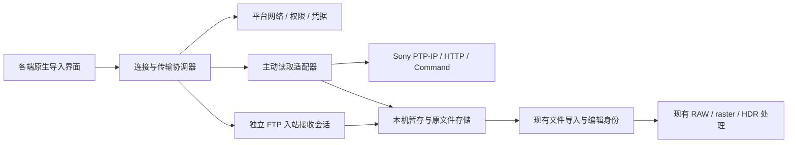

# Sony 相机 Wi-Fi 图片传输设计

日期：2026-11-10。设计版本：7。状态：iOS 与 Android 原生接入已实现；iOS 相机硬件验收待完成，其他平台保留长期设计与桌面实验。
源码核对基线：`9259f4eeece4f48bc1f9684542b6a5bf51e3b24f`（开始设计时的 `origin/development`）。
桌面实验入口见 [Sony 实验工具](../../../tools/camera-transfer/README.md)：
`ILCE-7CM2 / 固件 2.00 / PC Remote / Wi-Fi / SSH` 已完成卡内列表、ARW 传输及 macOS 编辑闭环。
正式 Android 入口见 [RawLab Android](../../../RawLabAndroid/README.md)。在
`Pixel XL / Android 10 / ILCE-7CM2 / 固件 2.00 / Smartphone Connection` 下，已验证
蓝牙配对、自动请求相机热点、TCP 15740 PTP/IP 双通道、RAW 列表与预览、原件下载、编辑与选片集合交接。
重复导入复用原件和调整；停止、进程重启与后台暂停后可保留完成项，重连后重传未完成文件。
该手机 profile 不经过桌面 SSH 或 PC Remote 初始化；已比对的 ARW 与既有桌面下载大小及 SHA-256 一致。
初代 `ZV-E10 / 2.02` 已增加独立 Android profile，使用手动连接相机 Wi-Fi 与标准 PTP 卡内原件接口；
RAW/JPEG 协议传输已实测，蓝牙自动 Wi-Fi 交接尚未验证。α7C II 的 JPEG 原件、其他 Android 设备和固件仍未实测；
iOS 已使用原生 Swift 协议与持久原件区接入相机 UI，模拟器验证不代表相机硬件验证。其他平台的完整产品相机 UI、跨平台统一相机 C ABI 与其他品牌尚未实现。
单机结果不代表完整四端兼容；独立 [Android 实验程序](../../../tools/camera-transfer/android-connect/README.md) 仍保留为协议验证入口。
界面方案见 [Sony UI 与交互设计](ui-interaction.md) 和 [可点击原型](prototype/index.html)。
移动端方案及实现边界见 [iOS / Android UI 与交互](mobile-ui-interaction.md) 及 [移动端原型](prototype/mobile.html)。
Android 原件位置、拍摄日期分目录和相册重开遵循 [系统媒体库接入](android-media-library.md)。

## 1. 目标与范围

用户希望为 RawLab 增加 Sony 相机无线传图，尽量覆盖有无线传输能力的机型；长期希望扩展到其他品牌。
用户进一步明确：**当前以 Sony 为主，其他品牌仅调研**。其他品牌的开放程度、SDK 与协议见
[跨品牌调研](vendor-sdk-survey.md)，不进入本期交付范围。

本设计建议让 Mac、Windows、iOS/iPadOS、Android 共用传输语义，逐平台、逐机型验证后开放。
四端覆盖是长期设计建议；当前优先接入 Android。桌面工具与移动端分别验证协议、网络和文件生命周期，
不把桌面实验结果当作移动端可用证据。

核心场景是把**存储卡中已经拍摄的静态照片**可靠地复制到本机，再进入现有编辑、调整记忆与批量流程。
相机允许时优先传 ARW 原图，同时支持相机提供的 JPEG；HEIF 可接收性与当前平台的可编辑性分别判断。
取景、遥控快门、视频、固件更新、相机照片删除、云同步、多相机并行不属于首期。
后续已另行选择实时取景、遥控与机身快门、拍后自动回传，见 [无线联机拍摄设计](wireless-tethering.md)；
该扩展已接入 Android 原生入口，使用独立遥控 profile，与本文选片导入共享原件存储和相机 owner；各路径的验收分别记录。

“尽量支持所有”是覆盖目标，不是可以据此发布的兼容承诺。兼容单位必须是：

`品牌 + 精确型号 + 固件 + 相机连接模式 + 协议版本 + 客户端平台/系统 + 文件表示`

同一机型在“发送到智能手机”“发送到电脑”“PC Remote”“FTP”中的能力可能不同。
有 Wi-Fi、支持官方手机 App、列入 SDK 名单、能够下载原始 RAW，是四个独立事实。

## 2. 调研结论与证据边界

### 2.1 Sony 提供的接口不是一个统一的无线文件接口

| 路线 | 已确认事实 | 对 RawLab 的意义与限制 |
| --- | --- | --- |
| Camera Remote SDK | 官方列出 macOS、Windows、Linux，以及 USB/LAN/Wi-Fi；各机型接口另查 API Reference，未列 iOS/Android | 可作桌面候选适配器，不能作为四端或所有 Sony 机型的唯一依赖；“支持相机”不等于支持该机型 Wi-Fi 读卡 |
| Camera Remote Command | Sony 的 PTP 扩展协议，提供参考与示例；已增加 PTP-IP；接口和命令需按机型查随包 README/Reference | 适合评估自主协议实现，但不是不受限制的开放标准；官网申请面向企业客户 |
| 旧 Camera Remote API | Sony 已宣布停止提供和支持旧 API | 历史 JSON-RPC/HTTP 接口仅作为旧机兼容候选；不可作为新机型的长期统一接口 |
| 官方手机传图 | 旧机与新机、固件版本间能力不同 | 作为用户能力和测试模式的证据，不能推导第三方可以调用同一个接口 |
| FTP/FTPS | 部分相机可向配置的服务器推送照片，α7 IV 官方文档明确含 RAW/JPEG/HEIF | 不依赖 Sony SDK 的补充路线；用户在相机选图，RawLab 接收，不能伪装成 RawLab 浏览整张卡 |

依据：[Sony SDK](https://support.d-imaging.sony.co.jp/app/sdk/en/)、
[Sony Command](https://support.d-imaging.sony.co.jp/app/cameraremotecommand/en/index.html)、
[旧 API 停止支持公告](https://sony.mediaroom.com/2020-02-12-Sony-Electronics-Announces-New-Camera-Software-Development-Kit-for-Third-party-Developers-and-Integrators)、
[α7 IV FTP 文件与传输模式](https://helpguide.sony.net/di/ftp_2110/v1/en/contents/TP1000657887.html)。

特别需要注意 Command 官方公告中的两条变化：2025 年修正过包含 ZV-E10 在内的 25 个型号错误的兼容标记；
2026 年公告提示部分机型自 2027 年起可能不能使用 Camera Control PTP 2 命令。
因此不能复制一份旧命令表就承诺长期兼容。需在取得当前材料后选择推荐命令族，并按固件维护配置。
这也不是“全部 PTP-IP 即将失效”的结论。来源同上 [Command 公告](https://support.d-imaging.sony.co.jp/app/cameraremotecommand/en/index.html)。

### 2.2 原始 RAW 与 JPEG 必须明确区分

- α6000 和 α7 III 的“发送到智能手机”说明明确写到 RAW 会转成 JPEG。这个结论仅限该传输模式，
  不等于证明它们所有无线模式都不能传 RAW。
  [α6000 说明](https://helpguide.sony.net/mig/Z001924611/EN/contents/TP0000301907.html)、
  [α7 III 说明](https://helpguide.sony.net/ilc/1720/v1/en/contents/TP0001653186.html)。
- Creators' App 官方文件表包含 RAW；α7 IV 当前说明提供 RAW、JPEG/HEIF、两者都传的选择。
  同一机型的固件升级可能改变配套 App，例如 α7 IV 从固件 2.00 起转用 Creators' App。
  这是官方 App 能力，第三方配对和读卡接口仍需验证。
  [Creators' App 文件和迁移说明](https://www.sony.com/electronics/support/interchangeable-lens-cameras-e-mount-body/articles/CCCA01000)、
  [α7 IV 发送选项](https://helpguide.sony.net/ilc/2110/v1/en/contents/TP1000659437.html)。
- Sony 的 Transfer & Tagging 说明展示了手机充当 FTP 服务器、同一接入点或手机热点接收的方式。
  它证明这一网络拓扑可用，不等于其自动配对流程可被第三方复用。
  [Sony FTP 导入步骤](https://support.d-imaging.sony.co.jp/app/transfer/en/instruction/21_ftp.php)。

界面必须区分 `RAW 原文件`、`JPEG 原文件`、`相机转换的 JPEG`、`缩小图片`、`缩略图`。
无法确认来源时显示“JPEG，原图属性未确认”，不能仅凭扩展名或像素尺寸标成原图。
用户选择 RAW 时，不静默改传 JPEG；明确说明当前模式只能提供 JPEG，并让用户重新选择。

### 2.3 开源实现能提供线索，不能提供全机型保证

[sony-pm-alt](https://github.com/falk0069/sony-pm-alt) 记录了旧机“Send to Computer”经 SSDP 发现、PTP/IP 传输以及初次 USB/GUID 配对。
其说明来自历史机型实验，不能直接扩展到手机和新固件。
[SonyPhotoTransfer 的具体客户端源码](https://github.com/Morning-Sea/SonyPhotoTransfer/blob/6d39accd8c0b366be2efb4c72f11234aba015d51/app/src/main/java/com/morningsea/sonytransfer/SonyCameraClient.kt)
可见存储枚举、对象信息、缩略图与流式 GetObject 调用；它的 README 广泛机型声明不作为本项目兼容证据。

较新的 [alpha2go v0.3.0 实测表](https://github.com/Knallli/alpha2go/blob/v0.3.0/docs/a6700.md)
记录 α6700 固件 2.00 在 Wi-Fi + SSH 认证下可列卡内内容、下载文件和取缩略图；其
[连接说明](https://github.com/Knallli/alpha2go/blob/v0.3.0/docs/camera-setup.md) 区分认证与未经测试的明文路径。
这是新机路线的具体可行性线索，仍不等于 RawLab 已通过、ARW 已做原字节校验或其他机型可用；
其“新拍传到主机”与“读取卡内内容”是不同能力，验证时必须分别记录。

[libgphoto2](https://gphoto.sourceforge.io/proj/libgphoto2/) 是跨品牌协议参考和桌面验证工具候选。
其 [PTP/IP 文档](https://gphoto.sourceforge.io/doc/ptpip.php) 本身说明来自协议观察；USB/遥控支持清单不能当成 Wi-Fi 读卡清单。
首期不默认整包嵌入 libgphoto2，也不从未知许可的实现复制代码。复用前固定版本、检查实际依赖和许可，验证四端构建及所需命令。

### 2.4 许可与材料可获得性

RawLab 当前是 [GPL-3.0-only](../../reference/licensing.md)，已有附加许可仅涵盖指定 RUM SDK，不能套用于 Sony。
Sony [SDK 协议](https://support.d-imaging.sony.co.jp/app/sdk/licenseagreement/en.html) 和
[Command 协议](https://support.d-imaging.sony.co.jp/app/cameraremotecommand/licenseagreement/en.html) 是单独的专有许可；
其有限分发授权不等于允许公开整个 SDK、参考文档或任意形式的源码组合。

工程前置项：由适格申请主体取得当前材料，确认开源实现、示例使用、二进制组合与分发条件；
需要版权人新增例外或供应商确认时单独处理。不以“免费”“动态库”“独立进程”自动推定兼容。
本次只阅读公开网页，没有申请账号、接受协议、下载 SDK 或使用受限材料；尚未作出最终许可兼容判定。

## 3. 方案比较与推荐

| 方案 | 收益 | 代价 | 结论 |
| --- | --- | --- | --- |
| 只接 Sony 官方 SDK | 高层 API，桌面开发较直接 | 移动端缺口、旧机覆盖不足；无线与卡内读图仍按型号限制；分发条件需核实 | 保留可选适配器，不作唯一基础 |
| 统一传输合同 + Sony 分代协议适配 + FTP 补充 | 可兼顾旧机、新机、移动端，后续品牌不必改导入流程 | 需要机型配置、协议回归与设备矩阵 | **推荐** |
| 只做 FTP/监视厂商软件输出目录 | 接收原文件简单、能避开部分私有会话 | 不是所有机型有 FTP，缺少相机内浏览；桌面中转增加使用步骤 | 作为补充或不可直连时的明确替代 |

以上是本次调研提出的技术建议，不记录为用户已批准实施。最先消除的是“是否能读取既有照片”和
“能否取得原始字节”的不确定性，之后才建设完整原生界面。

建议的支持路径：

1. `sony-mobile-transfer`：用户启用手机传输模式；根据实际发现的服务选择经过验证的 PTP/IP 或历史 HTTP 配置。
2. `sony-pc-transfer`：旧式发送到电脑的 PTP/IP。允许明确标注首次需要电脑/USB 配对，不能称为全程无线。
3. `sony-remote-command`：新机官方 Command 路线；仅在许可、认证、Wi-Fi 接口和卡内内容能力均确认后启用。
4. `ftp-receiver`：独立入站接收会话，用户在相机选图或配置自动发送。Sony 先验收，其他品牌未来分别登记。
5. `system-file-import`：提示用户用官方 App 保存到系统文件/相册，再走 RawLab 现有导入。
   这属于外部中转，不计入 RawLab 直连支持数量，也不访问其他 App 私有目录。

协议选择基于用户所选模式和只读能力探测，不依次试遍所有私有写命令。不能为连接而自动升级固件、
安装相机端非官方软件、提取官方 App 凭据或覆盖已有配对。

现代机型还可能启用 `Access Authen.`。例如 α7CR 官方说明此模式使用 SSH 认证与加密；
不能把关闭认证作为默认连接步骤。适配器需单独实现已核实的认证流程、凭据存储和主机指纹确认，
指纹变化时重新确认，不静默降级为明文。具体 SSH/PTP 组合与端口仍按正式资料和设备验证。
[α7CR 访问认证说明](https://helpguide.sony.net/ilc/2370/v1/en/contents/221h_access_authentication_settings.html)。

### 3.1 协议配置的选择规则

PTP/IP 是可复用的传输/会话层，不是一份覆盖所有 Sony 的相机命令表。
旧手机模式、发送到电脑模式和现代 Command 扩展在共享报文层之上使用不同的命令 profile；
HTTP 是另一种协议实现，SDK 则是可选的完整适配器，不在 SDK 内部连接上再叠加自行实现的 PTP 会话。

2026-11-10 用户明确调整连接策略：**已验证型号／固件清单只作为实测记录，不作为连接准入限制。**
现有 S0 实现使用精确型号 profile；这是当前实现差异，不能继续作为新版产品准入合同。
协议适配器仍记录连接模式、认证策略、传输层、命令族、允许的只读探测与声明能力；
机型、固件与验收记录作为身份及兼容性证据单独保存。新版设计按以下顺序工作：

1. 用户选择相机连接模式；发现阶段只收集该网络中的候选服务，不主动试私有命令。
2. 依据已知服务标识、用户选择的连接方式和只读协议识别匹配适配器，完成所需认证，读取设备身份；不因型号／固件未出现在实测表中而拒绝。
3. 根据适配器已知语义和运行时能力，分别开放导入、取景、快门、参数控制等功能。运行时探测不能把设备广告的未知命令自动加入调用集；某项不支持不关闭其他已可用能力。
4. 没有可用协议适配、认证失败或握手不兼容时，显示具体连接原因与可恢复动作，不把“型号尚未验证”作为拒绝理由。认证失败仍不自动切换明文或试另一个命令族。

新的未知命令语义仍需单独进行工程实验；这不限制未验证机型尝试已有通用适配器。不同连接模式不能同时占用同一相机。
FTP 不经过这套拉取协议探测，由用户显式开启本机接收并在相机配置服务器。

## 4. 用户流程

Mac 首版的具体窗口、交互与文案以 [UI 与交互设计](ui-interaction.md) 为准；
下图保留跨机型、跨模式扩展的长期流程，首版不要求用户先选择品牌或协议。

新增入口“从相机导入”，放在现有打开/导入菜单，沿用系统导航与 [RawLab 设计规则](../../../DESIGN.md)。
没有连接过相机的用户不需要在编辑器中看到常驻网络面板。

```text
从相机导入
  → 选择 Sony / 最近连接的相机
  → 按机型提示启用发送模式、加入相机 Wi-Fi 或同一局域网
  → 系统权限 / 必要配对确认
  → 检查能力
     ├─ 能浏览：卡槽 / 日期 / 缩略图 → 多选 → 选择 RAW、JPEG 或两者 → 下载
     ├─ 仅相机选图：显示接收状态 → 用户在相机选图发送
     └─ 不支持：说明具体缺口 → 可用替代模式或系统文件导入
  → 下载结果：已保存 / 部分失败 / 已保存但暂不能编辑
  → 用户选择“打开编辑”或“加入批量选择”
```

下载期间显示真实文件数、字节进度、当前文件、可用空间和停止入口；未知总字节时不编造百分比。
RAW+JPEG 可以在浏览时视觉分组，底层仍是两个对象、两个结果；一个失败不能算整组成功。
初期不自动把新下载照片打开到画布，避免覆盖当前编辑和几何/镜头草稿。

已保存照片在一个轻量“相机导入记录”中可重新打开、定位、移除记录和管理本地副本；这不是新增通用照片库。
移除记录与删除本地原文件必须是不同操作，删除本地副本需要显式确认并检查编辑/批量引用。
永远不联动删除相机中的照片。

## 5. 组件边界



- `CameraBrowseProvider`：发现、认证、能力、枚举、缩略图、主动下载与断开；不支持浏览的相机选图模式明确报告能力限制。
- `IncomingTransferProvider`：本机监听、认证、逐文件接收和停止。FTP 使用此独立合同，不伪造相机发现和卡内枚举。
- `TransferCoordinator`：单相机会话、队列、取消、重连、进度和结果。UI 不发送协议命令。
- `TransferStore`：任务清单、部分文件、完整源文件、去重与恢复；不复用可被日常清理的渲染缓存。
- `ImportBridge`：仅把已完成的本机文件交给现有导入入口；照片解码、色彩、编辑身份仍由现有逻辑决定。

传输不进入 `sony2fuji` 图像处理 ABI；名字中的 `sony` 不代表它是设备通信库。
若原生 PTP/IP 路线通过验证，建议在独立 `camera-transfer/` 目标共享 C++17 报文编解码与会话实现，
提供独立、版本化的小型 C ABI，供 Swift/JNI/PInvoke 使用。平台层提供指定网络的字节通道、取消与落盘 sink，
共享层不依赖 iOS 权限、Android 全局网络绑定或 GUI。HTTP、FTP、许可受限 SDK 的实现可独立替换。

这是为避免四份 PTP 状态机分叉提出的方案；第 0 阶段先比较成熟库的复用成本和自有最小实现，
若有可在四端分发的库能直接满足合同，优先复用，不重写整个 PTP 标准。
首期仅内置需要的适配器，不建设第三方插件市场、动态脚本执行或远程下载驱动机制。

### 5.1 能力和来源合同

每项能力是 `supported / unsupported / unknown`，附原因与证据级别；未知不等于支持。

| 数据 | 必要字段和语义 |
| --- | --- |
| `CameraIdentity` | 品牌、型号、固件、协议 profile；本机配对 ID。相机序列号如果可读，仅本地保存，不上传 |
| `CameraCapabilities` | browseExisting、cameraSelectedTransfer、thumbnail、originalRAW、originalJPEG、originalHEIF、partialRead、双卡访问、传输时可拍摄；全部按当前模式表达 |
| `RemoteAsset` | 会话内对象 locator、storageId、文件名、大小/未知、拍摄时间/时区未知、实际可提供的表示、关联 RAW+JPEG 信息 |
| `TransferItem` | 每次传输尝试的 UUID、来源快照、请求的表示、字节进度、状态和可选 sourceId；对象句柄只在当前会话有效 |
| `SourceRecord` | 本机永久 UUID sourceId、持久文件位置、字节数、SHA-256、实际表示、来源收据列表、平台 editorIdentity 映射及文件状态 |
| `ImportedFile` | 已提交的 sourceId、完整本机文件位置、实际格式；无远程 URL 作为渲染输入 |

跨重连不把 PTP handle 当永久身份。先重新枚举和核对相机、卡槽、对象元数据；无法确认同一对象时重下。
跨会话跳过下载需要可靠的源标识或重新验证字节，不能只用“文件名+日期+大小”判定照片相同。
最终内容摘要用于确认重复与完整文件身份；不把缩略图摘要当原文件身份。

### 5.2 最小接口行为

```text
discover(networkContext) -> Candidate[]
connect(candidate, pairingContext) -> Session + Capabilities
listAssets(session, pageOrCursor) -> AssetPage       // 不支持浏览时明确返回 unsupported
readThumbnail(session, locator) -> bounded preview // 不得用作原图导入
download(session, locator, representation, sink, cancellation) -> TransferReceipt
disconnect(session)

// 独立的入站合同，复用 Store 和结果，不要求远端目录/对象句柄
startReceive(ReceiveConfig, writerFactory) -> ReceiveSession
observeReceive(session) -> IncomingStarted / BytesReceived / FileSaved / FileFailed
stopReceive(session) -> stopped
```

共享合同不要求所有相机支持分页；适配器可对有界对象列表分页展示。限制条目数、报文长度、缩略图尺寸和超时，
超过限制报告原因，不能造成 OOM 或静默把不完整列表显示成“全部照片”。
每台相机初始只运行一个文件传输；下载时缩略图请求降优先级或暂停。先用实测判断并发收益，再扩大并发。

### 5.3 FTP 入站会话合同

`ReceiveConfig` 明确选定本地网络/监听地址、控制端口、有限的被动端口范围、FTP 或 FTPS 模式、
凭据引用、目标存储和空间预算。服务器配置由用户开启，不因网络发现而自动监听；凭据按接收配置首次随机生成，
保存在系统凭据库，需要重新配置相机时明确提示。认证不等于自动识别真实机型，未确认的发送者仅记录本地接收配置身份。

每个获准的 `STOR` 创建独立 TransferItem 和写入 sink；远端路径仅是元数据，不能指定本机文件位置。
限制一个活跃文件上传，支持经过验收的被动模式，拒绝任意第三方目标的数据连接及删除/任意目录命令。
正常结束数据通道后执行与主动下载相同的校验和原子保存，**源文件已持久化才回复 FTP 成功完成状态**；
保存失败返回协议错误，导入/预览失败不撤销已经成功接收的原件。

没有可信远端长度时，完成证据是正常的上传事务终止加本地格式/文件检查，不能宣称已与发送端做哈希对照。
中断、后台暂停或停止会话时关闭数据通道并留下可解释结果；相机重新发送属于新的尝试，完整接收后按内容去重，
首版不支持 `REST` 字节续传。FTP 没有远端队列重建能力，“恢复接收”只恢复本机监听，必要时提示在相机重发。

## 6. 文件安全、恢复和导入事务

### 6.1 状态机

```text
queued → connecting → transferring → verifying → publishPrepared → saved
                         ↓              ↓                           ↓
                      interrupted     failed                     importing
                         └→ 重试                           → imported / savedNotEditable
任一未完成传输 → cancelling → cancelled
```

`saved` 表示完整源文件已持久化；`imported` 才表示现有导入和预览准备成功。
解码不支持时保留原文件并显示 `savedNotEditable`，不要删除已传到本机的唯一副本。
导入因内存、读取或暂时处理错误失败时记录独立的导入错误，传输仍保持 `saved`，用户可只重试导入；
不把已保存文件退回下载失败，也不触发重复传输。
失败、用户取消、权限拒绝、网络不可达、卡被移除、相机忙、空间不足分别记录，不能全部提示“找不到相机”。

### 6.2 落盘与恢复

1. 先选定平台允许的持久位置并检查空间。Android 使用系统媒体库目录规则，下载阶段写入应用缓存，完整校验后写入 MediaStore 待发布项；其他平台使用应用持久目录或用户明确选择的目标目录及同文件系统临时目录。
2. 流式落盘和计算摘要，内存不随完整 RAW 大小增长；未完成文件只使用 `.partial` 名称，不对编辑器可见。
3. 收到协议成功终态，并校验可用的声明长度、实际长度、文件头及表示一致性，刷新文件后原子发布。
   单独计算本地 SHA-256 只能标识本地内容，不能宣称已经与相机原文件端到端校验；验收时需与读卡器副本比较。
4. 持久任务记录和原件发布使用可恢复顺序：校验并记录 `publishPrepared` → 发布原件 → 记录 `saved` → 调用导入 → 更新导入结果。
   Android 发布通过 MediaStore `IS_PENDING` 完成，任务记录媒体 URI；具体事务和恢复规则见[Android 媒体库设计](android-media-library.md)。
   重启时对孤立文件、未更新状态和部分文件进行一致性恢复；不会因重试重复创建编辑记录。
5. 取消后关闭数据流，隔离晚到回调；只有仍属于当前 task/session generation 的回调可改变结果。
6. 原生 socket 会话不承诺系统后台持续传输。移动端离开前台或被挂起后记录中断，回来重连；已保存项不重传。

首版支持**队列恢复**：完成项保留，未完成项重新下载。只有协议确认提供偏移读取、对象身份稳定且有完整性验证时，
才启用字节级续传；HTTP 不默认支持 Range，PTP 不默认支持 GetPartialObject，FTP 不默认允许 REST。
首版取消或确认中断后，在数据流关闭时删除对应 `.partial`；若进程崩溃，由下次恢复清理未发布部分文件，
保留任务元数据供重新下载。完整 `saved` 文件不属于自动清理对象。
空间未知时显示未知估算、设置明确任务预算，并在写入过程中处理空间耗尽，不一次性预分配可信度不足的远端长度。

### 6.3 文件身份、发布事务与崩溃窗口

统一的是本机 `sourceId` 与传输结果，不强行统一四端已有编辑键。TransferStore 使用带 schemaVersion 的持久清单，
包含 SourceRecord 与 TransferItem，由持有目录级跨进程锁的单一写入者串行更新，
并通过同目录临时清单、刷新和原子替换提交整个快照。
文件发布与清单更新之间不能做到同一个文件系统事务，必须按下表恢复。

首次完整传输计算字节数与 SHA-256 后，先查本机已提交且仍存在的 SourceRecord。
复用前校验已有原件的当前字节摘要，不只比较清单中的缓存摘要；内容一致时复用其 sourceId、文件路径/URI 和编辑映射，
追加本次来源收据，删除重复暂存；不重置已有编辑。
未命中则预留 sourceId 和最终路径，把摘要、字节数与 `publishPrepared` 写入清单后，再原子发布文件，
最后在同一次清单更新中把 SourceRecord 标为 committed、TransferItem 标为 saved。

| 恢复时观察到的状态 | 固定处理 |
| --- | --- |
| publishPrepared + 最终文件存在，摘要/长度匹配 | 认领预留 sourceId，补写 committed/saved；不再下载，不创建第二个来源 |
| publishPrepared + 只有 partial | 删除 partial，标记 interrupted；主动下载重连后重下，FTP 等相机重发 |
| 没有清单引用的最终文件，或摘要不符 | 隔离并提示待处理，不自动删除、不自动交给编辑器；用户可明确重新导入 |
| saved/committed 但文件缺失或已改变 | 标记 sourceMissing/sourceChanged，保留导入记录与原编辑；阻止从该记录继续编辑/导出，不伪造空文件或文件属性 |
| 持久目标因权限或外部卷离线暂时不可读 | 标记 sourceUnavailable，保留路径与引用，提供重新授权/挂载重试；不当成文件已删除 |
| 原文件存在，导入完成但导入结果未落盘 | 传输仍为 saved；重启不自动切换画布。用户重开时用原 editorIdentity 恢复已有编辑，再更新导入结果 |

映射固定为：iOS 使用已算出的内容摘要按既有规则生成编辑身份；Android 新相机原件使用具体媒体卷的 Images URI，已登记相机照片的别名归一化到该身份；
Mac/Windows 使用 SourceRecord 的稳定路径和现有文件属性校验。后两者不通过重写 mtime/inode 绕过冲突检查。
缺失/被改的原件若重新下载，生成新的来源记录并按现有平台规则打开；不承诺跨四端自动恢复失去原件的旧编辑，
需要复用时使用明确的调整复制流程。正常重复发送命中的是仍有效的原件，因此可以直接复用原编辑。

FTP 与主动下载进入同一个 Store，可在完成后按完整内容去重；普通系统文件/Photos 导入继续使用自己的既有身份，
本期不扫描它们的目录、不迁移其编辑记录，也不承诺与外部中转文件自动合并。
文件使用引用按 sourceId 登记；活动编辑和可恢复批量任务仍引用时禁止删除持久原件。
移除一条来源收据不删除共享 SourceRecord，最后一个引用消失也不自动删除原件，交由显式本地文件删除操作。

### 6.4 命名、生命周期与权限

- Android 媒体库保留安全化的相机文件名及原扩展名，按用户目录规则归档；其他平台私有存储可使用内部 UUID 或内容摘要。
  拒绝路径穿越、绝对路径、分隔符及保留名称。
  不覆盖用户已有 `DSC00001.ARW`，不只按文件名去重。RAW 和原样保存的 JPEG 保留原始字节与元数据。
- 增量任务显式选择调整 JPEG 时，完整校验相机文件后才调整。用来源摘要与冻结的 JPEG 设置匹配可复用副本，
  并独立校验处理后的长度和摘要再发布。导入记录显示已调整的 JPEG。相机卡内原片由相机保管。
- 完整源文件放平台持久区；Android 的唯一长期原件位于 MediaStore，私有空间只保留任务、摘要记录和可清理缓存。部分文件与预览放可清理区。清理任务记录、临时文件、完整源文件采用不同策略。
  编辑会话和批量任务持有文件使用引用，不能被清理器删除。
- 新文件进入既有来源识别后生成/恢复编辑身份；新内容默认中性调整，不自动继承当前照片参数。
  相机来源元数据属于导入记录，不改变 Edit JSON、渲染参数版本或 EXIF。
- 凭据使用 Keychain、Android Keystore 支持的加密存储、Windows 系统凭据保护；任务 JSON 不存密码。
  忘记配对只删除本应用的记录和网络配置，不擅自清空相机或系统的其他配对。
- 只连接用户选择的局域网候选。SSDP/XML/HTTP 返回值不可信：限制解析、禁用外部实体，拒绝越界的下载地址和跳转。
  不把相机 Wi-Fi 密码、序列号、SSID、文件名、照片/EXIF 或原始协议日志加入统计，遵守
  [现有统计合同](../../reference/rum-analytics.md)。

## 7. 平台约束

| 平台 | 接入要求与限制 |
| --- | --- |
| iOS / iPadOS | 局域网用途说明；SSDP 等组播/广播需相应 entitlement，并用真机验证签名。系统 Wi-Fi 配置需 Hotspot Configuration 能力和用户同意；允许用户手动连接。前台接收为首版合同，不承诺锁屏后台下载 |
| macOS | 处理局域网权限、不同网络接口和应用签名；如启用 App Sandbox，按实际客户端/服务器行为配置网络 entitlement；最低系统与 SDK 所需版本分别判断 |
| Android | 当前项目 minSdk 26、target/compile 35。当前相机导入要求 API 29+，使用 WifiNetworkSpecifier；旧版明确显示不支持，尚未实现手动连接入口。按系统/API 请求附近设备或必要位置权限。相机流量绑定选定 Network 的 socket，不全局改路由；无互联网不等于相机不可达 |
| Windows | 出站相机连接与 FTP 入站监听分开；处理防火墙、网络配置文件和多网卡。仅为用户启用的接收会话开放所需监听，不要求关闭防火墙；Windows 10/11 与供应商 SDK 的系统支持范围分别记录 |

Apple 的局域网权限覆盖 iOS 14+、macOS 15+；`NSBonjourServices` 只用于实际使用的 Bonjour 服务，
不能用它替代 SSDP 所需组播能力。Hotspot Configuration 也不意味着可以静默加入任意 Wi-Fi。
[Apple TN3179](https://developer.apple.com/documentation/technotes/tn3179-understanding-local-network-privacy)、
[NEHotspotConfigurationManager](https://developer.apple.com/documentation/networkextension/nehotspotconfigurationmanager)。

Android 的网络请求可返回一个没有互联网的局域网连接。当前版本在拒绝或不支持时说明原因并允许重试；手动连接路径留待后续验证。
后续升级 targetSdk 时重新核对权限：当前官方文档要求 target 37+ 处理 `ACCESS_LOCAL_NETWORK`，
不能为现有 target 35 无条件加入并请求该权限。
[Wi-Fi Network Request](https://developer.android.com/develop/connectivity/wifi/wifi-bootstrap)、
[Wi-Fi 权限](https://developer.android.com/develop/connectivity/wifi/wifi-permissions)、
[局域网权限](https://developer.android.com/privacy-and-security/local-network-permission)。

HTTP/FTP 明文兼容只在用户选定的本地会话按需启用；不为此全局关闭 TLS/ATS 或开放任意远端明文。
FTP 首版只在前台提供受限接收目录、随机凭据和有限被动端口；支持 FTPS 的机型优先验证 FTPS，
不把 FTPS 与 SFTP 混为一谈。仅实现必要上传命令，禁止删除、任意目录访问和第三方地址的数据连接。
手机热点、相机 AP、共享路由器是三种不同拓扑，不能用一种测试结果替代另外两种。

## 8. RawLab 接入点

传输结束后复用现有导入，不改共享 RAW、raster、HDR 的解码与颜色规则。
下载成功与当前平台可编辑性分别报告；不通过转 JPEG 来掩盖 ARW 解码失败。
现有规则见 [产品范围](../../../PRODUCT.md) 和 [颜色与渲染合同](../../../lutools/docs/color-contract.md)。

| 平台 | 已有接入点（上述基线） | 本次应增加的边界 |
| --- | --- | --- |
| iOS | [RawEditorViewModel+IO.swift](../../../RawLab/RawLab/Core/ViewModel/IO/RawEditorViewModel+IO.swift) 的 `importImage`（121 行起）；[PhotoImportTypes.swift](../../../RawLab/RawLab/Core/Models/PhotoImportTypes.swift) 的 `PhotoImportSource` | 完整下载保存到独立的 Application Support 源目录，再创建本地 `PhotoImportSource`。允许编辑器继续生成自己的 working copy，但导入记录持有持久原件 |
| macOS | [EditorModel+Workflow.swift](../../../RawLabMac/Sources/Editor/Model/EditorModel+Workflow.swift) 的 `open(_:)`（365 行起）；[BatchExport.swift](../../../RawLabMac/Sources/Export/BatchExport.swift) 的路径输入 | 将持久文件路径交给打开/批量选择。桌面批量不会替下载器保管原片，不可交付临时路径 |
| Android | [PhotoStorage.kt](../../../RawLabAndroid/app/src/main/java/com/rawlab/android/photo/PhotoStorage.kt) 的 `import(uri)`；[WorkingCopy.kt](../../../RawLabAndroid/app/src/main/java/com/rawlab/android/photo/WorkingCopy.kt) 的流式副本 | 新相机原件发布到系统媒体库，登记摘要并统一媒体 URI；经既有草稿门禁进入编辑/集合，也可从相册重开。已登记媒体不再复制到私有原件目录；其他来源的既有身份和持久输入行为不迁移 |
| Windows | [Rendering.cs](../../../RawLabWindows/MainWindow/Rendering.cs) 的 `OpenFile`（18 行起）；[BatchExport.cs](../../../RawLabWindows/BatchExport.cs) 的本地输入 | 下载到持久目录后调用现有文件打开流程。原片路径在编辑/批量存续期间保持稳定 |

需要明确保护的既有行为：

- iOS [CachedPhotoFile.swift](../../../RawLab/RawLab/Core/Persistence/CachedPhotoFile.swift) 第 10–33 行在首次使用时回收旧缓存、owner 释放时删除副本；
  [PhotoImportTypes.swift](../../../RawLab/RawLab/Core/Models/PhotoImportTypes.swift) 的暂存释放也不能覆盖相机持久目录。
  [EditPersistence.swift](../../../RawLab/RawLab/Core/Persistence/EditPersistence.swift) 优先 Photos 身份，否则以内容摘要识别；
  相机文件没有 Photos ID 时复用现有内容身份，不假造 `PHAsset`。
- Android [WorkingCopyCleanup.kt](../../../RawLabAndroid/app/src/main/java/com/rawlab/android/photo/WorkingCopyCleanup.kt)
  会清除未被批量任务保护的旧 working copy；系统媒体库中的完整相机原件不属于该清理范围。
  现有 `PhotoStorage.import` 以 URI 字符串作编辑身份：导入记录必须将已保存的文件映射到稳定 URI，重开沿用同一 URI。
- macOS [EditPersistence.swift](../../../RawLabMac/Sources/Editor/Storage/EditPersistence.swift) 第 4–21 行及
  Windows [EditPersistence.cs](../../../RawLabWindows/EditPersistence.cs) 第 88–103 行依据路径和文件属性识别原件。
  内容去重命中后应复用已有持久文件路径，不每次生成新路径后期待自动恢复旧编辑；也不覆盖已有路径来制造相同身份。
- iOS/Android 批量任务已有输入复制机制，但任务清理会释放这些副本，不能让它们成为“相机导入记录”的唯一存储。
  Mac/Windows 批量主要保存原路径和校验身份，下载目录必须活到任务结束。

Android 的 [AndroidManifest.xml](../../../RawLabAndroid/app/src/main/AndroidManifest.xml) 为相机连接声明
网络状态、Wi-Fi、位置和附近设备权限；运行时权限只在用户点击查找时申请。
统计仍使用隔离的 `RumIsolatedContext`：拒绝相机相关权限查询，并对统计 SDK 隐藏 connectivity service。
固定 RUM SDK 2.3.2 的启动网络元数据路径会直接取该 service，单独拒绝权限查询不足以保持原边界；
该版本在 manager 为 null 时跳过网络采集。network/statechange collector 继续关闭，自定义事件不增加相机或照片字段。
SDK 升级须复核这些调用和空值分支。Apple 本地网络用途说明和签名能力属于各自平台的新增接入项。

## 9. 兼容登记与验收

兼容表的状态固定为：`文档有据`、`实验候选`、`RawLab 真机通过`、`当前模式不支持`。
不单独使用无条件的“支持”。每一行记录型号、固件、平台/系统、模式、协议 profile、格式、卡槽、
浏览/相机选图、原文件比对结果、断线/取消/后台结果和证据日期。只测试一个型号，不扩展为同系列全支持。

建议第一轮样机覆盖以下差异，实际设备由后续实施准备确认，不假定用户拥有：

| 样机类别 | 代表候选，不是支持清单 | 必须解决的问题 |
| --- | --- | --- |
| 旧 α 系列 | α6000、α7 III | 手机模式 JPEG 与电脑模式原图是否不同；首次配对；卡内旧照片 |
| IEM 后期设备 | 初代 ZV-E10、α6400 | PTP/IP 读卡与真实格式；不得从型号名单推断命令可用 |
| Creators' App 世代 | α7 IV 固件 2.00+、α7C II、α7R V 对应新固件 | 新认证、原始 ARW、双卡、模式差异；厂商材料与真机相互验证 |
| Cyber-shot | RX100 VII 或 RX10 IV | 独立验证紧凑机系列，不能沿用 α 系列假设 |
| FTP 设备 | 具备 FTP 功能且有明确手册的 Sony 机型，如 α7 IV | 已有照片、RAW+JPEG、网络中断、重复命名、TLS/被动连接 |

### 9.1 协议与存储测试

- 合成设备/录制后脱敏的协议样本：分包、短读、无响应、相机忙、损坏长度、超大清单、旧事件、拒绝认证、格式替换。
- 无真实照片的文件事务测试：同名不同内容、同内容重试、换卡后句柄复用、两卡同名、磁盘不足、写入失败、取消和崩溃恢复。
- 原始文件验收：经无线和读卡器取得同一个对象，比较字节数与 SHA-256；覆盖至少一张压缩 ARW、一张适用的无损/未压缩 ARW、JPEG 和 RAW+JPEG。
  没有对应模式的机型记“不适用”，不是失败，也不能补造通过记录。
- 交付能力测试：从开机前就已存在的卡内照片列出、预览、下载；不能仅遥控拍一张后下载来替代。

### 9.2 四端用户主路径

连接 → 选择既有照片 → 保存原件（Android 发布到系统媒体库）→ 打开编辑 → 保存调整 → 重启重新打开 → 单张/批量导出。
相机断开后此流程仍可完成。覆盖 RAW/JPEG 表示提示、失败项重试、权限拒绝、网络切换、锁屏/回前台、相机休眠，
以及当前照片有未应用草稿时完成下载但不替换画布。

UI 实现后按 [验证 SOP](../../process/ci.md) 先运行受影响的本地 UI 测试，再做真实运行页面/原生应用交互验证。
模拟器、mock、编译、UI 测试与实体相机网络验收分别报告，不能互相替代。
性能记录实际机型、频段、距离、文件数量/字节、有效吞吐、内存峰值和电量影响；首轮测量前不承诺统一 MB/s。

## 10. 建议推进阶段与停止条件

| 阶段 | 交付物 | 进入下一阶段的证据 |
| --- | --- | --- |
| S0：协议与许可验证 | 代表机型资料、当前合法可用的协议材料、可复现最小读卡实验、依赖选择 | 至少旧机与新机两条候选路径的身份/格式/卡内内容结论；失败也必须定位到具体能力，不能用 UI 绕过 |
| S1：端到端最小闭环 | 一个已验证 Sony profile + 独立协议/传输层 + 持久源文件 + 原生导入入口 | 真机原字节比对、离线编辑/重启、取消/中断/同名恢复；明确此时只是已验机型支持 |
| S2：四端接入与分代扩展 | 复用合同，增加旧机、新机、Cyber-shot 配置及设备矩阵 | 每个平台自己的签名/权限/网络/导入/UI 证据；缺设备平台继续标未验证 |
| S3：Sony FTP 补充 | 相机选图发送、受限接收器、和同一导入记录融合 | RAW+JPEG、重复发送、失败恢复、前台生命周期与必要网络安全验证 |
| 后续：其他品牌 | 重新立项并选择优先品牌 | 依据跨品牌调研取得材料和样机，未因本设计自动授权实现 |

如果 S0 发现所选新机只允许受限官方 App 或只有新拍事件、没有可用的既有文件接口，记录缺口，
改验该机已公开的 FTP 路线；不得把 FTP 接收记为“卡内浏览已完成”。旧机不能取得 RAW 时仍可实现明确标注的 JPEG 传输，
该机的 RAW 能力保持未支持/待验证，不阻止其他已验证 profile 独立交付。

后续扩展仍需取得的输入：其他具体型号/固件、四端设备与签名能力；采用官方受限材料时还需申请主体与对应许可。
这些不影响本设计文档完成，但会决定首批兼容清单和实现排期。当前没有足够证据给出覆盖所有 Sony 机型的工期。

## 11. 维护规则

本文件维护长期架构、行为边界和决策；机型增量以可审计兼容记录维护，单次命令、日志、截图、性能数字放相应 PR。
协议/固件变化更新 profile 与对应测试，不修改旧证据冒充新固件已通过。
新增品牌必须说明是官方接口、标准协议还是社区实现，并补齐原图、平台和许可证据。
设计批准、实现完成、真机验收、发布是不同状态，不互相推导；不在本次文档任务中修改发布说明或对外宣称兼容。
