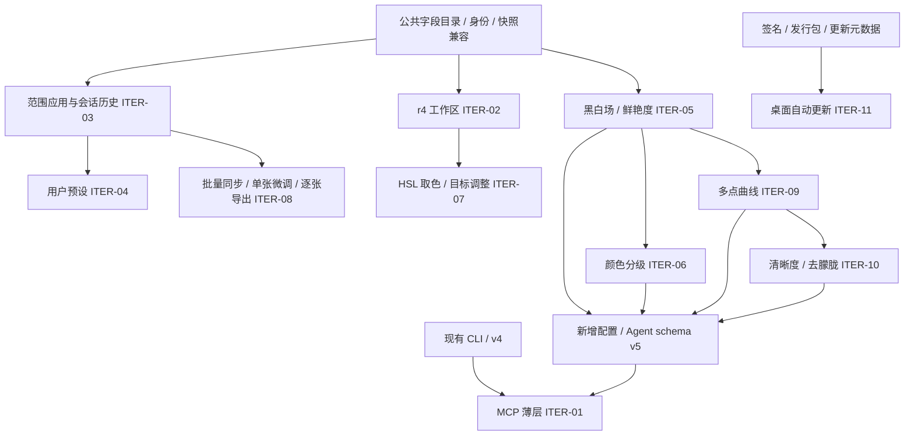

# 本次迭代总技术方案：第一阶段收尾与第二阶段全量

状态：待评审，尚未实施。范围基线：2026-10-21，`13efd9c342f15029c47e302c467423cb45fc4f60`。

[迭代总需求 ITER-01～11 / IT-01～16](requirements.md) 是本方案的范围依据。[r4 工作区技术方案](../editor-workspace/technical-design.md) 仅负责 ITER-02，不再作为本轮所有功能的总方案。本文件中的参数、算法与模块名是拟采用设计；不表示已经写入核心或通过验收。

## 1. 当前基础与真正新增范围

| 范围                | 当前实现依据                                                                                                                                                                                                                                                                                                                                                                | 本轮动作                                                         |
| ------------------- | --------------------------------------------------------------------------------------------------------------------------------------------------------------------------------------------------------------------------------------------------------------------------------------------------------------------------------------------------------------------------- | ---------------------------------------------------------------- |
| 第一阶段 Agent/JSON | [CLI commands](../../../lutools/src/cli/agent_commands.cpp)、[recipe parser](../../../lutools/src/cli/edit_recipe.cpp)、[EditRecipe](../../../lutools/include/sony2fuji/edit_recipe.h) 已有 v1～v4、五类命令、完整现有参数；[Mac AgentRecipe](../../../RawLabMac/Sources/Rendering/AgentRecipe.swift) / [Windows AgentRecipe](../../../RawLabWindows/AgentRecipe.cs) 已接通 | 不重做。增加 MCP 薄层，并使第二阶段新字段继续贯通 Agent          |
| 几何/透视/镜头      | 已有配置、处理、保存、预览/最终输出与可选 Lensfun 能力                                                                                                                                                                                                                                                                                                                      | 保持契约，接入新 UI/范围复制/逐张快照，定向回归                  |
| HSL/效果/降噪       | [C ABI](../../../lutools/include/sony2fuji/ffi/sony2fuji_c.h) 有 HSL、暗角/颗粒、传统降噪 setter                                                                                                                                                                                                                                                                            | HSL 加目标调整；新增调色用独立配置，不塞入旧结构                 |
| 编辑记忆/完整应用   | 四端已有每照片保存，桌面有 full apply                                                                                                                                                                                                                                                                                                                                       | 加按项合并、部分失败、历史与预设，不用 full apply 冒充选择性粘贴 |
| 批量导出            | 四端已有统一源快照与任务恢复                                                                                                                                                                                                                                                                                                                                                | 保留旧 export-only，增加逐目标快照与集合导航                     |
| 桌面更新            | [Mac UpdateChecker](../../../RawLabMac/Sources/System/UpdateChecker.swift)、[Windows UpdateChecker](../../../RawLabWindows/UpdateChecker.cs) 只检查并打开发布页                                                                                                                                                                                                             | 新建下载/可信验证/任务准入/安装/恢复；先补可信发行链             |

### 1.1 模块与依赖



不统一四端内部模型。只建立共同的字段语义、版本和测试向量，各端用 adapter 接现有快照、存储和渲染桥。各模块可分 PR；共享核心/C ABI、资源、构建入口按 [集成规范](../../process/integration-workflow.md) 指定单一 owner，不能多端各自改出一套参数定义。

## 2. 字段与格式兼容：先区分三类数据

| 数据                | 用途                             | 保存语义                                                                        |
| ------------------- | -------------------------------- | ------------------------------------------------------------------------------- |
| 本端照片记录        | 恢复该照片的完整编辑及兼容上下文 | 原生模型 + 新增 optional/identity 扩展；保留自动模式、配方版本与照片身份        |
| 选择性调整 payload  | 剪贴板/用户预设/批量同步         | 稳定字段 ID、选中集合、逻辑值/模式/外观引用及来源上下文；不冻结相机自动派生结果 |
| Agent render recipe | CLI/MCP/处理验收                 | 解析到目标后的最终 core 参数；当前 v4 已是最终值，不能直接拿它充当跨照片剪贴板  |

新增 payload 使用独立 `payload_version=1`、`scope_version=1`，与 Agent 的 `schema_version`、batch journal 版本及 native record 版本分开。字段目录规定 ID、类型、单位、合法范围、默认解析器、所属组、RAW-only 条件和对配方强度的解释；例：`tone.exposure` 是 EV，HSL 是原 [-100,100] 轴值，WB 是模式及固定 Kelvin/tint，自动镜头仅保存请求配置。

scope 默认包含通用调整字段，`geometry`/`lens` 默认排除；只有本次明确选择“全部”或勾选相应项才进入 payload。界面摘要展示实际字段集合，不能将默认排除等同于目标归零。`prepare/commit` 再次校验 scope，仅合并 payload 明确包含的字段；新增字段必须登记其默认选择规则。

“仅已修改”继续按照片有效默认和存储逻辑值判断，包含配方注入值；不借操作历史或乘强度后的 0 值隐藏改动。未来新增字段先登记目录，再接 UI、scope、snapshot、preset、history、recipe 和导出，不允许各路径漏字段。

### 2.1 Agent v5 与 additive C ABI

当前 request v2、HSL config v1、photo-effects config v1 均保留字段顺序、大小和数值意义。拟新增独立 `version/struct_size` 配置与 setter：

| 拟新增配置             | 字段与默认                                            | 调用职责                                           |
| ---------------------- | ----------------------------------------------------- | -------------------------------------------------- |
| `tone_controls_config` | black_point/white_point/vibrance，core [-1,1]，默认 0 | 端点与鲜艳度；不改 LibRaw sensor black/white       |
| `color_grading_config` | 三分区 hue [0,360)、saturation [0,100]                | 全部 saturation=0 为精确 bypass                    |
| `tone_curve_config`    | mode、count、最多 33 个归一化点                       | legacy scalar 仍在 request v2；custom 曲线单独激活 |
| `atmosphere_config`    | clarity/dehaze，core [-1,1]，默认 0                   | 空间处理，不加入旧 effects v1                      |

setter 先校验全部值，非有限、越界、错误版本或曲线无效时保留旧 session 状态；新 session 使用 identity，复用 session 时每次请求显式配置或清零，防止上一张照片泄漏。

拟新增 Edit JSON v5/schema 文件，v1～v4 的未知字段拒绝、旧序列化与像素行为保持。v5 扩展：`tone.black_point/white_point`、`color.vibrance`、`color_grading`、`tone.curve`、`effects.clarity/dehaze`。`s_curve` 与 active custom curve 互斥；v5 明确输出 identity 默认。能力查询只有真实接通时才宣告 v5 和各新配置，不能先把未实现字段 advertise 成支持。

[EditRecipe](../../../lutools/include/sony2fuji/edit_recipe.h)、parser/serializer、[agent_commands](../../../lutools/src/cli/agent_commands.cpp)、Mac/Windows AgentRecipe 与所有 native 预览/导出配置必须同批接线。新参数默认不跟随旧 master-recipe strength 自动二次缩放；旧 recipe 的原有缩放保留，新建用户预设保存其选中值，Agent 在目标解析后只接收一次最终值。

### 2.2 四端记录演进

- iOS `RawSettings`、Mac `Adjustments` 增加 optional 新对象，缺失为 identity；保留旧曝光模式、配方设置版本、nil/legacy 降噪分支。不在读取时改写所有旧记录。
- Android [EditPersistence](../../../RawLabAndroid/app/src/main/java/com/rawlab/android/settings/EditPersistence.kt) 的现有 11/15/24/49 长度 CSV 继续解码。新编辑值采用带 `v2:` 标识的结构化 JSON payload 编码在原 key 下，复用原子 registry 写入；不在 CSV 中间插入复杂曲线/色轮字段，不按猜测字段数量解析新格式。`SettingsCodec` 和 journal 使用各自明确版本。
- Windows 保留旧 `Parameter` 索引和固定 Values 数组，新参数放 nullable 扩展对象；`FromSnapshot` 显式处理旧长度/缺字段，不能新增 enum 后使全部旧数组因长度不符失效。
- 保存失败保留原记录；迁移仅在明确编辑保存时发生，按版本保留可恢复旧数据。原始照片始终只读。未知未来版本拒绝有损覆盖。

## 3. ITER-01：MCP 薄适配器

采用官方 Python SDK v2、Python 3.11+，本地 stdio 传输；这是当前 SDK 官方支持的本地 server 路线，依赖在新增的工具子项目锁文件固定，不引入应用网络服务。[SDK 文档](https://py.sdk.modelcontextprotocol.io/)、[运行与 stdio](https://py.sdk.modelcontextprotocol.io/run/)

拟新增 `tools/mcp/`，职责为 server、schema/CLI adapter、配置与协议测试；不能把处理代码搬进 Python。启动参数显式指定 `--cli`、读入根目录、输出根目录和任务超时；不修改客户端全局配置。

| MCP 工具          | 既有 CLI 映射                                 | 结果                                       |
| ----------------- | --------------------------------------------- | ------------------------------------------ |
| `capabilities`    | `--capabilities --json`                       | 当前实际版本/字段/后端能力                 |
| `validate_recipe` | `--recipe … --print-recipe --json`            | 校验/标准化或结构化字段错误                |
| `image_info`      | `--info … --json`                             | 既有信息契约，不能为 null 的 WB/尺寸编造值 |
| `render_preview`  | `--recipe … --preview … --long-edge … --json` | exact PNG 文件、实际尺寸及 quality         |
| `export_photo`    | `--recipe … --json`                           | 最终文件及既有 lens/backend 等结果         |

用 subprocess 参数数组执行固定 CLI，不启用 shell。先按原配方目录解析并校验 input/look/output 的真实路径和允许根目录，再将绝对路径写入任务私有配方，避免暂存位置改变相对路径语义。CLI 输出先写目标同文件系统内的私有暂存文件，成功后原子发布，已有目标默认拒绝覆盖；失败/取消只清自己的未发布输出。stdout 只保留 SDK 协议，CLI stdout 被捕获解析，日志写 stderr。运行中每任务单独句柄，不终止其他任务。

先服务现有 v4，v5 能力随核心实际发布透传；服务启动或握手成功不代表处理成功。测试覆盖握手、tools/list、五类真实调用、未知字段、路径/Unicode、取消、子进程失败、协议输出隔离、CLI/MCP 像素等价。首批不做移动端常驻 Agent/MCP，也不额外新增 generic image-info C API。

### 3.1 版本协商与可交付配置

server 启动先执行 capabilities，校验既有 JSON envelope 的 `protocol_version=1`、五类命令及 `recipe_versions`。首批 adapter 支持 v1～v4，至少要求 CLI 支持 v4；缺命令、未知协议或不可解析结果时拒绝进入 ready，并给出更换 CLI 路径/版本的诊断。应用版本字符串不是协议版本，不要求二者数字相等。CLI 增加 v5 时，只有 adapter 也支持 v5 才开放该输入；双方取支持版本交集，不能降低 schema 后丢掉字段。CLI 可选后端和图片类型按实际 capabilities 暴露，不将没有构建的功能列为可用。运行中不切换已协商的 CLI；配置更换需重启 server。

ITER-01 必须同时交付 `tools/mcp/README.md`、锁定依赖、macOS/Windows 本地 stdio 客户端配置示例和独立 smoke test。说明包含 Python/CLI 安装、绝对路径及带空格目录、允许读写根、超时、兼容表和错误排查；示例只供用户选择导入，不自动写其全局客户端设置。smoke test 用临时目录与受控小素材依次调用五类工具，核对 recipe 标准化和预览/导出文件，随后直接 CLI 对照；再覆盖一个不匹配协议/版本和一个越界路径拒绝。文档/配置样例能实际复现 smoke test 才满足 IT-01，不能只交付 server 进程。

## 4. ITER-02：r4 工作区

直接执行 [工作区需求/方案](../editor-workspace/requirements.md) 与 [技术子方案](../editor-workspace/technical-design.md)，包括新 RGB 桥接、对比缺失方式、纯预览与范围 reset，不仅做 CSS 对齐。其“本步不包含新算法/预设”等表述只限定该子项，不排除本总方案里的其他迭代项。

新工具按 [总需求](requirements.md) 分组接入。导航/取色/历史位置不进入处理参数；原生 view state 与照片 snapshot 分离。新面板不能破坏固定参数区、输入草稿取消、source/request revision、几何门控、保存失败与旧代理/FINAL 区别。

## 5. ITER-03：选择性应用与会话历史

### 5.1 Capture / Prepare / Commit

各端新增小型 adapter，复用本端快照和稳定身份：`capture(scope, source)` → 独立深拷贝 payload；`prepare(payload, target)` → candidate/不兼容摘要；`commit(candidate, expectedRevision)` → applied/blocked/failed。不直接复用 v4 render recipe，也不通过逐个 UI setter 产生大量保存/历史。

capture 冻结选中字段，自动 WB/曝光/镜头保存模式，固定值保持单位与语义；外观保存稳定引用。配方整体强度不是自动相机派生值，需附来源解释上下文。prepare 对目标解析自动项、合并选中字段，并比较所有未选组的有效参数；配方上下文会改变未选项时，先按工作区的无损独立化规则保护它们，无法表示则 blocked，不静默 clamp。

部分复制不重新执行 `applyMasterRecipe()`，否则它会覆盖未选字段。没有复制外观时不自动选中源配方；需要物化源配方固定贡献时，在应用摘要显示“按实际生效值应用，已包含配方强度”。复制完整配方上下文及全部依赖项时可保留配方身份；否则显示独立调整，不假称仍完整选用了该配方。RAW 自动校准始终逐目标解析，不以来源派生 Kelvin 物化。

先对全部目标 prepare 并给出不兼容项，用户选择取消或明确跳过后，按目标串行原子保存；单目标全部选中字段一起成功或失败，不做静默半组提交。成功目标保留，不因另一目标失败自动撤回；结果记录 before/after、identity、revision、实际范围和状态。存储失败不清原记录，失败项可单独重试。

操作上下文与剪贴板、`BatchSelectionSession`、历史记录分开：每次粘贴/预设应用/同步/逐张导出创建操作身份，固定 payload 来源、目标筛选、跳过集合和后续动作。关闭、取消或回到操作入口结束待执行上下文；同一操作的预检、兼容确认和失败重试保留它。新操作不得复用旧预设 payload 或 skip 集合。已完成结果保留为历史摘要，不作为下一操作的控制状态；集合来源与冻结剪贴来源分别保存。

### 5.2 统一草稿预检

复制、保存/应用预设、粘贴、同步和提交逐张导出都先走本端同一个 draft preflight，复用 ITER-02 的“持久化成功后才算应用”规则。先结束当前滑杆手势；精确输入仍有本地草稿时，要求应用合法值或取消输入，不能悄悄读取半输入文本。几何/镜头草稿按下表处理，不通过后台 full apply 隐式提交。

| 位置/操作                     | 用户选择与结果                                                                                                                                                                                 |
| ----------------------------- | ---------------------------------------------------------------------------------------------------------------------------------------------------------------------------------------------- |
| 来源复制或保存预设            | 应用并继续：保存草稿成功后 capture；放弃并继续：从原 committed snapshot capture；继续编辑/取消：整次退出，原剪贴内容/预设不变。保存失败保留草稿并阻止 capture。                                |
| 粘贴/同步目标存在打开的脏会话 | 预检列出照片，可逐张应用草稿、放弃草稿或跳过目标，也可取消整次操作；未选择前不合并。应用成功后才以新 committed snapshot/revision prepare；失败目标为 blocked，显示保存原因并允许重试/跳过。    |
| 提交逐张快照导出              | 冻结前逐目标执行同一预检，包含当前编辑器的 active session；跳过的目标不入任务，处理完回确认页重新显示数量和最终 committed snapshot，用户再次确认后才冻结。保存失败不把临时预览当作已冻结记录。 |
| 旧统一 export-only            | 仅处理作为统一来源的草稿；目标记录不被读取覆盖，目标打开的独立草稿保留。                                                                                                                       |

预检记录发起意图：仅检查草稿时，处理完返回摘要，不自动 prepare/commit；用户已确认粘贴/同步才允许恢复该提交。目标清空或全部跳过返回无目标状态，禁用提交，不产生成功结果、历史或任务；无目标页的返回与重新选择保留原操作意图，不能把 export 续接到 paste/commit。

先收集决定，再执行用户明确选择的草稿应用/放弃；草稿应用是该照片独立历史项，粘贴事务的 before 从预检完成后取得。跨照片预检不是数据库全局事务：后续取消粘贴不会自动撤销已经明确应用并保存的草稿，结果说明这些单独编辑。跳过的草稿保持原状，且不进入本次粘贴/同步历史。进入 prepare/commit 前再次核对所有目标的 active session 与 revision；有新编辑则重新预检或 blocked，不覆盖后台未保存状态。

### 5.3 历史

新增会话 `HistoryTransaction`，包含 operation ID、来源动作、范围和成功目标 before/after。普通单次拖动在 begin/end 处合并一个事务，interactive 回调不持续堆栈；取消手势恢复 before。胶片/外观、大师配方、降噪开关/预设、自动曝光、白平衡模式、reset、transform apply、粘贴和同步均从同一正式提交入口记录。草稿 apply 的 before 是该照片 committed snapshot；原工具内应用、离开时应用和预检中应用使用同一入口。无变化、预览、导航、取消及保存失败不建立成功历史，重试成功后只记录一次；文本框本地草稿不进入照片历史。

undo/redo 使用 revision guard：目标当前状态仍匹配预期 after/before 才准备逆向提交。冲突先列出，默认取消，不覆盖用户后续独立编辑；明确选择跳过后只处理无冲突成功子集，更新历史结果。保存失败的逆向动作留可重试状态，不将失败目标移动到成功 redo 集合。新编辑清除该分支 redo；复制/预设保存/导航不清剪贴板。会话结束释放历史，照片记录继续持久化。

同一 transaction 为每个成功目标记录 applied/undone/redo-invalidated 状态。`undoPhoto(identity)` 只逆向当前照片最新可撤销分量；批量结果的 `undoTransaction(operationID)` 逆向尚为 applied 的成功集合，并在操作摘要显示数量。redo 同样只处理实际 undone 分量，不能把失败/跳过项加入。单张后来新编辑只使该照片相关 redo 分量失效；其他照片的状态保留。单张已撤销后再撤销整批不会重复处理它。键盘事件由文本控件优先消费，退出本地输入编辑后才进入照片 history。

## 6. ITER-04：用户预设

预设 registry 与照片记录分开，复用版本化/原子写入模式，首批放各端 app-support 私有目录：`id`、`name`、时间、payload/scope version、字段集合、逻辑值/模式、外观引用。名称不是 ID；新建使用独立生成、经碰撞检查的唯一标识，不能以 registry 长度或列表位置派生。碰撞时重新生成或阻止创建，不覆盖已有项。重命名、删除其他预设、排序与恢复不改剩余 ID；删除不修改已应用照片。

创建/覆盖先完整校验并原子替换；损坏 registry 保留原文件并给出恢复说明。应用完全调用第 5 节 draft preflight/prepare/commit/history，不另实现参数合并。原照片删除后仍能复用，外观缺失走统一 blocked/跳过流程，不自动替换成中性。新参数通过字段目录扩展；旧 preset 缺失新字段表示“未包含”，不是“将目标新字段归零”。

## 7. ITER-08：批量编辑与逐张导出

现有入口与存储继续由各平台 owner 负责：iOS `BatchExportModels/Storage/Runner`，Mac `BatchExportModel/BatchExport`，Android `EditorBatches/BatchJournal/JournalCodec`，Windows `BatchExport/BatchExportWindow`。

### 7.1 编辑集合

新增会话 `BatchSelectionSession`：稳定 identity 有序集合、选择集合、当前照片、返回位置及同步操作结果。进入单张复用同一 editor/保存/草稿守卫，不复制另一个参数面板。返回保留集合，源文件消失或授权丢失逐张标记，不按同名文件替代。

“跳过目标”独立于集合选择记录，仅影响本次操作，保留未应用草稿；返回集合仍保留事务历史入口。同步操作另冻结 `sourceIdentity`；构造目标集合时按稳定身份去重并排除来源，确认页显示排除后的真实目标数量，不能按文件名比较。没有剩余目标时禁用提交并说明原因。写入前再次拒绝来源 identity，防止选择/导航变化把来源加回；IT-03/09 要覆盖来源也在多选集、同名异身份和重复目标。

同步走第 5 节事务并保存各目标；重新同步前显示范围，单张微调的未选项保留。同步失败与导出失败分别报告，不把一次成功导出视作已保存目标编辑。

集合多目标操作同样执行 5.2 的草稿预检，不能只在进入单张时拦截。成功保存后同步更新该目标所有打开会话的 committed snapshot/revision；不能只改磁盘而让旧窗口随后覆盖新记录。

### 7.2 任务模型与兼容

区分编辑操作和导出模式：同步是编辑事务；导出 job 增加 `settings_mode=uniform_frozen|per_target_frozen`。缺字段旧 job 一律按旧统一源快照恢复。每个新逐张 item 冻结 native snapshot/版本、look 引用与校验、输出设置、稳定身份和序号；runner 不再去读实时 editor。

job/item 显式版本升级，保留 iOS/Mac/Windows 旧版本及 Android journal v3 reader。旧统一 job 不展开成读取目标当前设置的新任务。继续复用 waiting/running/publishing/succeeded/failed 与原子 journal；重启时 publishing 先核对既有输出提交标记，成功项不重复执行。取消不删除已成功输出，retry 只调度选定失败项。新旧任务各有快照回归。

## 8. ITER-05/06/09/10：共享处理扩展

### 8.1 固定处理顺序

保留原 RAW 解码、曝光/WB、LUT 和旧阶段相对顺序。新阶段插入如下；所有新值为 identity 时精确 bypass，不能为了“重构统一”改变旧 CPU/GPU 数学运算顺序。

```text
RAW/raster decode → 线性降噪 → WB/曝光 → 中性显示/LUT/强度混合
→ Dehaze（新）→ Black/White point（新）
→ 既有 tone/curve/contrast/saturation（原顺序，custom curve 替换 curve 槽位）
→ Vibrance（新）→ 既有 HSL → Color grading（新）
→ 既有 chroma denoise → Clarity（新）→ 既有 sharpening
→ 既有 vignette/grain → geometry → FINAL resize/encode
```

新增空间处理在最终缩放前执行。UI 预览可按原 viewport opt-in 近似，空间半径用全源尺寸定义并按代理比例缩放；actual-pixel/FINAL 保持完整源路径。不能将 GUI 的快速代理称为 CLI exact preview。

### 8.2 黑白场与鲜艳度

以下为 RawLab 首版算法选择，不是 Adobe 算法。用户范围 [-100,100] 映射 core [-1,1]，0 精确 bypass。

- 黑白场属于显示输出端点控制，不改变 LibRaw sensor metadata、RAW cache 或 demosaic。亮度 Y 使用归一化系数，灰色 `(Y,Y,Y)` 的亮度仍为 Y。令 `S(t)=3t²-2t³`，t 先限于 `[0,1]`；暗端权重 `D(Y)=1-S(Y/.35)`，亮端权重 `H(Y)=S((Y-.65)/.35)`。修正后的候选位移为 `delta=.20*(b*D(Y)+w*H(Y))`，其中 `b,w∈[-1,1]`；沿 RGB 中性轴加 delta，再作 SDR 有界输出。纯黑提升不因除以 Y 而失效，灰阶保持灰阶；全零仍精确 bypass，不执行新限幅。
- 鲜艳度独立于 saturation：由当前彩度 s 计算低饱和权重 `(1-s)^2`，正向色度增益采用 `1+v*weight*skinProtection`；负向采用有界衰减。肤色用平滑色相与亮度/彩度掩码，不用硬切色相。灰色 C=0 必须不产生颜色。系数由合成向量与肤色/高饱和样本冻结后写入算法版本，未达质量验收不能仅因公式可运行就交付。

黑白场灰阶单调性是冻结前硬约束：两个过渡区不重叠，各权重导数绝对值不超过 `1.5/.35=30/7`，故未限幅映射 `F(Y)=Y+delta` 对任意 b/w 组合均满足 `F'(Y)≥1-.20*30/7=1/7>0`；单调的输出限幅不会反转顺序。旧 `.25` 候选不满足此界，b=1/w=0 时 `F(.15)=.3016035 > F(.20)=.2983965`，不能用限幅修复。修正到 `.20` 后这两点分别为 `.2712828`、`.2787172`。

固定回归必须包含上述旧反例、亮端对称反例，以及 `b,w∈{-1,-.75,-.5,-.25,0,.25,.5,.75,1}` 的 81 组参数、Y 至少 10001 点；未限幅和限幅后的相邻输出都不得下降，另覆盖 `0/.175/.35/.65/.825/1`。后续若改变过渡区间、重叠或位移幅度，必须重新推导导数界并跑此网格；数学单调通过不代表肤色/高光等质量合同已经冻结。

### 8.3 三分区颜色分级

首版采用 display-linear RGB 的亮度/对立色度向量，不新增 OKLab/ICC 依赖。三个色轮转换为零亮度色度方向，按像素亮度的平滑三分区权重混合；权重归一化，避免三块硬切。候选区间为 shadows 0.20～0.55、highlights 0.45～0.80，中间调在 0.20～0.80 平滑包络；这些是 RawLab 方案常量，需在冻结前以黑白灰梯度和真实样本验收。

每区 hue [0,360)、saturation [0,100]，饱和度零不染色，三组全零不改变像素。输出色域映射/有界处理在该阶段固定，CPU/GPU不能分别使用不同的混合空间。自动区间分析、全局第四轮和局部蒙版本轮不扩入。

### 8.4 多点曲线

custom 主 RGB 曲线采用 2～33 点、x 严格递增、y 非递减、坐标 [0,1]、固定端点 (0,0)/(1,1)。采用形状保持的分段三次 Hermite（PCHIP）斜率限制，避免过冲；这是数学策略，应用内用 C++ 实现，不引入 SciPy 运行时。[PCHIP 官方算法说明](https://docs.scipy.org/doc/scipy/reference/generated/scipy.interpolate.PchipInterpolator.html)

旧 `s_curve` 的分段线性公式保持独立 legacy 模式，不把旧标量自动转换为 PCHIP。切到 custom 时明确确认：从 identity 开始编辑；不能声称三点近似转换保留旧像素。custom 点按同一策略生成查表/系数供 CPU/GPU 使用，identity 点列精确旁路。v5 同时给出非零旧 scalar 和 active custom 时拒绝，不设置隐含优先级。

### 8.5 清晰度与去朦胧

- Clarity：在固定显示线性亮度上计算中尺度、边缘保护的 base layer，取 residual 以有符号强度增强/压低中尺度局部对比；通过亮度/色度重建而非独立 RGB unsharp。半径首版按长边比例定义，限制 halo、噪声和彩边；它不是现有 3×3 sharpening 的别名。
- Dehaze：首版采用有界大气模型的 CPU 参考，暗通道/低分位统计估计空气光、边缘平滑 transmission，使用 transmission 下限避免除零和噪声极端放大；正向去雾、负向混入雾层。空气光与统计基于同一照片请求并缓存，不能随预览缩小而在每帧重新选择另一套估计。天空/高光保护和无雾场景是发布门槛。模型依据为[原作者论文](https://people.csail.mit.edu/kaiming/publications/pami10dehaze.pdf)，具体保护与负向模式是 RawLab 工程设计，不声称 Lightroom 复刻。

这两项存在视觉质量取舍，先以合成雾、灰阶、细线/边缘、天空、逆光、人像和夜景噪声形成固定质量集，冻结半径/空气光/增益限制与算法版本，再开放 UI。不能以“TODO 优化画质”作为完成标准；不达 IT-12 则该项未完成，不暗中换成全局 contrast。

### 8.6 GPU 与验收

CPU 为所有新阶段 reference。点运算逐项接 Metal/D3D11/GLES；尚未完成的后端 Auto 必须整条一致路径回 CPU，Force 明确 unsupported/error，不在 GPU 输出之后重复处理旧阶段。Clarity/Dehaze 初版允许 CPU Auto，GPU Force 不支持如实报告；GPU 加速不是伪造成功的理由。

默认值对当前基线要求像素不变。点操作与曲线在同输入/输出尺寸下比较 CPU/GPU 浮点及 RGB8 差异，GPU RGB8 上限先沿既有套件要求（最多 2 DN）并检查无系统色偏；空间效果除数值误差还比较 halo/尺度/边界。UI 代理对照缩小后的 FINAL，不要求邻域代理与全尺寸逐像素相同，但不允许处理顺序、参数或结构性效果不同。

### 8.7 算法冻结状态与准入

ITER-05/06/10 当前均为**未实施、数值合同待冻结**。上文选定处理路线、顺序和 identity 行为，候选半径/保护权重不是已经验证的跨端常量；这些项没有达到数值冻结前，不能登记为“核心完成”或直接并行抄写到 GPU。ITER-09 的点数、合法性与 PCHIP 策略已明确，但仍未实现/验证。

核心 owner 在对应算法 PR 先提交同一份版本化数值合同和 CPU 参考向量：黑白场的亮度系数/限幅规则，鲜艳度的彩度定义/肤色权重/负向公式，颜色分级的传递函数/三分区权重/色域处理，以及 Clarity/Dehaze 的半径/边界采样/空气光/transmission 下限/增益和噪声保护。合同连同 fixture ID、来源许可、哈希、参数和期望输出写入共享核心契约与测试资产；默认参数、常量或公式变化不得只在某端修改。先 CPU 参考评估，再冻结算法版本，最后接各端及可用 GPU。

通过条件分两部分：可自动判断的 identity 字节不变、有限/有界输出、灰阶与方向/连续性、曲线单调不越界、CPU/GPU 误差；以及使用固定合成与真实样本，在 100% 和匹配尺寸下检查肤色、高饱和、天空、梯度、边缘 halo 与阴影噪声的质量评审。质量集及各项可测阈值随数值合同一起冻结，不用一条通用 PSNR 阈值替代视觉质量。未形成合同或未达固定质量集的项保持未完成，IT-06/07/12/15 不得标通过；这是本轮内部前置工作，不是移到下轮。

## 9. ITER-07：HSL 取色与目标调整

复用 [photo_color](../../../lutools/src/core/photo_color.cpp) 的八色域 smoothstep 权重。拟增加 additive 采样/probe 接口，输入源/request revision 和归一化照片坐标，返回 pre-HSL 的显示颜色、H/S/L 与八通道权重；采样路径在目标点读取 tone/vibrance 完成、HSL 尚未应用的状态，避免当前 HSL 把下一次取色带偏。

客户端将画布点反变换为实际结果图坐标，经过 crop/rotate/perspective/lens 同一变换映射；尽量复用核心变换，不能各端猜坐标。probe 的预览/精确质量明确，不声称代理取样与全分辨率纹理完全一致；色域选择/变化方向要稳定。无彩度、越界、黑边或过期帧返回不可取样。

手势开始冻结 before HSL、通道权重、当前轴和采样 revision，之后所有 delta 从 before 计算，结束一次提交；不在每帧新像素重新取权重造成反馈。持久化只有最终 24 个值，坐标/权重是会话状态。取消、切图、后台、草稿、多指缩放不产生历史；三轴和相邻色域均有测试。

## 10. ITER-11：两端更新链与发行前置

### 10.1 路线选择与旧安装迁移

- macOS 采用 Sparkle 2：复用 `.app` ZIP 作为传输容器，集成 framework/helper、appcast、固定公钥与 EdDSA 包签名；这是其官方接入机制。[接入](https://sparkle-project.org/documentation/)、[发布与签名](https://sparkle-project.org/documentation/publishing/)。RawLab 本方案另外把 Developer ID 与公证设为开放自动安装的发布门槛；当前 ad-hoc ZIP 不满足该项目门槛，不能只加一个下载按钮就宣称可自动更新。
- Windows 采用 Velopack，首批**仅支持 x64、当前用户 Setup 安装形态**自动更新；裸 ZIP 与 portable 不在自动安装支持矩阵，继续提供发布页手动下载。安装 App ID 拟为 `RawLab.Desktop`，安装目录与现有 `%LOCALAPPDATA%/RawLab` 数据目录分离，保持原数据路径。由现有发布目录生成正式 package/feed 与 Setup/Update；启动最早阶段在 WPF 初始化前接框架生命周期，Check/Download/Apply/restart 由平台 adapter 包装。[打包](https://docs.velopack.io/packaging/overview)、[集成](https://docs.velopack.io/integrating/overview)、[签名](https://docs.velopack.io/packaging/signing)。本方案要求 Authenticode 发行身份和经信任的更新元数据。
- 当前 0.8.2 客户端没有 updater，不可能无修改自举为自动安装。第一版携带 updater 的“种子版”需通过现有发布页手动安装/迁移；之后才验收种子版→后续版自动升级。Windows 旧 ZIP 用户先退出旧进程，再手动运行可信 Setup，安装版读取原用户数据并核对记录/外观/任务，不自动删除旧目录；新安装版以更新/运行锁约束受管理实例，迁移与启动发现仍运行的旧 RawLab 时阻止写入并提示退出。旧客户端不遵循新锁，与安装版并行写同一数据不属于支持场景，不能声称新锁能约束旧程序。macOS 对当前 arm64/x86_64 各自提供签名种子 `.app`，保留 bundle ID/数据容器，由用户按安装引导替换旧应用；非可写位置先解决权限。种子版与后续包均在发布说明标明支持范围。

安装支持说明页只读，不改变当前安装资格；只有受信任种子版迁移成功且数据核对完成才开放自动安装。

该节是本技术方案选定、待评审的路线，不是 r4 视觉稿已经决定的框架，也不代表已实施。IT-13/14 固定验证“Windows 裸 ZIP 手动迁移到 Setup 种子版→Setup 新版”和“Mac 同架构旧 `.app` 手动迁移到签名种子版→新版”；不以另一个干净安装场景替代迁移验收。

### 10.2 元数据与状态

更新 descriptor 至少包含 version/build、OS/arch/channel、最小可升级版本、asset URL、size、SHA-256、签名/发行身份与发布说明。Mac 按 Sparkle 的可信 appcast/EdDSA；Windows 由可信发行渠道提供签名描述并绑定 package hash，校验 package 和 Authenticode publisher，不能信任“任意 feed 的 hash 与它自己提供的文件一致”。私钥不入库，公钥和来源固定在正式应用配置。

统一状态机：idle → checking → available → downloading → verifying → package_ready（等待本次选择）→ 安装准入 → waiting_for_tasks/ready_to_install → installing → pending_restart/complete；校验成功后才进入准入，阻挡解除且任务/journal 完成后重新准入，不能从下载或等待直接绕过检查安装；各阶段可失败并带重试/手动下载。业务状态通用，安装行为由两端框架分别负责，不自写一个跨平台文件替换脚本。

更新任务独立于窗口导航保存阶段、错误类别、包身份与 attempt token。校验/安装失败进入对应 failed 状态；关窗再开恢复错误与重试入口。取消、失败和启动重试均使旧 attempt 的 timer/回调失效，回调还须匹配当前活动阶段，不能使失败或新任务跃迁到 ready/complete。显式重试重新走下载与校验；原型仅在浏览器会话内演示，原生 pendingUpdate 落盘恢复另行验收。

保留 automatic-check 默认 true；新增 auto-install 默认 false、skippedVersion、remindAfter、channel 和 pendingUpdate 状态，存本端更新偏好，不进照片设置。只有用户开启 auto-install 且准入通过时，才允许自动下载/准备并在正常退出时安装。关闭时自动检查不启动下载或替换；仍可由本次“安装更新”操作明确选择下载和重启/下次退出安装。立即重启或“任务结束后安装”必须来自明确的本次选择，不能在编辑中突然重启。用户在准备后关闭 auto-install 时同时撤销自动排队安装，已验证缓存可保留。

### 10.3 安装准入与恢复

编辑器 draft/dirty/save-error 归属照片会话，不归属设置或更新画面。打开/关闭窗口、检查和下载只读取这些状态；返回保留原工具与草稿。明确 apply/discard 通过统一草稿提交入口更新阻挡，安装前重新读取准入。

新增 `UpdateInstallGate` 聚合所有打开的编辑会话、导出窗口与任务，不只检查前台照片：脏草稿需用户处理，committed edits 保存成功，单张/批量/预检结束或安全停止且 journal 已落盘，才返回可安装。保存失败返回具体阻挡；下载可以继续，安装不能绕过。Mac 接 `EditorModel.saveEdits/geometryDraft/batch`，Windows 接 `EditWorkflow.SaveEdits/TransformDraft/foregroundBusy/BatchWindow.Busy`。

更新框架完成受信任替换，失败不覆盖可启动版本；迁移前保留用户数据备份，首次启动健康标记在开放编辑之前落下。安装/首次启动失败使用前一可信版本及相应数据备份恢复，保留新格式文件副本，不用旧程序覆盖无法识别的新记录。用户已经在新版开始编辑后不自动降级，改为保留数据的手动恢复路径。

验收种子版→新版、arm64/x86_64 Mac 与 Windows x64 支持形态、只读/权限/错误架构、损坏/伪造包、断网、取消、重复安装锁、等待任务、重启失败和数据保留。签名/公证/发布 feed 与正式包上传另需授权；本轮文档不访问密钥、不发布。

## 11. 原生与设计资产落点

| owner / 范围    | 接入面                                                                                                                                                                              |
| --------------- | ----------------------------------------------------------------------------------------------------------------------------------------------------------------------------------- |
| 核心 owner      | `lutools/include/sony2fuji/ffi/sony2fuji_c.h`、session 配置、`src/core/photo_color` 邻近新模块、CPU 调用顺序与缓存；Metal/GLES/D3D11 参数/算子                                      |
| Agent/MCP owner | `EditRecipe`、parser/serializer/capabilities、CLI setter 配置、`tools/mcp` server/锁文件/README/配置样例/smoke test、Mac/Windows AgentRecipe                                        |
| iOS owner       | `RawSettings`/CodingKeys、processor 预览/导出、EditPersistence、EditorState/Panels、BatchExport models/storage/runner                                                               |
| Mac owner       | `Adjustments`/Codable/AgentRecipe、EditorModel 操作事务与保存、Look/预设 UI、BatchExportModel/journal、Sparkle adapter 与 bundle                                                    |
| Android owner   | `EditSettings`/codec/persistence、NativeProcessor/JNI/render request、EditorViewModel、album/集合导航、BatchJournal/JournalCodec                                                    |
| Windows owner   | `Adjustments` nullable 扩展/AdjustmentSnapshot、EditWorkflow、AgentRecipe、主窗口/新工具面板、BatchExport、Velopack adapter/发行脚本                                                |
| 设计/资源 owner | 在现有资产增加 scope dialog、paste result、history conflict、preset CRUD、selection session、grading、target HSL、curve、clarity/dehaze 等稳定 screen ID 和四端稿；六语与无障碍同步 |

原覆盖表中的新功能已在原资产增量补稿，按[覆盖表](../editor-workspace/coverage.html)与[新增交互说明](../editor-workspace/iteration-design.md)等待评审；不能用空链接或 toast 算覆盖；不另复制四套静态图。资产元信息的实现状态按实际端登记，设计通过不等于功能通过。已画的更新状态也须关联真实 adapter 后才能验收。

## 12. 交付顺序、联合验证与退出条件

| 批次 | 交付内容                                                            | 依赖与验收                                                                            |
| ---- | ------------------------------------------------------------------- | ------------------------------------------------------------------------------------- |
| I0   | 字段目录/兼容策略、迭代总账、缺失新功能稿与公共 owner               | 先冻结 scope/身份/版本；各新算法另须通过 8.7 数值合同与质量集准入，不要求重写四端模型 |
| I1   | ITER-02 工作区；ITER-01 先接已有 v4，含版本协商/配置文档/smoke test | 工作区 AC-01～21、IT-01/02；MCP 与 UI 可并行                                          |
| I2   | ITER-03 复制/范围/粘贴/历史                                         | IT-03/04；事务稳定后才让预设和同步复用                                                |
| I3   | ITER-04 用户预设；ITER-05 黑白场/鲜艳度                             | 两条线并行，IT-05/06/15；新字段贯通 schema v5 与 native bridges                       |
| I4   | ITER-06 颜色分级、ITER-07 HSL 目标调整；ITER-08 批量同步/逐张微调   | IT-07～10；批量依赖 I2，不强制等新算法全部完成                                        |
| I5   | ITER-09 多点曲线、ITER-10 清晰度/去朦胧                             | IT-11/12/15；质量、旧曲线和空间尺度验证                                               |
| IU   | ITER-11 可信发行链→种子版→真实升级                                  | 独立并行；IT-13/14；签名/发布条件不足时明确该项未完成，不删出迭代                     |
| IF   | 同源联合验收与版本冻结                                              | IT-01～16 + 工作区 AC，全端/真实设备证据，不能各 PR 单独通过代替组合通过              |

实现时以现有 test suites 扩展，而非只写控件存在测试：核心 `edit_recipe_tests`/schema/CLI/geometry/GPU suites；Mac `AgentRecipeRenderTests`、control-groups/edit-model/BatchExport/updates；iOS EditMemory/AdjustmentScale/BatchExport 与专属 UI/processor harness；Android JVM/Compose/race/journal/native processor；Windows editing/AgentRecipe/BatchExport/comparison/UI/updates。具体原生命令见 [工作区验证入口](../editor-workspace/technical-design.md#101-已有验证入口与需要扩展的断言)，每次按影响选择并在 PR 记录 source、配置和未覆盖平台。

新增必须覆盖的负向集：旧格式/未来版本、缺外观、RAW/raster混合、自动 WB 逐目标解析、配方强度二次缩放、目标后续编辑冲突、保存失败、历史部分失败、旧任务恢复、新参数 identity、曲线非法点、低彩度目标、空间 halo/天空/噪声、GPU Auto/Force、伪造更新与失败恢复。

只有对应 ITER 项实现、设计资产补齐且 IT 验收成立才登记完成。CPU fallback 是合法后端策略，不是缺失功能；未实现算法、不可安装更新、仅 UI 占位则不能标完成。不得把历史设备测试、未运行套件或旧 head CI 作为本次联合通过。
