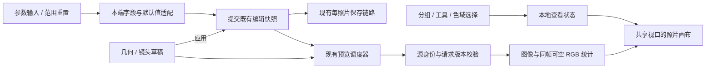

# ITER-02 技术子方案：原生分组、HSL 与工作区状态

紧凑导航、原生滑块及裁切精度的补充约定见[紧凑调整栏与裁切精度](compact-controls.md)。

状态：待评审，尚未执行。基线：r4，`13efd9c342f15029c47e302c467423cb45fc4f60`，2026-10-21。

本文只实现 ITER-02，其他功能见[迭代总技术方案](../editing-iteration/technical-design.md)与[总需求](../editing-iteration/requirements.md)。下文“不在本步”“独立交付”只划分模块责任，不表示复制粘贴、预设、新调色、批量逐张工作流或更新移出本次迭代。

本方案实现 [REQ-01～11 和 AC-01～21](requirements.md)，约束来自 [roadmap](../../architecture/roadmap.md)、[颜色与渲染契约](../../../lutools/docs/color-contract.md)、[Edit JSON v4](../../../lutools/docs/edit-json.md) 与 [集成协作规范](../../process/integration-workflow.md)。HTML 是交互参考，不嵌入应用，不把 CSS/fixture 转成原生参数契约。

## 1. 架构选择

| 问题                         | 采用方案                                                                 | 取舍                                                                             |
| ---------------------------- | ------------------------------------------------------------------------ | -------------------------------------------------------------------------------- |
| 六组是否成为新的编辑数据格式 | 各端新增小型 UI 分组描述与状态，映射到现有工具、字段和默认解析器         | 不统一四端内部编辑模型，不新增跨平台运行时框架，不为未来复制粘贴先造通用补丁协议 |
| HSL 是否重做算法             | 改导航、色块、参数行、精确值、重置和标记；复用现有 HSL 设置与渲染入口    | 渐变轨道只提供方向提示，不引入 Lightroom 算法或颜色分级                          |
| 组重置如何接入               | 从本端完整快照构造范围明确的候选，校验后一次提交                         | 不通过连续触发每一行回调实现，不直接调用旧名称分组/全重置                        |
| 新对比如何渲染               | 复用中性参考与结果帧，组合画布和裁剪；共享一个视口                       | 切换方式可能引起既有预览尺寸请求，但不能改变编辑参数或重建 RAW 会话              |
| RGB 直方图                   | iOS/Android 补接已有 `sony2fuji_analyze_image`，Mac/Windows 复用现有链路 | 不维护第二套平台统计算法；统计显示输出而非 RAW 传感器数据；不新增 C ABI          |
| 设计中其他流程               | 保留原系统选择器、存储、导出和任务边界，定向回归                         | 自动更新、完整撤销/重做、复制粘贴与用户预设仍独立交付                            |

导航只连接查看状态。提交继续经过各端现有 edited/edit/MarkEdited 入口；不从新控件直接写存储文件、调用导出或跳过预览调度。

## 2. 当前实现与接入边界

### 2.1 四端来源

下表保留方案编写时的符号与接入缺口；后续实现与验收进度见[迭代总账](../../integration/editing-iteration/README.md)，不以本表判断当前功能是否缺失。新增类型名在后文单独标为“拟新增”。文件内职责不清时只抽取本次需要的导航/展示单元，不顺便拆分整套编辑系统。

| 平台    | 现有结构与接入文件                                                                                                                                                                                                                                                                                                                                                                                                      | 本步关键差异                                                                                                                     |
| ------- | ----------------------------------------------------------------------------------------------------------------------------------------------------------------------------------------------------------------------------------------------------------------------------------------------------------------------------------------------------------------------------------------------------------------------- | -------------------------------------------------------------------------------------------------------------------------------- |
| iOS     | [ContentView+Panels](../../../RawLab/RawLab/UI/Editor/ContentView+Panels.swift)、[AdjustmentPanels](../../../RawLab/RawLab/UI/Panels/AdjustmentPanels.swift)、[EditorDrafts](../../../RawLab/RawLab/UI/EditorState/EditorDrafts.swift)、[EditorLayout](../../../RawLab/RawLab/UI/EditorState/EditorLayout.swift)；工具为 `EditorToolSelection` / `AdjustmentKind`                                                       | 扁平工具条；高度按 HSL/几何/镜头增加；`showingBefore` 仅切换整张前后图；直方图为 128-bin 亮度                                    |
| macOS   | [AdjustmentDock](../../../RawLabMac/Sources/Editor/View/AdjustmentDock.swift)、[EditorView](../../../RawLabMac/Sources/Editor/View/EditorView.swift)、[AdjustmentPanelLayout](../../../RawLabMac/Sources/Editor/View/AdjustmentPanelLayout.swift)、[Adjustments](../../../RawLabMac/Sources/Adjustments/Adjustments.swift)                                                                                              | 已有 `AdjustmentGroup` 是 film/input/tone/color/detail/effects/lens/geometry，不等于新六组；目前只支持并排；面板会按工具改变高度 |
| Android | [EditorScreen](../../../RawLabAndroid/app/src/main/java/com/rawlab/android/editor/ui/EditorScreen.kt)、[EditorTools](../../../RawLabAndroid/app/src/main/java/com/rawlab/android/editor/ui/EditorTools.kt)、[AdjustmentDock](../../../RawLabAndroid/app/src/main/java/com/rawlab/android/editor/ui/AdjustmentDock.kt)、[EditorState](../../../RawLabAndroid/app/src/main/java/com/rawlab/android/editor/EditorState.kt) | 工具用整数 ID；已有 wipe 和共享 zoom；没有 RGB 直方图；`canApplyDraft` 还需加入 changed 判定                                     |
| Windows | [MainWindow.xaml](../../../RawLabWindows/MainWindow.xaml)、[Tools.cs](../../../RawLabWindows/MainWindow/Tools.cs)、[Adjustments](../../../RawLabWindows/Adjustments.cs)、[ParameterRow](../../../RawLabWindows/ParameterRow.cs)、[HslPanel](../../../RawLabWindows/HslPanel.cs)                                                                                                                                         | 多个 choosing 布尔量切面板；已有并排/wipe 及共享视口，需统一开关/方式记忆；HSL `WrapPanel` 需改为单行                            |

持久化继续使用 iOS `RawSettings` / `PhotoEditState`、Mac `Adjustments` / `PhotoEditState`、Android `EditSettings` / `EditStore`、Windows `AdjustmentSnapshot` / `EditWorkflow`。不新增名为通用 `EditSnapshot` 的跨平台格式，不把 UI 分组 ID 写进 Edit JSON v4。

### 2.2 必须保持的参数边界

- [Shared/HSLSettings.swift](../../../Shared/HSLSettings.swift) 与 [C 头文件](../../../lutools/include/sony2fuji/ffi/sony2fuji_c.h) 已定义三轴八通道，顺序为 R/O/Y/G/Aqua/B/P/M；均为 `[-100,100]`，全零 identity。Hue 满量程对应约 ±30°，不是 UI 直接传角度。
- Swift 共享 `set` 会把用户值取整；[MacHSLPrecision](../../../RawLabMac/Sources/Controls/MacHSLPrecision.swift) 为桌面保留 0.1。Android `NumericControl` 的 HSL 步进为 1，Windows `NumericRange` 为 0.1。数据加载、配方缩放和快照不能因为控件显示而取整；`scaled(by:)` 的合法小数必须保留。
- [iOS AdjustmentScale](../../../RawLab/RawLab/UI/Adjustments/AdjustmentScale.swift)、[Mac AdjustmentTypes](../../../RawLabMac/Sources/Adjustments/AdjustmentTypes.swift)、[Android AdjustmentControls](../../../RawLabAndroid/app/src/main/java/com/rawlab/android/editor/controls/AdjustmentControls.kt)、Windows `ParameterSpec` 继续拥有合法范围、步进、单位与温度映射。原型曝光/强度/透视单位不直接成为平台存储单位。
- 原有百分比到 core multiplier、highlights 正负方向、recipe strength 缩放、RAW WB 与几何顺序保持不变；不要在新参数行或 JNI 中再次换算。普通图片仍按已有 `effectiveFor(input)` 等路径禁用 RAW 专属项。

## 3. UI 状态与操作边界

各端拟新增 `EditorAdjustmentGroup`（或本语言同义枚举），值固定为 `looks/light/color/effects/detail/geometry`。Mac 不重命名或复用旧 `AdjustmentGroup` 的输入/色彩语义。Android 保留现有工具整数 ID 的适配，不借分组改写保存值或自动化入口。

| 状态     | 内容和生命周期                                                                       | 禁止进入照片快照   |
| -------- | ------------------------------------------------------------------------------------ | ------------------ |
| 导航     | `expandedGroup?`、当前工具、组栏与参数滚动位置；工具进入默认值见 REQ-02              | 是                 |
| HSL 选择 | `selectedChannel`，0～7；编辑器会话内保存，首次 0                                    | 是                 |
| 精细     | 移动端面板级 Boolean；切工具/组恢复 false                                            | 是                 |
| 对比     | `enabled`、`preferredMode=sideBySide/wipe`、`split=0.5`、临时 `holdingBefore`        | 是                 |
| 查看     | 原有 viewport/zoom/pan，加 info 三态、photoMargin、mobile immersive、histogram 展开  | 是                 |
| 参数     | 已提交的本端编辑设置；几何/镜头另有既有 draft                                        | 否，沿原保存链路   |
| 工作状态 | 既有 source revision、render revision、draft epoch、exact/resize pending、save error | 不作为照片参数保存 |

本步不增加查看偏好的跨重启存储，保留现有平台已经保存的偏好；新状态在本会话内记忆。原生采用 SwiftUI 状态/Compose 状态/WPF view state，不能让 View 销毁重建时丢失 HSL 值、草稿或保存状态。

### 3.1 导航转换

| 事件                   | 转换                                                                         |
| ---------------------- | ---------------------------------------------------------------------------- |
| 点击未选组             | 走草稿离开守卫，成功后展开目标及默认工具                                     |
| 点击当前组             | 走同一守卫，成功后收起；不提交当前参数的额外写入                             |
| 切组内工具             | 先结束/取消数值输入的本地草稿，再处理几何/镜头离开；不能依赖视图消失自动应用 |
| 隐藏调整区/导入/切照片 | 同一离开守卫；有待办目的地时应用/放弃后只执行一次                            |
| 原地应用/取消草稿      | 回到 light/exposure；若是“应用并离开”，执行原目的地                          |
| 进入/退出纯预览        | 只变展示状态，保存原导航，不经过编辑提交                                     |

待办导航以事件数据保存（目标组、导入等），避免在重建 View 时重复打开系统选择器。失去源身份时使待办无效。原有工具选择、展开和系统返回入口都必须进入同一守卫。

草稿应用统一为“持久化候选成功后提交”的事务：捕获 draft/原 committed/source revision，取消尚未开始的自动保存，在该照片既有串行存储链上保存候选；成功后一次替换 committed、清草稿、安排精确预览并执行待办。失败保持原 committed 与草稿、清除提交中状态，仍在当前照片显示错误，可重试或明确放弃。进行中阻止修改草稿、重复应用和换源；后台保存不能再用旧 committed 覆盖成功候选。各端 guard 接到可返回成功/失败的本端保存结果；现有同步存储继续同步，不为此引入新的异步 writer。若以后异步化，完成回调仍需核对源、版本与候选，不能沿旧路径先清草稿再执行导航。

全量重置也是待办动作，但不预先构造候选：脏草稿先完成应用/放弃，之后从新的 committed 准备并确认全量重置；继续编辑取消待办。当前工具/几何与镜头组重置不经过离开守卫，直接改草稿。整组需准备 geometry+lens 成对候选，各端现有单 kind 草稿可扩展其投影/待应用字段以容纳这一范围，不能只重置当前 kind，却把另一个对象立即写入 committed。应用/放弃草稿后最后取消全量重置，不回滚已经明确确认的前一步。

## 4. 字段归属、默认值和重置事务

各端新增小型组描述表，由同一张表提供工具顺序、字段归属和改动标记；具体字段仍用本端 enum/key path/不可变对象复制，不能用本地化名称或裸 JSON 路径驱动 UI。

拟新增的本端接口职责如下，类型参数使用各自现有快照与上下文，不新建公共 DTO：

| 接口职责                                  | 输入 → 输出                                                              |
| ----------------------------------------- | ------------------------------------------------------------------------ |
| `groupFor(tool)` / `tools(group)`         | 已有工具 → 稳定分组；分组 → 有序工具                                     |
| `isModified(scope, snapshot, context)`    | 工具/色域/组、完整快照、输入种类与有效默认 → Boolean                     |
| `prepareReset(scope, snapshot, context)`  | 范围、快照、源身份/编辑 revision/配方版本 → 候选快照、确认摘要或阻挡原因 |
| `commitReset(prepared, expectedRevision)` | 已确认候选与期望版本 → 单次本端提交；版本变化则重新准备，不能覆盖新编辑  |

默认解析器包装现有 spec/default/WB resolver。RAW 的 as-shot 不能用固定 6500/0 代替；无校准则按当前不可用策略表达。缺字段旧记录的兼容逻辑留在 decoder，本步不跑“加载即标准化并保存”的迁移。

`isModified` 使用存储的逻辑值及配方感知的默认，包含配方注入值，不使用 renderHSL/recipeScale 后的值来隐藏标记。外观还比较外部 filmID、recipeID 和 strength；光线/颜色分别标记配方贡献，即使 strength=0；辅助效果/旧降噪字段也不能因关闭而遗漏。重置这些组恢复所有该组存储值，没有单独的“用户覆盖层”；重置后不能重放 recipe。此规则同时驱动小点、读屏状态和菜单是否禁用，避免三处各自判断。

### 4.1 普通重置

1. 从已提交快照（或当前草稿）复制候选；一次设置整个 scope，不逐行通知。
2. 依据所有权恢复默认，校验全部对象和跨字段关系；非选中组的独立参数保持原样。HSL identity 的 nil/zero 表达按原存储规则处理。
3. 需要确认时将作用范围与源 revision 固定。取消不写回，确认时检查源照片与 revision 仍匹配。
4. 普通参数通过现有编辑入口一次替换、排队保存和渲染；几何/镜头只替换草稿，沿原应用链提交。没有实际变化不创建保存或渲染请求。
5. 全部重置同时处理外观引用、配方与设置。Android `EditSettings.reset()` 保留 film、Mac `settings.resetAll()` 不清 `selectedFilmID`，均不能单独当作新的“全部重置”。

### 4.2 配方耦合：先独立化，再重置外观

这是本步的关键兼容取舍，属于新增需求规则，不是已经存在的 helper。[Mac Adjustments](../../../RawLabMac/Sources/Adjustments/Adjustments.swift) 的 `applyMasterRecipe` 写入曝光/明暗/饱和度/tint/HSL，`apply(to:)` 再乘整体强度；`clearMasterRecipe` 还转换 WB。Android/Windows 有相似的 recipeScale/ClearMasterRecipe 逻辑。直接删 ID、重置旧 `.film`、重放配方，都会改变其他组的解释。

外观组和当前大师配方重置使用下述准备过程。需要将现有正向转换与有效值捕获抽成小型纯 helper 时，在本端模型内部共用原公式，不复制出另一套渲染实现：

1. 从完整快照捕获清除前的有效曝光、tone、WB 模式及有效 Kelvin/tint、render HSL、S 曲线和其他非外观对象，使用本端当前渲染转换器的数值。保留 exposureMode，不重建为新默认。输入先检查 finite 与现有范围；Mac decoder 对普通字段的历史读入并不保证已经满足 UI 范围，不能省略这层校验。
2. Mac helper 放在 `Adjustments` 内部，以便在清身份前消费私有 `masterRecipeSettingsVersion`：先取原 `renderHSLSettings`，它对 v2/缺省版本与 v3 的强度规则不同；不能先调用会更新版本的 `clearMasterRecipe()`。其他端也先执行原版本兼容解析，再捕获有效值。
3. 在候选中移除 film/look 和 recipe 身份，恢复 strength 默认。将此前配方缩放产生的非外观有效值写成现有格式可表示的独立值；HSL 保留已经过原强度缩放/夹紧的结果，不走会再次量化的用户输入 setter。这里保留的是现有渲染转换器实际输出的结果，不补偿原算法已经执行过的 HSL/tint 限幅。
4. RAW 配方非零相对 tint 需要转换为独立自定义 WB 时，必须有真实 as-shot 校准，否则 blocked，不沿用现有 clear helper 的 6500/0 fallback 猜测。没有该转换的 as-shot 路径保持 as-shot。普通图片按既有 raster resolver 的有效值比较，不制造相机 WB；若相对色调不能用其现有独立字段无损表示，也 blocked。模式转换与物化涉及的显示数值在组重置确认摘要中说明。
5. 对候选执行现有范围校验并生成 core 参数，与原非外观 core 参数逐项比较。物化前后同一 core 字段转换成 Float 后要求相等；HSL 同样比较最终 Float 数组，不增加新的宽松容差。几何、镜头、效果、降噪保持快照相等。源字段、模式或版本无法解释时 blocked，不继续猜测。
6. 必须覆盖 strength factor `0...2`、有效曝光 `-4...4`、tone/color UI 值 `-100...100`、tint `-150...150`、HSL `-100...100` 及各参数原有约束。无法无损表示则候选不提交，例如 recipe exposure 4 EV × strength 2 不能 clamp 成独立曝光 4。用户可取消或另确认全量重置，不自动迁移 schema。

Mac 提交同时包含 `settings`、`EditorModel.selectedFilmID` 及保存时对应的 `PhotoEditState.filmID/masterRecipeID`。沿现有 `selectMasterRecipe` 的 batching 模式，在 `updatingMetadata` 保护内一次赋值，最后只调用一次 `edited()`；不能通过普通 selectedFilmID didSet 重新触发 clearMasterRecipe 或中间保存。其他端同样用本端事务/单次不可变替换，不仅清模型里恰好叫 recipeID 的字段。

该路径只服务本步的重置，不预先扩展为通用跨照片复制。配方的正常选择、取消选择、强度改变仍走既有行为；组重置需要单独测试，不能借用 selectFilm/selectMasterRecipe 具有的附带动作。光线/颜色等组重置也直接修改相应存储字段，不重新应用配方；重置为 0 的配方偏移仍为 0，不给其他组重新乘强度。

## 5. 通用参数行与 HSL

### 5.1 控件职责

参数行只消费本端 spec、当前值、有效默认、显示单位、enabled、onChange(interactive)、onEnd、reset 动作和面板 fine 状态。拖动期间复用原代理请求，结束只提交一次 settled 请求；导航、刷新 binding 和标记计算不得反向触发 onChange。

显示层用同一个归一化位置函数 `p(value)` 计算当前和默认位置；填充区间为 `[min(p(default),p(current)), max(...)]`。色温必须使用既有 reciprocal 函数。选择改变与值改变分别维护，不能把黄色选中色误判成 modified。

精确输入先解析本地草稿，显式验证 finite、范围和本端合法网格再提交。现有某些 Windows parser 会 clamp 越界值，r4 落地时在提交前补越界校验与错误显示；不是只搬旧 Parser 就宣称满足 REQ-03。Cancel/Escape 不经过 onChange，窗口关闭与输入焦点恢复要覆盖。

原值不在当前网格上时采用“原值例外、新输入按网格”：保存精确的 originalValue 与 dirty，显示文本最多两位小数，不能通过反解析显示文本重建原值。没有实际变化的 Apply 不调用 setter；确认与原值显示相同的文本时保留原值，细调也从原值起步。iOS wheel 沿用把原值加入候选的能力；Android 的 HSL 0.5 保持显示为 0.5，超过两位的历史小数仅对标签舍入。数值字段、读屏、帮助、批量摘要和照片信息使用相同的两位上限；小于百分之一的步进使用分数表达，不能显示为零。用户选择或拖动到新网格值才提交；新手工输入若不在网格上则报错，原有非网格值无变更应用始终是 no-op。

单值重置通过名称/轨道的双击与语义动作调用同一 reset 接口；数字框内双击仍是文本选择。VoiceOver/TalkBack 不注册会覆盖其激活行为的原始双击识别器。面板 fine 的 0.25 只进入拖动位移转换，不能再乘在已经量化的参数值上。

### 5.2 HSL 接入

| 平台    | 复用入口                                                                                                                           | 本步改动                                                                                                                       |
| ------- | ---------------------------------------------------------------------------------------------------------------------------------- | ------------------------------------------------------------------------------------------------------------------------------ |
| iOS     | [IOSHSLMixer](../../../RawLab/RawLab/UI/Panels/PhotoEffectPanels.swift)、`HSLSettings.value/set/reset`、`AdjustmentControl`        | 色域选择状态提升到编辑器；单行色块、下方改动点、方向轨道、单面板 fine 与集中重置。`.hsl` 的整体 progress 不能绑定成普通 scalar |
| Mac     | [MacHSLMixer](../../../RawLabMac/Sources/Controls/MacHSLMixer.swift)、`MacHSLPrecision.setting`、现有 optional identity binding    | 保留 0.1 精度；移除行内/面板重复重置，增加标记、轨道和菜单                                                                     |
| Android | [HslControls](../../../RawLabAndroid/app/src/main/java/com/rawlab/android/editor/controls/HslControls.kt)、`HslSettings.withValue` | 由会话持有 channel；色块收紧且保持触点；使用现有 1 步进与不可变设置；新 fine 从面板传入                                        |
| Windows | [HslPanel](../../../RawLabWindows/HslPanel.cs)、`HslSettings.WithValue`、`ParameterRow`                                            | WrapPanel 改单行滚动，保留 0.1；refresh/syncing 保持无副作用，增加色域改动点与三轴轨道                                         |

HSL 保存/核心数据依然 axis-major：0～7 hue，8～15 saturation，16～23 lightness。切色域时先取消未提交的旧输入，再刷新三轴，回调必须绑定原 axis/channel，不能在异步结束后使用新的 currentChannel 写错色域。

### 5.3 iOS 刻度窗口

保留 [AdjustmentScale](../../../RawLab/RawLab/UI/Adjustments/AdjustmentScale.swift) 的值域、候选、倒数映射、fine 与触觉计算，只改变 [AdjustmentRuler](../../../RawLab/RawLab/UI/Adjustments/AdjustmentRuler.swift) 的可视窗口和指示位置。

先把合法值转换到现有刻度坐标 `u=scale.position(value)`。可见跨度 `span` 由实际控件宽度与原刻度密度得到，限制不大于整个合法坐标域；`start=clamp(u-span/2, lower, upper-span)`，指示位置为 `(u-start)/span`。控件变宽只重新算窗口，不改 value。温度在 reciprocal 坐标算窗口，再反变换标签，不能直接用线性 Kelvin 代入。位移到值的映射仍由原交互控制器完成，不因指示线移动再叠加一次位移。

需覆盖 strength 0、锐化 0、HSL ±100、曝光 ±4、2000/50000 K、布局改变与开始拖动瞬间；保留默认点、原触觉/刻度动画和 Reduce Motion，不能因为重新布局伪造“用户拖过刻度”的事件。

## 6. 布局与草稿集成

布局分为组栏、工具栏和 panel area，内部再分滚动内容与固定 draft actions。桌面的展开态高度由窗口、字号、安全区/键盘和用户桌面高度一次计算，不依 selectedTool 改变。iOS、Android 底部面板以该预算为上限，按当前工具内容收紧；分组和草稿操作固定在参数滚动区外，侧栏保持满高，见[紧凑控件](compact-controls.md)。

按 r4 采用宽度≥600、宽>高、非无障碍字号的侧栏；使用 336 逻辑单位为设计目标，实际原生目标尺寸与文字放不下时回退底部布局。六列侧栏按钮仍须达到原生点击目标，不能只看 20 px glyph 可见就算通过。桌面保留用户拖动的面板高度，在 950×620/1024×720 测试内部滚动。

- iOS：在 `EditorLayout` 测量当前参数内容的自然高度，以窗口和字号预算为上限收紧底部面板，侧栏仍填满；`EditorDrafts.selectEditorTool/commitEditorDraft/discardEditorDraft` 仍是唯一草稿入口，保留 sourceRevision、uncropped 预览和 Apply 门控。 分组按钮与横滑容器采用同一实际文字排版高度，并将该高度计入窗口预算。无障碍字号的短横窗可将组内工具放入参数区内部滚动，分组与草稿操作仍固定可达；末项和组内工具都必须能通过滚动完整到达，不缩小文字或触点。工具行是否随参数滚动由窗口和字号决定；底栏可随工具内容收紧，数值变化不改变布局。
- Mac：`AdjustmentPanelLayout` 改为用户/窗口预算，取消工具选择时自动拉高；复用 `MacGeometryWorkspace` 和 `MacCropOverlay`，保留 draft epoch 与精确结果后的提交展示。
- Android：`EditorScreen` 的 expanded/tool 状态接入组导航；`EditorState.canApplyDraft` 加 changed 且保留 exact/rendering 门控，更新当前依赖 unchanged draft 可应用的旧测试。保留 beginDraft 对 resize 的现有互斥，不另造并发草稿状态。常规工具采用图标与名称横排并独占一行；短屏或大字号由窗口和字号统一决定工具行是否随参数滚动，保留文字自然宽度、横向滚动与至少 48dp 点击区域。高度上限包含固定草稿操作和参数控件；底栏使用非填充的参数权重，简单工具把空白还给照片。所有参数区均将名称/数值与整行标尺分开，复杂工具内部滚动，数值变化不改变外框。
- Windows：收口 choosing 布尔量为一致的组/工具状态投影；仍用 `TransformDraft` / `ResolveTransformDraft`，菜单或快捷键不能绕开 `ApplyDraftButton` 的精确结果条件。 处理版本、曝光基准和拍摄时白平衡等辅助控件放入“照片处理设置”弹出面板，重置与收起保持可见；弹出面板和参数区分别滚动，参数末项和辅助控件均须完整可达。直方图在照片区可用高度内压缩图形，保留统计文字的完整显示。

原生已有裁切手柄继续使用各自 geometry/crop controller，r4 的直接拖动不引入另一套几何计算。手柄、画布点按、对比和长按互斥；照片/窗口变化后取消旧 pointer capture。

## 7. 对比、视口与输入优先级

`enabled` 与 `preferredMode` 分开：toggle 仅切 enabled；选方式更新 preferredMode 并开启；关闭不清方式。首次方式 sideBySide，首次 split 0.5；切照片清临时按住及旧参考，不清会话方式。分割位置是照片矩形中的归一化比例，限制 0～1，按新布局重投影。

每个工作区只持有一份图像坐标视口：在并排的两张照片里各自计算 fit scale，但使用相同的相对 fit 放大倍率和归一化照片焦点，再投影 pan。这样左右/上下不同尺寸时仍指向同一位置，不直接共享两个屏幕像素 offset。Wipe 在同一 image rect 上绘制 neutral/result 两层，分割线转换到该 rect；查看边距只改变可用 rect。

“调整前”采用默认中性显影，不是本次操作前的快照：RAW 用现有客户端默认曝光基准、相机 WB、无外观与其他默认调色；普通图片用其现有 sensor/none 输出路径。参考带当前已提交 geometry/lens，以便构图一致。不能跟随当前用户曝光、WB、HSL 或 LUT，也不能修改缓存原图。参考 key 至少覆盖源身份、输入种类、geometry/lens 与需要的预览尺寸，沿用现有 neutral cache，禁止跨照片复用。

草稿期间保持现有禁用对比约束；纯展示开关不要求重新显影。并排使 pane 尺寸变小时，通过已有 viewport-demand/resize debounce 请求所需代理，未完成前继续展示最后有效帧；不要把改变查看方式当成编辑 dirty。

### 7.1 手势与快捷键

- 使用平台手势识别器与系统触摸位移/长按阈值；原型 180 ms/8 px 是演示值，不直接成为跨平台契约。单指已进入 pan、出现第二触点、裁切手柄捕获或命中控件时，取消长按和纯预览候选。
- 单击等高优先级的双击/长按识别失败后再进入纯预览；长按释放只恢复，不再派发单击。移动端 a11y 提供独立“进入/退出纯预览”“查看调整前”动作。
- `holdingBefore` 是临时覆盖，不改变 preferredMode。pointer cancel、键盘 key-up、窗口失焦、后台、导入、切照片均清除；文本输入、弹窗或菜单活动时不响应桌面 `I` 与反斜杠。
- 纯预览退出恢复原组/工具/视口，系统返回先退出纯预览。几何/镜头草稿不允许进入；toolbar 的长按方式菜单要有点按即可找到的画面内入口和 a11y 动作。

## 8. 预览、RGB 统计和忙状态

### 8.1 保留现有调度器

| 平台    | 必须保留的机制                                                                                                                                                                                                                                                                        |
| ------- | ------------------------------------------------------------------------------------------------------------------------------------------------------------------------------------------------------------------------------------------------------------------------------------- |
| iOS     | [RawEditorViewModel+Rendering](../../../RawLab/RawLab/Core/ViewModel/RawEditorViewModel+Rendering.swift) 的 `latestRenderID` + `sourceRevision`、`previewRendering` / `previewResizePending`；全局 `isBusy` 分开                                                                      |
| Mac     | [RenderScheduling](../../../RawLabMac/Sources/Rendering/RenderScheduling.swift) 的一个 in-flight/一个 pending；[EditorModel+Rendering](../../../RawLabMac/Sources/Editor/Model/EditorModel+Rendering.swift) 的文件、draft epoch、look 与 viewport 检查                                |
| Android | [RenderQueue](../../../RawLabAndroid/app/src/main/java/com/rawlab/android/editor/render/RenderQueue.kt) revision 与 [EditorViewModel](../../../RawLabAndroid/app/src/main/java/com/rawlab/android/editor/EditorViewModel.kt) 的二次 currentRevision 校验、exact/rendering/resize 状态 |
| Windows | [Rendering.cs](../../../RawLabWindows/MainWindow/Rendering.cs) 的 `LatestWork`、file/LUT/geometry/lens/transformGeneration 及交互/精确结果检查                                                                                                                                        |

细线是这些状态的展示投影，不新建与请求脱节的 timer/busy Boolean。只要最新预览或尺寸请求未收敛就保持 busy；不能由任意旧回调的 finally 统一清除。失败保留上次有效图及明确的未更新状态，不强行置 exact；保存错误与预览错误使用原有各自状态。

导出维持本端 canExport 条件：无阻塞工作、无草稿、精确结果可用、无 resize pending，以及本端现有保存/外观可用条件。细线不改变按钮判定。交互仍可继续排队最新参数，不能因把所有工作并成 busy 而锁住拖动。

### 8.2 RGB 统计数据链

已有 [sony2fuji_analyze_image](../../../lutools/include/sony2fuji/ffi/sony2fuji_c.h) 返回 channel-major 768 个 UInt32 计数，要求有效 RGB8/RGBA8、stride/size、三个输出指针；不需要高光遮罩时 `clipping_mask=null`。采用 Auto/CPU 路径处理已经位于 CPU 的预览，避免为直方图额外上传 GPU；不改变用户选择的照片渲染 backend 或假报 GPU 成功。

1. iOS 在 [Sony2FujiProcessor](../../../RawLab/RawLab/Core/RawProcessing/Sony2FujiProcessor.swift) 持有实际显示输出 buffer 时调用，发布新的三通道 histogram payload，替换 VM 的 128-bin 亮度数组；原生 buffer 生命周期内完成统计，不先转 CGImage 再读回截图。
2. Android 在现有 [JNI preview](../../../RawLabAndroid/app/src/main/cpp/rawlab_jni.cpp) / [NativeProcessor](../../../RawLabAndroid/app/src/main/java/com/rawlab/android/engine/NativeProcessor.kt) 结果中附带三通道计数，经 `NativeFrame`、`PreviewPair` 交给 ViewModel；明确 JNI 数组拷贝所有权，不保存被释放的 native 指针。现有 Android 没有 histogram，不能只改 Compose 外观。
3. Mac 的 [Engine](../../../RawLabMac/Sources/Rendering/Engine.swift) 和 [HistogramPresentation](../../../RawLabMac/Sources/Presentation/HistogramPresentation.swift)、Windows 的 [RenderEngine](../../../RawLabWindows/RenderEngine.cs) / [HistogramView](../../../RawLabWindows/PhotoCanvas.cs) 已有真实 RGB 链路，复用数据和重叠绘制规则。
4. 每次接受像素帧时原子发布其 frame identity 和可空 histogram；缺少统计就清除前一帧统计，不阻挡新图显示。沿用 iOS 交互请求 `includeHistogram=false` 的节流能力，统计稍后到达仅在 identity 仍等于当前接受帧时回填；取消旧 histogram fallback，不能取 base/上次结果的 bins 代替当前帧。每通道计数总和必须等于当前统计图的宽×高，不能拿全分辨率标签配代理统计或把 128-bin 亮度复制三份。
5. 常规并排/wipe 的直方图说明其统计“调整后”；临时按住调整前时使用相应 neutral 的统计并标识调整前，若尚未取得则暂不绘制旧统计。直方图缩放、折叠、info、留白均是查看状态。

三通道共享峰值尺度，RGB 叠加成 RGB/CMY/灰；不分别归一到三个不一致的峰值，不从原型固定 SVG 生成数据。失败显示统计不可用，不提供虚假山形。统计只针对已生成的显示预览，不增加全尺寸 RAW 解码；不得将移动预览直方图当作传感器测光或全尺寸细节证明。

## 9. 文件与 owner 划分

| 责任               | 拟新增或修改范围                                                                                                                                                                                                                                                                                                          | 边界                                                                             |
| ------------------ | ------------------------------------------------------------------------------------------------------------------------------------------------------------------------------------------------------------------------------------------------------------------------------------------------------------------------- | -------------------------------------------------------------------------------- |
| 六组与重置规则     | 各端邻近现有 editor state/adjustments 增加 `EditorAdjustmentGroup` 与 reset helper；[Shared/HSLSettings](../../../Shared/HSLSettings.swift) 原数据结构保持                                                                                                                                                                | 各端 owner 写本端适配，共同评审 REQ-01 字段表；不要共享旧 enum 的错误语义        |
| iOS 参数与布局     | `ContentView+Panels`、`EditorLayout`、`AdjustmentPanels`、[AdjustmentControl](../../../RawLab/RawLab/UI/Adjustments/AdjustmentControl.swift)、`AdjustmentRuler`、`PhotoEffectPanels`                                                                                                                                      | 视图与输入层；值轮、保存与 core 转换继续复用                                     |
| Mac 参数与布局     | `AdjustmentDock`、`AdjustmentRow`、`AdjustmentPanelLayout`、`MacHSLMixer`、`EditorModel+Workflow`                                                                                                                                                                                                                         | selectedFilmID 与 settings 的 reset 候选一起提交，不触发递归 onChange            |
| Android 参数与布局 | `EditorScreen`、`EditorTools`、`AdjustmentDock`、`AdjustmentControls`、`HslControls`、`EditorViewModel`                                                                                                                                                                                                                   | `rememberSaveable` 仅保存查看状态，编辑事实仍以 VM 为准                          |
| Windows 参数与布局 | `MainWindow.xaml`、`Tools.cs`、`MainWindow.Commands.cs`、`ParameterRow`、`HslPanel`、`Controls.xaml`                                                                                                                                                                                                                      | 保留 WPF 本地化、UIA、Enter/Escape 与菜单习惯                                    |
| 查看/对比          | iOS [ZoomablePhoto](../../../RawLab/RawLab/UI/Preview/ZoomablePhoto.swift)，Mac [PhotoCanvas](../../../RawLabMac/Sources/Presentation/PhotoCanvas.swift)，Android [PhotoCanvas](../../../RawLabAndroid/app/src/main/java/com/rawlab/android/editor/canvas/PhotoCanvas.kt)，Windows `PhotoCanvas` / `InteractionExport.cs` | 复用视口与 crop controller；不复制解码或编辑模型                                 |
| RGB 桥接           | iOS processor/VM/EditorComponents，Android NativeProcessor/JNI/EditorWork/VM + histogram Composable                                                                                                                                                                                                                       | 两端独立接入既有统计 C API，核心文件不改；需要改变 C ABI 才另拆前置 PR           |
| 资源               | 各端现有本地化调用与 [Shared/strings](../../../Shared/strings) 的资源入口                                                                                                                                                                                                                                                 | 一位资源 owner 维护共享目录，平台 owner 提交所需 key；不重开已完成的旧字符串整改 |

没有自动化生成原生代码的步骤。设计 assets 继续是共同交互来源，原生资源/tokens 用本端类型映射，不把 Web hex/px 一键覆盖 SwiftUI/Compose/WPF 令牌。

## 10. 推进顺序与验证责任

下列为本步内部交付，不改第二阶段的六步顺序。先用一个平台完成规则验证，再依稳定规则并行各端；各端可分多个 PR，但同一 editor 入口同一阶段只有一个 owner。未合并前置明确记录依赖，不靠大合并最后解决。

| 批次              | 交付与文件责任                                                                      | 完成证明                                                                                                                     |
| ----------------- | ----------------------------------------------------------------------------------- | ---------------------------------------------------------------------------------------------------------------------------- |
| S1 规则与事务     | 本端六组表、有效默认、完整对象标记、范围 reset 候选、配方独立化/blocked，不接新算法 | 为 AC-01/02/06/07/19 先补模型回归：未选组保留、neutral 默认、legacy default、强度 0/0.5/1/2 和越界独立化拒绝；保留原保存格式 |
| S2 原生导航与参数 | 四端组栏/组内路由、固定高度、单行输入、fine、HSL、重置菜单；iOS 刻度窗口            | AC-03/04/05/08/09/10；真实控件测试包括旧小数、Cancel/Enter/Escape、八色域横滑和大字号焦点                                    |
| S3 草稿与查看     | 草稿守卫、对比方式、统一视口、按住/纯预览、信息/留白、细进度线                      | AC-11～15/17/18；乱序请求、取消、键盘/手势竞争、草稿不可绕过、busy 无布局跳动                                                |
| S4 RGB 与联合回归 | iOS/Android RGB 桥接、各端显示与源绑定；全流程/六语/可访问性                        | AC-16/20/21；已知 RGB fixture 的 bin 精确计数、切图不串统计、保存重启、批量 snapshot 和相同设置的预览/FINAL 一致             |

S1 的字段边界先稳定；S2 各端可并行，S3 与本端导航/状态 owner 协调；S4 的 RGB 桥接可在 S1 后并行准备，不阻塞不相关控件。全部发布前在同一集成源联合验收，设备条件不足保留“未验证”，不能靠 HTML 代替。

### 10.1 已有验证入口与需要扩展的断言

下列是实现验收入口，不是验证结果；实际执行、配置、设备与结果写入对应 PR。外部 RAW 和专属设备由实现任务提供，不能把占位路径当成已验证环境。

| 层级          | 现有入口                                                                                                                                                                | 应增加或重用的检查                                                                                                                                               |
| ------------- | ----------------------------------------------------------------------------------------------------------------------------------------------------------------------- | ---------------------------------------------------------------------------------------------------------------------------------------------------------------- |
| 设计原型      | `node docs/design/editor-workspace/scripts/review.cjs`；环境见 [README](README.md)                                                                                      | 保留 r4 状态/布局参考；原生增加的 blocked/reset 状态需同步资产，浏览器通过不计原生完成                                                                           |
| iOS 模型      | `bash RawLab/tests/presentation.sh`、`adjustment-scale.sh`、`edit-memory.sh`（后两者也以 `RawLab/tests/` 为前缀）                                                       | 组范围/默认、HSL 201 个整数候选与合法旧小数、fine .25、刻度端点和持久化                                                                                          |
| iOS UI/处理   | [RawLab/AGENTS.md](../../../RawLab/AGENTS.md) 的 `build-for-testing`；`IOS_SIMULATOR_UDID=… bash RawLab/tests/editor-ui.sh` 及现有 processor-export/viewport harness    | build-for-testing 只编译；专用模拟器与 RAW fixture 实跑组导航、固定高度、输入/草稿/对比、RGB；源框架变化才重建 xcframework                                       |
| Mac 模型/图像 | `bash RawLabMac/tests/control-groups.sh`、`bash RawLabMac/tests/adjustments.sh`、`bash RawLabMac/tests/edit-model.sh`、`bash RawLabMac/tests/histogram.sh`              | HSL tenths、组 reset 不串组、recipe/WB 转换、保存失败、RGB shared peak                                                                                           |
| Mac 调度/UI   | `bash RawLabMac/tests/render-scheduling.sh`、viewport-preview/mac-geometry-draft/compact-controls-presentation runners；`bash RawLabMac/build.sh`                       | 当前 source 对应 RAW 与输出目录显式指定；增加组/对比/草稿固定布局及 stale result 回归                                                                            |
| Android 主机  | 在 `RawLabAndroid/`：`./gradlew :app:testDebugUnitTest :app:lintDebug :app:assembleDebug :app:assembleDebugAndroidTest --console=plain`；`bash scripts/check-native.sh` | 扩展 EditorToolGroupingTest、EditorContractsTest、AdjustmentInteractionTest、EditorEditStoreTest；检查 JNI RGB 数据边界                                          |
| Android 设备  | 在隔离 ADB server 与指定 serial 上运行现有 connectedDebugAndroidTest                                                                                                    | 新 HSL Compose 检查、EditorScreen/EditorV08Test、PhotoCanvasTest、GeometryDraftInstrumentedTest、ViewModelRaceInstrumentedTest；unchanged Apply 断言按新规则更新 |
| Windows       | Windows 环境 `./RawLabWindows/build.ps1 -Test -RawPath <外部 RAW>`；按 [run-v08.ps1](../../../RawLabWindows/tests/run-v08.ps1) 选择受影响套件                           | editing、tool-groups、editor-review、comparison-default、localization-ui；扩展 UiPanelChecks/ComparisonChecks/Busy/ResizeUi 与 reset adapter                     |
| 核心回归      | 核心/桥接受影响时运行对应现有 HSL/统计/几何用例；Mac 已配置核心可用 `ctest --test-dir lutools/build-macos --output-on-failure`                                          | 同最终参数无额外强度/符号转换；RGB bins 精确；geometry/CPU Auto 和 Force 边界不变                                                                                |

新测试以用户行为与快照不变量为目标，不只断言控件数或镜像实现。至少包含：配方 tint 与强度耦合、相同 basename 不同照片、RAW/普通图片切换、输入取消、草稿目标导航、键盘失焦、过期图像/统计、保存失败；这些风险要落在负责该行为的 S1～S4 回归中。

## 11. 兼容、发布与仍需评审的取舍

本步不改 Edit JSON/C ABI/旧记录 schema，不做数据库迁移。新 UI 读取原模型，新照片用当前有效默认；缺失字段、legacy FBDD、recipe settings version 和已有 HSL 精度按原解码保留。旧 FBDD 可只在旧记录/兼容入口说明，不把它映射成新 wavelet 开关后悄悄更换算法。

需要一起评审的方案选择包括：r4 的常驻导航和对比开关替代旧交互；外观重置采用“无损独立化，否则阻挡”以避免配方串组；草稿应用先保存成功再提交和导航，失败保留草稿；新查看偏好先保持会话级，不新增跨重启状态格式。它们已给出可实现的默认规则，无需先写功能代码试做。

发布时保持每端可独立构建及旧照片恢复能力。出现无法满足的 UI/参数冲突时，记录具体 REQ/AC、source 与待决行为，修订本文件和设计决策，不静默改动原生规则或提前把 `manifest.implementation` 标为完成。是否合入、发布与安装仍按根 Gitflow 的单独授权执行。
