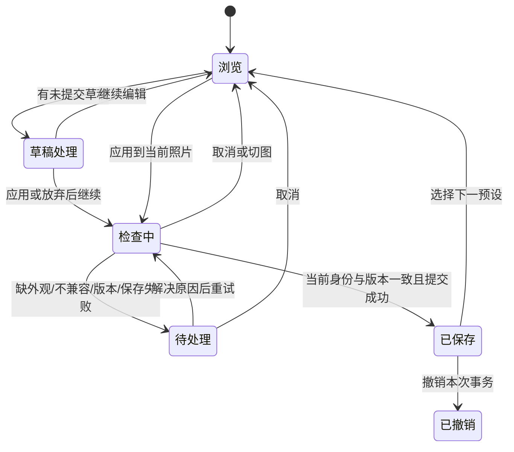

# UI/UX 优化交互合同

本合同记录 UI/UX 迭代确认的长期交互规则；[实施与验收记录](../../archive/integration/ui-ux-optimization-20261030.md)单独归档。
保留现有灰黄照片工作区、六组调整与各平台原生控件。

## 1. 调整范围摘要（UX-03）

复制、预设保存、预设详情和多目标应用显示同一套摘要：

1. 当前范围选择：全部、仅已修改、自定义，默认选择规则不变。Windows 保留已有独立的
   “默认范围”，它等价于当前家族的 common 字段集合，也显示同样的即时摘要。
2. `将覆盖以下 N 项调整；其他调整保留目标原值。`
3. 非空组按外观、光线、颜色、效果、细节、几何与镜头排序；组标题带数量，展开后是字段名与值。
4. 未选几何组时明确 `未包含几何与镜头。`；选中时说明包含，不再仅显示静态规则。
5. HDR 来源额外显示 HDR 与相对白平衡语义；有配方时显示配方强度与逻辑值说明。

自定义模式复用字段选择组：组标题显示已选数量，选中字段下直接显示 payload 值，
不重复呈现第二套分组树。未选组保留以供选择；只读详情和其他范围模式仅显示非空组。

数量、组和具体值必须来自**同一个实际 capture payload**。禁止用自定义勾选集合替代
all/modified 的结果，禁止为了摘要调用会写 clipboard、保存照片或新增历史的入口。
范围编辑期间对已提交快照调用纯 capture；保存/复制时重新执行正式校验与 capture。
Mac 使用 `committedEdit.state`；没有已保存记录时仅在 live state 与本端默认状态一致时使用
该默认状态。iOS 使用 `loadedEditRecord.state ?? PhotoEditState(settings: sourceDefaultSettings)`。
两端先验证当前照片身份、无草稿/交互/保存失败、live 调整与该提交状态一致；不一致显示
已有草稿/冲突原因，不静默展示旧值。磁盘 CAS/源 fingerprint 在正式动作时再次检查，
范围每次重绘不反复读取或显影原照片。Android/Windows 按本端已加载 record 和同样的守卫接入。
有草稿、快照已变化、AI 不支持该范围等错误时显示既有具体原因，不能伪装为 0 项。
仅捕获 `emptyScope` 显示空状态：modified 用 `尚无已修改的调整。`，custom 用 `未选择任何调整。`。
空范围不能确认保存或复制；切换范围、修改自定义字段后摘要即时更新。

### 数值和对象

- 摘要展示 payload 的逻辑值，单位投影与编辑器一致，展示舍入不回写 payload。
- 曝光为带符号 EV；strength 为百分比；contrast/saturation 为 `(v-1)*100`；
  highlights 为 `-v*100`；shadows/s_curve/sharpening 为 `v*100`。
- crop 的四项为百分比，quarter_turns 为 `v*90°`，straighten 为角度，透视两轴为 `v*100`；HSL 和其他百分比域保持原逻辑量。
- RAW 温度有 K；HDR 温度明确为相对参考白平衡，不当作目标相机绝对温度。
- camera WB 及其 null 温度/色调写 `相机白平衡（按目标照片）`；非 RAW 的不适用 WB 写 `不适用`。
  配方 tint 的数值仍展示为逻辑色调，不用相机派生 tint 替换。
- null lens profile 写 `自动（按目标照片）`；chroma/wavelet 的 null 写 `默认降噪设置`，
  它们表示使用既有默认配置，不声称逐照片分析。不把 null 显示成 0、关闭或 JSON。
  手动镜头未选择的 sentinel 写明确的待选择说明。
- Mac 可以捕获 null 降噪，iOS/Android/Windows 通常捕获显式数值与对象；摘要按各自
  payload 的实际形态显示，不将显式 0/默认对象归一为 null。跨端一致指同一 payload 的
  含义和显示规则一致，不要求不同默认存储形态的文案强行相同。
- 布尔值用本地化开启/关闭；曝光模式和白平衡模式使用现有本地化名称。
- 外观显示来源类型和可解析名称；缺失外观显示原身份及缺失提示，不能悄悄改成中性。
- 曲线显示模式、控制点数量，可展开全部点；颜色分级显示色相/饱和度；wavelet 显示
  enabled、luma、chroma、coarse、preset。对象不能简化成 `object` 或字符串化 JSON。
- 有 recipe context 时注明 `以下为配方逻辑值；强度为 N%。部分范围会按此强度换算。`。
  不声称这些源逻辑值就是目标存储值；现有 prepare 的有效值保留与不可表示错误不变。

共享 fixture 使用真实 payload，覆盖普通曝光、全默认、自定义几何、相机 WB、SDR 栅格、
HDR 七项、recipe v3/v4、曲线、分级和降噪对象。各端验证字段集合、分组计数与值投影，
保留现有 v1/v2 格式，摘要不新增持久化字段。

## 2. 当前照片预设（UX-01）

在现有外观组提供紧凑的“我的预设”入口：库与照片同屏，桌面使用调整区内列表，
移动使用当前参数区内列表。库管理（新增、改名、删除）继续使用现有原生页面。
空库显示保存当前调整入口。库内每项显示名称、分组摘要与应用动作；管理菜单含多张应用。

主动作点击后自动 prepare；无冲突立即调用既有 commit，一次事务、一条可撤销历史。
prepare 期间禁用重复提交并显示进度与取消。关闭库、切图、切模式或改变编辑版本后
旧结果必须失效；提交前再次通过现有 CAS/current guard。取消不保存、不生成历史。
成功状态显示预设名和“已保存”，未变化则显示“未变化”；撤销操作绑定本次事务 ID，
不误撤销之后的照片编辑。全局撤销/重做或其他传递动作接管当前照片的有效回执后，
清除过期的快捷结果提示并保留预设浏览；快捷动作自身继续显示其保存/撤销结果。
保存失败保留具体原因与重试，不显示“已保存”。
缺外观、目标不支持的字段及未来版本沿用既有整体拒绝。公共逻辑字段保持既有 SDR/HDR
跨家族应用能力；相对白平衡不跨家族隐式转换，不因快捷入口改变这条规则。多目标应用进入目标页并自动预检，
用户仍明确确认覆盖范围和目标；目标、范围、源或 skip 改变时重验必要状态。

## 3. 批量选择与导出（UX-02）

选择页保留来源照片、选择数量和逐张微调。文件名为主，完整路径放详情；当前来源
提供文字标记。默认字号下动作行按可用宽度重排或使用原生菜单，不压缩文字。

逐张导出配置页的主动作是 `开始导出 N 张`。点击后依次只读校验、冻结、启动已有任务。
无冲突时直接转到进度页；冻结是内部步骤，不再要求用户再次点击导出。
冲突时停留配置页，按照片显示草稿、源已变化、缺外观或路径问题及处理动作。
用户解决后再次点击同一主动作；保留选择、格式、输出目录和尺寸。
检查中取消不会创建 journal 或任务。冻结已成功而启动失败时保留可恢复任务并显示原因，
不得再次冻结重复任务。已有待运行/运行中任务继续使用原有单任务保护。
uniform batch 已有一次最终动作的端仅核验；暂停、恢复、失败重试、输出原子发布不改。

## 4. 照片空间（UX-04）

- Mac 内容窗口仍至少 950×620；普通 950×620 单值编辑时，照片画布预算至少 500×300 pt。
  用户主动展开辅助区或放大参数区时允许低于自动预算，必须可恢复紧凑状态。
- 没有目录、窗口宽度小于 1100 pt、用户本次尚未手动切换文件树时默认收起文件树；
  工具栏文件树按钮保持可发现。已加载目录、手动开关偏好不能被自动布局反复覆盖。
- 桌面单值参数采用 220 pt 自动高度；HSL/曲线/外观等复杂内容使用既有足够高度并可滚动。
  用户拖动高度后遵守用户选择，工具切换不能覆盖它；提供恢复自动高度入口。
- Mac 照片区域宽度不足 760 pt 或高度不足 400 pt 时，直方图默认紧凑头部，点开后使用
  原生 popover；大视口保留浮动展开图。紧凑状态不修改用户的展开偏好。
- iOS/Android 保留 compact-controls 已实现的按内容收紧与横向侧栏，不重新设计。
  预设列表和外观检索必须服从该预算，固定分组/返回/草稿操作仍可达。
- Windows 先核验 1024×720 的当前预算；同类问题按相同照片优先规则实现，DPI/字体按
  本端实际可用空间处理，不照抄 pt 到像素。

## 5. 外观检索与状态（UX-05/06）

保留胶片包装图与横向快速尝试。其前方增加固定分类入口、搜索和导入，不随长列表滑走。
分类用现有 Fuji/Kodak/Other 身份，另加全部、用户外观、最近使用；显示名称本地化。
搜索按名称不区分大小写与重音；空结果含清除搜索动作，不能改当前已应用外观。
最近使用按稳定 ID 记录最多 12 项，成功应用并保存后更新；去重、剔除已删除项。
这个 UI 偏好不进入照片记录，不改变渲染或外观存储格式。
当前外观始终在处理设置摘要可查；过滤隐藏当前项时不能选中列表第一项替代它。

不支持的白平衡/镜头/HDR 算子有具体原因；配方选中增加勾选或边框，不仅颜色。
原生控件保留键盘、读屏名称与状态。iOS 命中区域至少 44 pt，Android 至少 48 dp。
Windows 辅助页使用本端默认字号与可发现的横向滚动；源风险未复现则记录核验，
不为统一而改掉已正确的布局。

## 6. 验证与发布交接

界面变更按[验证 SOP](../../process/ci.md)执行受影响的本地原生检查；编译、模型测试、原生 UI 和硬件能力分别记录。
基线变化时核对实际源码和接口，仅重验受影响组合。历史运行结果保留其源码版本和平台范围。

2026-10-30 用户确认本轮以默认字号、窄窗、横竖屏、键盘、原生无障碍状态、Windows 200% DPI、组合流程和 Mac 122 张照片交互观察收口。以下项目仍未完成，移至发布验收：

- iPad 分屏和 Android 多窗口。
- Windows 100% 与 150% 显示 DPI；系统文字保持默认大小。
- VoiceOver、TalkBack、Narrator 的完整操作与朗读流程。

系统大字号不在本轮范围内。模拟器和 VM 结果不能证明物理 HDR 亮度、硬件 GPU 或真实触觉；这些设备条件继续由平台发布验收单独处理。
