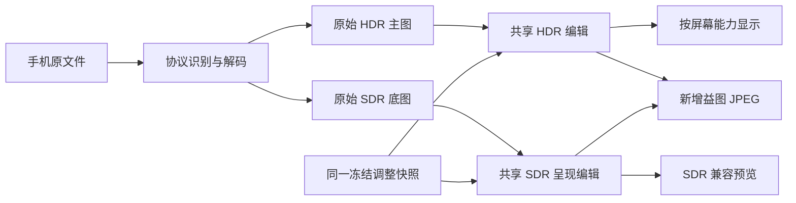

# 手机 HDR 照片支持技术方案

日期：2026-10-28。设计版本：1。源码核对基线：`a4de533e94cf0dd42355e6b95c6023b4836fb4cc`。

状态：方向及首批平台已获用户确认；2026-10-28 用户授权实施，HDR-00～04 已接通工作树中的实现，
正在按实施计划核验。用户同意先完成本机和模拟器可验证的部分，保留缺少的真机验收门槛。
本文是目标合同，不表示功能或设备验收已通过；push、PR、合入和发布仍需各自授权。
实施顺序见[分阶段计划](../../integration/hdr-photos/implementation-plan.md)。

## 1. 目标、来源与边界

让用户在 Mac、iOS/iPadOS 中导入手机拍摄的 HDR 照片，保留高光进行基础编辑，
分别检查 HDR 和 SDR 呈现，并保存可在普通查看器显示的 HDR JPEG。

用户于 2026-10-28 确认：先处理 iPhone/Android HDR 照片输入，Mac 和 iOS 先交付。
这是一条独立于[编辑迭代](../editing-iteration/requirements.md)的后续工作线，不补记为该轮已交付功能，
不预设版本号或发布日期。用户提供的 `Lightroom_Classic_HDR_Workflow_Analysis.md` 是调研输入；
本文保留工程决策与公开依据，不要求实现者访问个人知识库，也不把逆向符号等同于算法证明。

### 1.1 首批平台与显示能力

| 环境 | 首批承诺 |
| --- | --- |
| macOS 15+，Apple Silicon 或 Intel | HDR 解码、基础编辑、HDR/SDR 预览、增益图 JPEG 导出；两种架构分别验证 |
| iOS/iPadOS 18+ | 相册/文件导入、相同编辑与导出；iPhone、iPad 分别验证 |
| 上述系统上的 SDR 屏幕，或当前 headroom 为 1 | 仍可编辑、保存 HDR；显示 SDR 兼容结果，并可查看 HDR 直方图、假色 |
| macOS 14 | 应用和现有 SDR 行为继续支持；首批不宣告 HDR 编辑/导出能力，HDR 输入明确提示系统能力限制 |
| Windows、Android 客户端 | 首批不接入 HDR 编辑/显示；共享接口与旧行为需保持兼容，不因可编译而宣告 HDR 支持 |

系统版本、图像解码能力和屏幕 HDR 能力分别判断。没有 HDR 显示器不等于不能处理 HDR 文件。
macOS 14 打开未来 HDR 编辑记录时，不应用或覆盖该记录；保留原数据并提示在支持的系统打开。
具体为本次打开失败，返回 `UNSUPPORTED`、原因 `SONY2FUJI_HDR_REASON_UNSUPPORTED_SYSTEM`，保留原先打开的照片；
若没有原先照片则显示带错误说明的空画布。不提取 SDR 底图冒充已恢复编辑，也不允许对这张
未打开的照片进行编辑、重置或任何导出；不新增“另存原始文件”功能，其他 SDR 照片照常使用。

### 1.2 输入与输出范围

| 类型 | 首批处理 |
| --- | --- |
| iPhone HEIC/JPEG + 旧式 Apple HDR Gain Map | 识别并还原 HDR，同时取得 SDR 底图 |
| iPhone HEIC/JPEG + ISO Adaptive HDR Gain Map | 同上；覆盖单通道和 RGB 增益图样本 |
| Android Ultra HDR JPEG，Adobe XMP、ISO 或双元数据 | 同上；双元数据优先 ISO，并检查两者是否一致 |
| 普通 SDR JPEG/PNG/TIFF/HEIF | 继续按已有平台范围与[SDR 契约](../../../lutools/docs/color-contract.md#display-referred-raster-input)处理 |
| 增益图 JPEG 输出 | 首批闭环必需；完整编辑结果生成新的 SDR 底图、增益图和元数据 |
| 普通 SDR 输出 | 使用本次编辑的 SDR 呈现；仍遵守各平台既有输出格式范围 |
| 原生 PQ/HLG 输入、独立 AVIF/JXL、浮点 TIFF、HDR HEIF 输出 | 后续格式扩展；不由扩展名推定已支持 |
| ProRAW、其他 RAW 的 HDR 显影、多张包围曝光合成 | 后续独立功能；保持现有 RAW 行为 |

只接受本轮明确验证的静态、不透明图像表示。增益图辅助图不按普通多页图像处理；
不因此解除对连拍、立体、未知辅助图、透明和其他不支持类型的限制。
输入没有有效增益图或明确 HDR 描述时，不凭位深、文件名或像素最大值推断为 HDR。

## 2. 方案选择与现状

| 路线 | 取舍 | 决策 |
| --- | --- | --- |
| Core Image 完成全部 HDR 调色 | Apple 两端接入快，但参数、预设、Agent、批量与现有共享核心容易分叉 | 不作为正式编辑核心 |
| 系统解码/显示 + 共享 C++ HDR 编辑 | 需要浮点接口和算子适配，但能共用参数、确定性处理与跨平台契约 | 采用 |
| 同时重做 RAW、所有格式及四端 HDR | 扩大解码、颜色、UI 和设备矩阵，无法围绕手机输入独立验收 | 后续另立范围 |

既有 SDR 路径的边界（本轮保持）：

- [Apple 普通图像适配器](../../../lutools/src/platform/display_image.cpp)主动拒绝增益图、HDR 色彩空间和浮点图像。
- [C ABI](../../../lutools/include/sony2fuji/ffi/sony2fuji_c.h)的图像 buffer 只有 RGB8/RGBA8。
- [调色曲线](../../../lutools/src/core/photo_tone_curve.cpp)、部分 tone/effects 和现有外观以 SDR 域为前提；不能只解除导入检查。
- [Mac Engine](../../../RawLabMac/Sources/Rendering/Engine.swift)与[iOS processor](../../../RawLab/RawLab/Core/RawProcessing/Sony2FujiProcessor+Helpers.swift)的旧路径创建 8 位 sRGB 预览；HDR 改走独立浮点 pair 与画布。
- 渲染型 DNG 保存的是 SDR 显影结果，float32 存储不构成 HDR 支持。

## 3. 图像、颜色与亮度契约

### 3.1 统一工作数据

新增 `hdr_raster`，表示已经由手机处理的、显示参考的 HDR 图像。它不是场景参考 RAW。
解码后的 HDR 主图采用 D65、扩展线性 sRGB、float32；`1.0` 是相对 SDR 参考白，
`2/4/8` 分别为其上方 `+1/+2/+3 EV`。不固定映射为某个屏幕的 nits。

保留有限的超白和矩阵转换产生的负分量；不在导入或中间阶段全局 clamp 到 `[0,1]`。
扩展线性 sRGB 可以用超范围坐标表示 P3/BT.2020 的颜色，但每个算子和输出色域映射仍须验证。
不因此声称现有仅限 SDR 的算子已支持广色域/HDR，也不迁移整个项目到 ProPhoto RGB。

不应用 RAW 的 `+0.7 EV`、BaselineExposure、相机白平衡、解马赛克、镜头标定或中性 sigmoid。
原文件的 ICC/CICP、传递函数、增益图协议及版本由解码层解释，归一化只能执行一次。
PQ/HLG 将来接入时另定义绝对/相对亮度转换，不能借用本轮文件类型的默认值。

### 3.2 三种 headroom 分开

| 数据 | 来源与生命周期 |
| --- | --- |
| source/content headroom | 文件描述或对完整工作图的分析；属于图像内容，标明 declared/measured/unknown |
| edited content headroom | 当前调整后的结果，允许曝光改变；不硬限制在源 headroom 或固定 +4 EV |
| display headroom | 当前屏幕/窗口的运行时能力；只驱动显示映射，不进入编辑记录、缓存主数据或导出参数 |

headroom 比值有限且已知时至少为 1；`0` 只表示未知，不能当成 SDR 或代入对数。
必要时对完整结果分析亮度范围；不能以当前显示器能力补造内容元数据。
假色和直方图按工作图相对亮度分析，不能从已经裁剪的 RGB8 预览反推 HDR。

### 3.3 HDR 与 SDR 两份呈现



无调整时 HDR 对应完整源 HDR、SDR 对应源底图。两份图使用同一照片身份、方向和几何变换；
EXIF 方向只执行一次，输出方向为 1。预览可以降采样，FINAL 必须重新使用全尺寸来源。
不把同一 SDR 公式机械套在两份图上；共用逻辑参数，通过对应的 HDR/SDR 算子实现其意义。
亮度与色彩编辑后重新计算增益图，不把旧增益图附回已经改变的底图。

## 4. 解码、来源与资源

- Apple HEIC/JPEG 优先使用 ImageIO/Core Image，显式请求 HDR 表示，并分别读取 SDR 表示。
  旧式 Apple、ISO、Ultra HDR 是不同协议分支；使用各自的 gamma、offset、基准方向和 headroom 规则。
- Android Ultra HDR JPEG 使用系统解码和共享 `libultrahdr` 补充路径；原生未还原出有效 HDR 时，
  由共享 codec 读取实际 ISO/XMP 描述，不能以系统返回一张普通位图作为成功。
  当前固定为 `libultrahdr 2.0.2` 与 `libjpeg-turbo 3.1.3`，版本、源码哈希、许可和开关由
  [依赖清单](../../../lutools/cmake/hdr-codec-dependencies.json)统一管理。关闭上游 intrinsics，
  以避免该固定版本 arm64 P3 路径违反 A08；产品和独立 harness 保持相同策略。
- 依赖新增只启用本轮需要的 JPEG 能力，固定源码版本、校验值、构建参数与许可；HEIF/AVIF 的
  额外依赖不随默认开关自动进入包。两个 Mac 架构和 iOS framework slices 都须实际链接验证。
- `libultrahdr` 的单边尺寸限制、ISO/XMP 开关和多通道元数据行为必须显式检查，不能直接继承默认值。
- iOS 相册采用保留当前文件表示的文件资源入口，覆盖本机、iCloud 下载、limited access、取消；
  不先经 `UIImage`/普通 JPEG 重编码。文件副本使用现有受控来源生命周期，不改写原片。
- 在分配前校验尺寸、步长、文件偏移、乘法溢出、辅助图范围和元数据有限性。128,000,000 源像素
  是现有导入上限，不是每台手机都能处理该尺寸的承诺；本轮不提高它。
- HDR 主图、SDR 底图和临时输出按需求解码、分阶段释放，复用现有预览/FINAL 分离规则。
  48 MP RGB float32 单图已约 550 MiB；不能默认同时常驻多份全尺寸工作副本。
- 性能采样使用 12/24/48 MP，另以超限/分配失败验证可恢复错误；真实峰值和设备范围记所属 PR，
  不在没有实测时给出内存、速度或设备支持结论。

## 5. 首批编辑、状态和交互

### 5.1 工具能力

| 工具 | 首批状态与参数 |
| --- | --- |
| 曝光 | 必需；UI `[-4,4] EV`，默认 0，线性乘 `2^EV` |
| 相对色温/色偏 | 必需；沿用 UI `2000..50000`、默认 `6500`，色偏 `[-150,150]`、默认 0；表示对已渲染图像的相对调整，不是恢复拍摄 Kelvin |
| 对比度、高光、阴影、饱和度 | 必需；UI `[-100,100]`、默认 0；正高光/阴影为提亮，饱和度 -100 为中性灰 |
| 裁剪、顺时针旋转、翻转、拉直、透视、最终缩放 | 必需；复用[现有几何契约](../../../lutools/docs/edit-json.md)，两份呈现保持同一坐标与采样 |
| 黑白场、鲜艳度、S/自定义曲线、HSL/取色、颜色分级 | 后续算子扩展，首批 HDR 中禁用，不以隐藏 clip 获得表面兼容 |
| 清晰度、去朦胧、锐化、颗粒、暗角、各种降噪 | 后续验证后逐项开放；RAW/AI 专属能力不对手机 HDR 图像开放 |
| CUBE、RLOOK/DCP、依赖外观的大师配方 | 首批 HDR 中不应用；保留原引用，提示尚未支持；不提供未经验证的自动 SDR 转换模式 |

HDR 对比度、高光、阴影的具体数值公式由核心实现者选择，但须先固定独立参考向量、处理顺序和
`hdr_processing_version=1` 的合同，再接 UI。约束是：identity 精确旁路、连续、有限、相对参考白
定义明暗分区、不在 1.0 产生断层或白色平台、不改变未操作色相。不能宣称与 Lightroom 像素一致。
SDR 呈现沿用其有效参数方向；旧 SDR 公式和默认结果不因 HDR 引入而改变。

### 5.2 模式与不支持设置

新导入的有效 HDR 照片默认进入 HDR 编辑；查看 SDR 预览只切显示，不改变编辑模式或导出类型。
旧记录缺少 HDR 字段时继续旧 SDR 行为，不因重新探测到增益图自动升级旧编辑。
从已有 SDR 编辑转换到 HDR 是显式动作；若含不支持调整，先列出冲突，取消则全量保持原状态。
该动作仅对原文件确有本轮支持 HDR 表示的照片开放，不把普通 SDR 来源提升为 HDR。
首次启用时逐项复制曝光、对比度、高光、阴影、饱和度的 UI 逻辑值及完整几何到新 HDR 快照，
HDR 相对色温/色偏从 `6500/0` 开始；其他非 identity 调整、外观或非中性旧 WB 都作为冲突，
用户须先自行清除，转换动作本身不静默重置。数值复制不承诺两种处理路径有相同外观。
转换成功作为一个历史事务，同时保存模式与两份快照；失败/取消不改历史、修改标记或磁盘记录。
已有 HDR 快照时再次启用恢复该快照，不用旧 SDR 值重建；返回 SDR 编辑时恢复保留的 SDR 快照，
不存在时使用 SDR 默认值。切换可一步撤销/重做，原始两份来源始终不变；SDR 导出无须切编辑模式。

首批不增加独立的 SDR 调色面板；SDR 呈现从同一快照产生。HDR 模式及相对色温语义进入
修改标记、重置、撤销/重做、保存/恢复及逐目标批量快照；预览方式、假色、屏幕 headroom 不进入历史。
重置 HDR 照片的调整仍留在 HDR 模式，恢复源 HDR/SDR 呈现；不会把原图转换成 SDR。

跨照片复制/预设不自动改变目标 HDR/SDR 模式。HDR 相对色温使用独立字段身份，不能当作 RAW
绝对白平衡；不支持的字段在 prepare 阶段报告，默认整个目标不提交，不允许静默部分应用。
批量任务可以继续其他目标，但明确逐项失败；旧任务、未知未来版本不做有损覆盖。

### 5.3 显示与无障碍

画布使用半浮点缓冲与扩展线性色彩空间；周围 UI 维持现有 SDR 语义颜色。
只有显示适配器执行工作色域转换、显示 headroom 映射和 RGBA16F 打包；不在核心成片中烘焙屏幕限制。
全局显示 `自动 HDR` / `SDR 兼容预览`，另提供 HDR 假色、参考白分界和当前屏幕容量标记。
监看工具不能改变保存结果；HDR 内容超出当前显示能力与源数据/输出裁剪使用不同说明。

换屏、窗口跨屏、亮度变化、后台恢复后更新显示能力。Metal 显示失败时切到明确标识的 SDR
兼容呈现，保留 HDR 编辑和保存能力；普通 HDR 编辑首批以 CPU 为参考，GPU Auto 可回退，
Force 对未实现 HDR 计算返回 unsupported，不能把仅 Metal 显示称为 GPU 调色完成。
这不改变现有 RAW AI 降噪只允许硬件 GPU 的规则。

所有新增状态/错误接通六语资源、读屏、Dynamic Type、键盘和现有画布手势。
前后对比、裁剪遮罩、缩放、批量缩略图也必须保留明确的 HDR 或 SDR 呈现身份。

## 6. HDR 接口与兼容策略

以下接口的草稿实现已位于工作树，阶段验收仍按实施计划逐项关闭；文件存在不表示首批已交付。
实际字段布局由[公开头](../../../lutools/include/sony2fuji/ffi/sony2fuji_hdr.h)及 C11 布局回归固定。
现有 `sony2fuji_request` v2、`sony2fuji_buffer`、enum 数值、已有函数和释放方法不变。
不重解释 `DISPLAY_BUFFER=2`，也不把旧 scene `BUFFER=1` 冒充显示参考 HDR。

### 6.1 Additive C ABI

| HDR 类型 | 必须表达的字段/约束 |
| --- | --- |
| `sony2fuji_hdr_decode_options_v1` | version/struct_size；PREVIEW/FINAL、预览长边；FINAL 禁止来源代理图 |
| `sony2fuji_hdr_source_info_v1` | 原始尺寸、方向、容器/增益图协议、颜色描述、内容 headroom 及已知性 |
| `sony2fuji_hdr_buffer_v1` | data、size_bytes、width/height、stride_bytes、像素格式、颜色解释、content_headroom、headroom_kind；只接受不透明、有限数据 |
| `sony2fuji_hdr_image_pair_v1` | HDR 与 SDR buffer、原尺寸、当前几何的全分辨率输出尺寸、已应用方向、decode/render intent/revision、is_proxy；统一所有权与释放 |
| `sony2fuji_hdr_request_v1` | version/struct_size、HDR 处理版本、§5.1 基础参数的 UI 逻辑值、既有 geometry/perspective config、intent、long_edge（0 为原尺寸） |
| `sony2fuji_hdr_export_config_v1` | version/struct_size、JPEG quality（默认 95）、SDR 底图输出色域 sRGB/Display P3、兼容元数据策略、可选 metadata_source_path 及对应源身份 |
| `sony2fuji_hdr_sdr_export_config_v1` | version/struct_size、既有输出格式 enum、quality、可选 metadata_source_path/源身份；颜色固定为既有 SDR sRGB |
| `sony2fuji_hdr_diagnostic_v1` | version/struct_size、固定 uint32 reason/field 枚举；调用方拥有，无动态字符串 |

交接函数：

```c
sony2fuji_status sony2fuji_hdr_probe(const char *path, sony2fuji_hdr_source_info_v1 *info,
                                   sony2fuji_hdr_diagnostic_v1 *diagnostic);
sony2fuji_status sony2fuji_hdr_decode(const char *path, const sony2fuji_hdr_decode_options_v1 *options,
                                    sony2fuji_hdr_image_pair_v1 *result, sony2fuji_hdr_diagnostic_v1 *diagnostic);
sony2fuji_status sony2fuji_hdr_render(sony2fuji_session *session, const sony2fuji_hdr_image_pair_v1 *source,
                                    const sony2fuji_hdr_request_v1 *request, sony2fuji_hdr_image_pair_v1 *result,
                                    sony2fuji_hdr_diagnostic_v1 *diagnostic);
sony2fuji_status sony2fuji_hdr_export_jpeg(const sony2fuji_hdr_image_pair_v1 *image,
                                         const sony2fuji_hdr_export_config_v1 *config, const char *path,
                                         sony2fuji_hdr_diagnostic_v1 *diagnostic);
sony2fuji_status sony2fuji_hdr_export_sdr(const sony2fuji_hdr_image_pair_v1 *image,
                                        const sony2fuji_hdr_sdr_export_config_v1 *config, const char *path,
                                        sony2fuji_hdr_diagnostic_v1 *diagnostic);
void sony2fuji_hdr_release_pair(sony2fuji_hdr_image_pair_v1 *image);
```

`path` 使用既有 UTF-8 路径约定。输入仅借用且在同步调用期间不可变；输出由核心拥有。
输入配置填写 version=1 和本端 struct_size；输出对象先清零并填写版本/大小，核心校验后仅写入约定布局。
复用前先释放再初始化；新接口不接受结果与输入 alias。失败清空新输出数据，保留输出头的版本/大小、
输入、既有 session 状态及目标文件；release 可重复执行并将整个对象归零。
新 buffer 的独立枚举固定为 `HDR_RGB32F_LINEAR=1`、`HDR_RGB8_SRGB=2`；不改旧 pixel-format enum。
RGB32F 为本机小端 IEEE754 float，RGB 交错、左上起点、行向下、正 stride；RGB8 为 RGB 顺序。
stride 至少为 width*像素字节数，size_bytes 覆盖所有行，允许行尾 padding。核心输出首地址至少 16 字节对齐，
使用核心分配器；调用方不能 free 单个 data、不能更改拥有对象或其内部 owner token，统一经 release_pair 释放。
复制 pair 的值不转移/复制所有权；Swift 用单一 owner 管理其全部借用视图，跨队列须保持 owner 存活。
source info 的协议/颜色/诊断均为固定数值枚举，不返回需要释放的字符串或任意元数据指针。

输入 HDR 为线性 RGB32F，SDR 底图可为有明确标签的 RGB8 sRGB 或线性 RGB32F；P3 底图必须转为
扩展线性 sRGB RGB32F，不能量化进普通 sRGB8 而丢色域。render 输出两份线性 RGB32F。
预乘 alpha、模糊色彩解释和非有限值均拒绝；Apple 显示适配另转 RGBA16F。
每个 buffer 的 `content_headroom/headroom_kind` 表示该 buffer 当前内容；source info 保留原始值，
render 后 buffer 对应 edited content，FINAL 输出由全图分析更新，三者都不接受 display headroom。
`content_headroom` 为 float32 比值；`headroom_kind` 为固定 uint32 枚举：`HDR_HEADROOM_UNKNOWN=0`、
`HDR_HEADROOM_DECLARED=1`、`HDR_HEADROOM_MEASURED=2`。UNKNOWN 必须搭配比值 0，其他值必须有限且>=1；
source info 使用同一组字段和枚举，不能只保留一个无法区分来源的 headroom 数字。

session 必须非 NULL，调用方串行使用，同一 session 不并发 render。FFI 层读取其 GPU 模式：
Auto/Off 调用无 session 的纯 CPU 核心，Force 返回 unsupported；不读写旧 LUT/HSL/效果/RAW cache。
成功只可更新 HDR 诊断/最近后端，失败保留原状态；这解释了内部纯函数与外部 session 生命周期的边界。

decode 的来源 intent/revision、is_proxy 随 pair 保留；render 另写 render_intent，不能将来源 PREVIEW
提升成 FINAL。FINAL 来源必须为完整解码，渲染后可按指定长边缩小；这与来源代理图区分。
两种 exporter 都拒绝 source intent 非 FINAL、is_proxy=true、render intent 非 FINAL 的 pair，
不因输出像素尺寸恰好相同就视为全质量；UI 必须从冻结快照重新走 FINAL decode/render。

所有公开结构均有 version/struct_size。v1 的最小大小是公开 v1 布局的 sizeof，较小或未知版本拒绝；
较大的 struct_size 只读取已知前缀、尾部忽略；输出只写已知前缀并保留调用方头信息，不借尾部改变 v1 语义。
错误沿用既有 status；每个可失败函数的 diagnostic 可为 NULL，非 NULL 时由调用方初始化并在失败/成功时填充，
没有全局共享 error string。固定 reason 包括 unsupported_system/protocol/color/version、malformed_aux、
nonfinite、invalid_buffer、preview_source、source_changed、out_of_memory、output_io；客户端本地化。
`metadata_source_path` 只供读取允许的拍摄字段，不参与工作像素或增益图生成；给定时必须验证源身份且可读，
失败明确报错。没有该字段时仅写新成片必要元数据。源/目标解析为同一文件时拒绝导出。

### 6.2 原生模型、Agent 和能力查询

- 新增共享 `HDRSettings`：`record_version=1`、`hdr_processing_version=1`、编辑模式及基础参数；
  现有 processing version 1/2 仍只解释 RAW/降噪，不用它编号 HDR。
- Mac `Adjustments/PhotoEditState`、iOS `RawSettings`、保存记录及 batch journal 增加版本化 HDR 对象。
  缺失为 legacy SDR；文件协议/颜色由源文件复核，不能把记录中的声明作为绕过解码校验的依据。
  HDR 模式下基础参数以 HDR 对象为唯一有效来源，旧 SDR 参数保留为 inactive 数据；不在两处同时维护有效值。
  显式模式转换才建立另一模式的快照，转换失败不改任一快照。
- 调整传递新增 payload v2/scope v2 的 HDR 上下文和相对 WB 字段；v1 仍可读，不能自动添加新字段。
  能力不足的版本显式拒绝 HDR payload；原始文件身份和派生 headroom 不作为通用预设数值复制。
- 新增 Edit JSON v6：`input.type="hdr_raster"`、HDR 处理版本、相对 WB 模式及 `output.format="hdr_jpeg"`。
  既有通用基础字段复用，HDR-only 参数独立命名；v1～v5 的 schema、拒绝规则和输出语义保留。
  v6 HDR recipe 中出现未支持外观/效果时按字段报错，不能仅忽略。
- CLI/Mac Agent、预览与批量均解析到同一 HDR request。移动端常驻 Agent 不在范围内。
  Windows/Android 旧调用方仍需编译及旧路径回归，但不宣告 HDR capability。
- capability 分别列出 probe/decode、基础调整、HDR 显示、HDR JPEG 输出及系统条件；
  只有对应实现和验证到位才 advertise，不因 parser 认识 v6 就宣告所有平台支持。

## 7. 保存与外部互操作

HDR JPEG 以编辑后的 SDR 基础图与 HDR 主图计算新增益图。输出底图明确带 sRGB 或 Display P3
ICC；对两份呈现执行一致、明确的输出色域适配，不把 BT.2020 工作颜色直接误标为 P3/sRGB。
普通 SDR JPEG 仍按现有 sRGB 输出规则，不把广色域默认值回写到旧导出。
首批同时实现 `sony2fuji_hdr_export_sdr`：只消费 FINAL pair 的已编辑 SDR buffer，执行明确 sRGB 编码，
复用既有 JPEG/PNG/渲染型 DNG writer，但各平台只暴露自身已有格式。普通 SDR 文件不含增益图、
HDR ICC 或过期 HDR 标签；渲染型 DNG 仍是 SDR。保存普通 SDR 与切换 SDR 预览互相独立。

目标为 ISO + Ultra HDR XMP 双元数据的兼容 JPEG。对单通道及 RGB 增益图检查实际重建结果；
不能为开启 XMP 就合并不相同的通道参数、复制旧增益图或输出相互矛盾的描述。
codec 不满足该门槛时修正选型/实现，或明确提出范围变更；不能将编码成功等同于阶段通过。
显示能力不参与文件生成，同一冻结参数在不同屏幕上导出相同的图像内容。

在同目录临时文件完成编码、元数据与结构校验后原子替换目标；失败保留既有文件，取消不发布半成品。
从来源选择性复制可用拍摄信息，更新尺寸/方向，清除失效源 gain-map/编码标签；色彩和 HDR 标签由
新编码器生成。[现有 ExportMetadata](../../../Shared/ExportMetadata.swift)不能不经验证再重写 HDR 文件。
原图、单张、批量、iOS 相册保存/文件保存和重新导入必须使用同一输出合同。
不保证社交平台转码后仍保留 HDR，只保证文件本身及明确测试查看器中的行为。

## 8. 验收矩阵

以下是交付门槛，不是已通过的结果。有损质量阈值是本方案规定的目标；若样本证明目标需调整，
必须先说明原因并更新此合同，不能在测试中静默放宽。

| ID | 必须证明的行为 |
| --- | --- |
| HDR-A01 输入覆盖 | §1.2 三类手机输入在 Mac/iOS 解出 HDR 与 SDR，记录所用系统/codec；损坏或不支持协议给出可定位错误 |
| HDR-A02 数值 identity | RGB32F 测试值 `0/0.18/1/2/4/8/16` 默认编辑的逐分量误差不超过 `1e-6 * max(1,abs(reference))`；包含有效负分量，无中间 clamp |
| HDR-A03 参数行为 | 曝光 +1 EV 在线性中间结果翻倍；默认旁路，基础参数正负方向正确；高光跨 1 连续，正反向极值无 NaN/Inf/色带或白色平台 |
| HDR-A04 几何 | EXIF 1～8、不同分辨率增益图、裁剪/旋转/翻转/拉直/透视/缩放保持配准；PREVIEW 与 FINAL 的画面范围一致 |
| HDR-A05 状态与旧兼容 | 保存/重启/重置/撤销/预设/复制/批量恢复一致；模式转换的数值复制、冲突拒绝、双快照及一步历史满足 §5.2；旧 SDR/RAW 默认像素不变；非法/未知版本不覆盖数据 |
| HDR-A06 显示隔离 | display headroom 1/2/4/8、换屏与后台恢复只改显示；工作图、记录和导出内容不变；SDR 屏仍能编辑、导出 HDR |
| HDR-A07 真实显示 | 真实 HDR Mac、iPhone、iPad 检查高光层次和肤色/饱和颜色；真实 SDR 屏检查底图；截图、模拟器、编译均不能替代 |
| HDR-A08 编码数值 | 在固定灰阶/色块样本、quality=95 下，HDR 亮度>=0.01 的区域解码亮度误差绝对 EV 的 P95<=0.10；SDR RGB8 逐分量 MAE<=2、P99<=8；同一比较必须在相同色域/传递函数下 |
| HDR-A09 元数据互操作 | 同时独立检查 ISO、XMP 的结构/引用/参数及各自重建；Apple Photos、Preview、Android Google Photos 实际打开且 SDR 底图正常；普通 SDR 导出无 HDR 标签且匹配其独立预览 |
| HDR-A10 事务与安全 | 非有限值、溢出、越界辅助图、分配失败、磁盘写失败、取消均不改原图/旧输出/旧状态；失败无部分结果 |
| HDR-A11 性能与内存 | 按 §8.2 的设备/尺寸准入及释放门槛通过；记录 12/24/48 MP 峰值和交互/FINAL 时间；缓存不混用颜色、模式、源版本与预览/全尺寸质量 |
| HDR-A12 UI 与可访问性 | 文件/相册导入、HDR/SDR/假色、基本编辑、前后对比、单张/批量保存在实际运行页面执行；六语、大字号、读屏/键盘和手势无关键阻塞 |
| HDR-A13 工具一致 | 同源、同参数、同尺寸的 Mac/iOS/CLI CPU 浮点结果误差<=`1e-5 * max(1,abs(reference))`；有损文件另按 A08，不要求 JPEG 字节与浮点相同 |
| HDR-A14 能力与包 | macOS14 旧路径、两种 Mac 架构、iOS framework slices、Windows/Android 旧客户端通过对应兼容检查；包内依赖和许可完整，未实现能力不 advertise |

### 8.1 数值比较与查看器 oracle

HDR-00 将实际版本/构建号、fixture hash、比较区域冻结进 fixture manifest；未填齐该清单不能关闭 HDR-00。
参考输入为已知 RGB32F 合成 HDR/SDR 图对，灰阶覆盖 0～16、彩色色块含 P3 与高光；
有损统计只取清单标记的平坦色块内部，排除距边界 2 像素范围，不临时按误差挑选区域。
HDR 比较两份图都转换到扩展线性 sRGB，以 `Y=0.2126R+0.7152G+0.0722B`，
只取 reference Y>=0.01，误差为 `abs(log2(decodedY/referenceY))`；decodedY<=0 计无限误差。
SDR 比较在编码目标原色及 sRGB 传递函数域归一化到 RGB8，按相同像素/分量计算 MAE 与 P99。

导出前 FINAL pair 是数值 reference；decoder 必须按文件内容 headroom 完整重建，不按测试屏幕映射。
ISO 路径至少用系统 Core Image 与固定版本 libultrahdr 交叉检查，XMP 路径强制由其支持的独立解析/解码
测试读取，不能把偏好 ISO 的一次 decode 同时计为两个协议通过；encoder 自解码只作补充。
在 HDR-00 固定 codec 版本后，将它与系统 decoder 的版本一起锁定；升级须重验，不由不同阶段自由换 oracle。
人工互操作固定为 macOS15.x 的 Photos/Preview、iOS18.x/iPadOS18.x Photos、Android14+ 真机 Google Photos；
具体设备、OS build 和 Google Photos 版本由 HDR-00 清单记实，HDR-05 使用同一基线或解释升级后重验。

### 8.2 最低验收资源与性能通过条件

不假定这些设备当前可用；HDR-00 先登记实际型号/内存/OS build，缺项是资源阻塞而非默认为通过。
每类至少一台，不要求穷举全部系统小版本/机型；更新大版本的结果不能替代下限大版本覆盖。
表中 Mac 16 GiB 是 24/48 MP 成功保证的参考配置，不改变应用最低内存；其他配置按同一任务准入规则处理。

| 资源 | 首批必须执行的范围 |
| --- | --- |
| 物理 Apple Silicon Mac，macOS15.x，内存至少 16 GiB，EDR>1 显示器 | HDR 显示及 12/24/48 MP 全流程成功 |
| 物理 Intel Mac，macOS15.x，内存至少 16 GiB，HDR 外接显示器 | x86_64 实际运行及 HDR 显示，12/24/48 MP 全流程成功；SDR-only 环境可验证编辑/导出与兼容预览，HDR 显示验收仍须后补 |
| 物理 iPhone，iOS18.x，具有 HDR 显示能力 | 12 MP 全流程成功；24/48 MP 测量并执行内存准入/失败恢复 |
| 物理 HDR iPad，iPadOS18.x，具有 EDR>1 显示能力 | 同上，另验证平板布局/方向切换 |
| 真实 SDR 显示器、macOS14.x Mac（可复用其他设备换屏/系统环境） | SDR 兼容呈现，以及 §1.1 的旧系统拒绝/记录保护 |
| Android14+ HDR 真机 | 输入来源样本及 Google Photos 导出互操作；不验收 RawLab Android HDR 编辑 |

12 MP 在全部首批 HDR 参考设备上必须能成功导入、编辑、原尺寸保存，不能以资源错误关闭功能验收。
24/48 MP 在两个 Mac 参考设备上必须成功；移动端可以因可用内存不足明确拒绝原尺寸任务，
但须在发布结果前返回可恢复资源错误、不被系统杀死、不静默降低 FINAL 分辨率，并能继续处理下一张 12 MP。
其他 iOS/iPadOS18 设备不因 OS 版本自动获得所有尺寸保证；支持说明记录实测的尺寸/内存条件。

每次全尺寸任务在分配前记录可用内存并确定预算，缓存总上限 128 MiB，临时图按阶段释放。
当前画布明确拥有的来源/结果对不计入缓存，但计入总内存预算；不能把额外副本改称当前结果规避上限。
连续 20 次切图/调整并取消或完成后，临时及前一张私有 buffer 的存活计数为 0，允许保留的缓存不超上限；
低内存注入下满足 A10。全尺寸 decode/render/encode 不在主线程执行，取消后不发布过期帧，
主线程仍能响应切换/取消。首批不承诺未测定的绝对处理秒数，时间数据用于后续优化，
A11 通过依赖上述成功尺寸、预算、释放、响应和失败恢复条件，不以仅写一张性能表关闭。

## 9. 验证证据与维护

实施各阶段的 source SHA、配置、命令、实际结果、设备/查看器版本和未覆盖项写所属 PR；
跨 PR 依赖与验收映射维护在[实施计划](../../integration/hdr-photos/implementation-plan.md)，
整轮结束后过程索引归档，本文保留长期合同。遵循[验证 SOP](../../process/ci.md)与[集成规范](../../process/integration-workflow.md)。

首批 release 需要 HDR-00～HDR-05 的门槛全部通过；HDR-06 是后续扩展，不影响已明确缩小的首批范围。
任何设备、样本或权限不足的验证记为未覆盖/阻塞，不标通过，不擅自去掉表中的首批设备或格式承诺。

## 10. 公开依据与实现者可决定事项

- [Apple HDR 图像读取、编辑策略与保存](https://developer.apple.com/videos/play/wwdc2024/10177/)：HDR/SDR 双表示及系统能力边界。
- [Apple 旧式增益图](https://developer.apple.com/documentation/appkit/applying-apple-hdr-effect-to-your-photos)：旧协议独立解码，不套用 Ultra HDR 公式。
- [Apple EDR 显示](https://developer.apple.com/videos/play/wwdc2022/10114/)：Core Image/Metal 显示路径。
- [Ultra HDR 规范](https://developer.android.com/media/platform/hdr-image-format)：log headroom、offset/gamma、元数据及 ISO 互操作。
- [libultrahdr](https://github.com/google/libultrahdr)及[构建选项](https://github.com/google/libultrahdr/blob/main/docs/building.md)：codec、尺寸和元数据开关；实际版本及覆盖策略以 §4 的固定依赖清单为准。

实现者可在不改变上述合同的前提下决定类/文件内部拆分、工作队列、分块尺寸、CPU SIMD、
HDR tone 数值公式与 codec 的具体固定版本；分别用 HDR-00/01/02 的门槛收敛。
首批平台、格式、工具范围、错误/旧记录行为、双呈现和数值阈值不是可自行放宽的实现细节。
