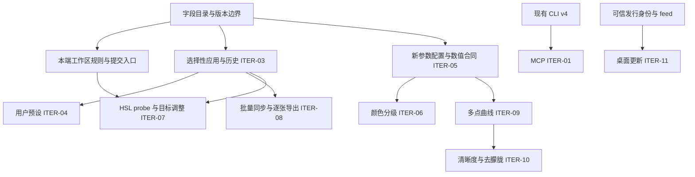

# 编辑迭代开发与验收总账

本轮覆盖第一阶段收尾、第二阶段全量及桌面更新，范围为 ITER-01～11。
用户已于 2026-10-21 要求启动开发，由本协调任务负责拆分、调度、复核和阶段集成。
不预设发布版本或日期；签名、发布、部署和后续 PR 合并按各自授权执行。

- 开发基线：`development@12cda1c67ddd1c58095831ff12a112fc1356da78`，已合入设计 PR [#105](https://github.com/dancancer/RawLab/pull/105)。
- 范围依据：[总需求](../../design/editing-iteration/requirements.md)、[总技术方案](../../design/editing-iteration/technical-design.md)。
- 工作区依据：[ITER-02 子需求](../../design/editor-workspace/requirements.md)、[技术子方案](../../design/editor-workspace/technical-design.md)、[r9 资产](../../design/editor-workspace/README.md)。
- 协作依据：[集成协作规范](../../process/integration-workflow.md)、[根项目约定](../../../AGENTS.md)。
- 首批执行：[首批实现计划](first-batch-plan.md)。后续批次在其前置明确后再写精确实施计划，不提前虚构跨端接口。

本文件是跨 PR 的依赖、owner 和验收索引。单个 PR 的命令输出、测量与复现过程写入对应 PR 说明；本轮结束后将总账移入 `docs/archive/`。

## 状态含义

`排队` → `接入核对` → `开发中` → `待独立复核` → `待集成` → `已集成` → `已验收`。
有前置未满足的项标注具体前置；不将其删出范围。代码、设计批准和验收分别记录。
浏览器设计测试不是原生实现证据，某端通过不能将整项标成已验收。

## 交付与依赖

| 批次 | 迭代项与交付 | 前置 | 当前状态 | 验收 |
| --- | --- | --- | --- | --- |
| I0 | 字段目录、身份/版本、兼容策略、共享文件 owner | 当前源码与需求核对 | 来源目录已复核；payload 编码/逐端 adapter 待冻结 | 来源/版本矩阵复核；payload 与 adapter 合同另设冻结门槛 |
| I1-MCP | ITER-01，本地 stdio 五工具，先服务既有 v4 CLI | CLI 协商、路径和子进程生命周期 | 本地实现与 Mac CLI 对照完成，待集成；Windows 待验收 | IT-01，真实 CLI/MCP 输出对照 |
| I1-UI | ITER-02，六组、范围重置、原生输入/草稿/查看、移动 RGB | 先完成 Mac S1 规则与候选；再接四端 | Mac S1 模型已实现并复核、待集成；事务/UI 和其他端排队 | AC-01～21、IT-02/16 |
| I2 | ITER-03，选择性复制/粘贴与会话历史 | I0 + 本端提交/草稿门控 | 排队 | IT-03/04/15 |
| I3-P | ITER-04，独立用户预设 | I2 的 prepare/commit/history | 排队 | IT-05/15 |
| I3-T | ITER-05，黑白场/鲜艳度与新字段端到端 | 版本化数值合同、固定质量集、CPU reference | 数值合同待冻结 | IT-06/15 |
| I4-G | ITER-06，三分区颜色分级 | I3-T 的新配置/数据链，单独质量准入 | 数值合同待冻结 | IT-07/15 |
| I4-H | ITER-07，HSL 真实像素 probe、坐标与目标手势 | I1-UI + 核心 probe 合同；提交接 I2 | 排队 | IT-08/15 |
| I4-B | ITER-08，集合、同步、单张微调、逐张冻结导出 | I2；不等待全部新算法 | 排队 | IT-09/10/15 |
| I5-Q | ITER-09，多点 PCHIP，保留 legacy S 曲线 | I3-T 的新参数配置、快照/Agent/导出接线 | 排队；合法性策略已明确 | IT-11/15 |
| I5-A | ITER-10，清晰度与去朦胧 | I5-Q 的配置/Agent 接口；各自数值合同、固定质量集、CPU reference | 数值合同待冻结 | IT-12/15 |
| IU | ITER-11，可信发行链、种子版、真实升级与恢复 | 两端发行身份、安装形态、可信 feed；真实发布另行授权 | 前置待核对 | IT-13/14 |
| IF | 同一集成源联合验收及发布源冻结 | 上述全部交付及逐端证据 | 未开始 | IT-01～16 + AC-01～21 |

I0 的来源目录退出条件是字段来源、单位/默认、格式版本事实和未决项均可追溯，并通过独立复核；它不等待整轮功能完成。payload 编码及逐端 adapter 的冻结是 I2 的单独前置，需以 recipe-active/未选字段向量证明唯一转换。IT-15/16 是 IF 的最终跨功能门槛，不作为来源目录的循环前置。

下图对应总技术方案的实施依赖；接口与数据的消费关系决定能否并行，不能仅按 ITER 编号启动任务。

共享接口的合入先于消费它的功能。构建/依赖、共享六语资源由下表指定的单一 owner 接入；首批 #108 由协调者在既有 CI 门槛内接入 MCP 协议测试及当前 Mac CLI 对照，没有共享资源变更。后续任务若新增此类依赖，必须先在本表登记对应 PR 和消费方，再开始跨端接入。

## 共享文件与当前 owner

owner 是当前阶段的唯一写入责任。未分派项由协调者保留写入权；子任务不得自行修改其他 owner 文件。

| 范围 | 当前 owner | 可写边界 | 交接规则 |
| --- | --- | --- | --- |
| 总账、批次计划、共享语义决定 | 协调者 | `docs/integration/editing-iteration/`；必要的规范勘误 | 决策关联需求/源码，修订后通知受影响执行者 |
| I0 字段目录 | 协调者；`field_contract` 来源核验 | `docs/design/editing-iteration/field-catalog.md` | 不新增通用 native DTO，不宣称尚未验证的跨端映射已冻结 |
| MCP v4 工具 | 协调者执行；`mcp_phase1` 接入核验 | `tools/mcp/` | CLI/C ABI 不改；协议缺口提交协调者另拆前置 |
| Mac S1 纯规则与候选 | 协调者执行；`workspace_s1` 接入核验 | Mac Adjustments 类型/模型、ControlGroupTests 及其必要 runner；Engine 仅调用共用 raster resolver | 本阶段不改 View、EditorModel、持久化格式、核心或共享资源 |
| 核心 C ABI / EditRecipe / CLI / schema | 协调者保留，按算法批次另派一个 owner | `lutools/include/sony2fuji/`、`src/ffi/`、`src/cli/`、对应核心/测试 | 新配置 additive；v5 真实贯通后才宣告支持 |
| 核心算法 / Metal / GLES / D3D11 | 协调者保留 | `lutools/src/core/`、对应后端 | CPU 合同与质量先准入，不能各后端并行猜常量 |
| iOS / Android / Windows 平台入口 | 各平台 owner 尚未激活 | 各端 editor、snapshot、storage、bridge、batch | S1 规则和交接接口稳定后按端派发 |
| 共享本地化与无障碍 keys | 协调者保留 | `Shared/strings/` 及生成入口 | 功能 owner 提交 key/参数需求，单一资源 owner 写入 |
| 构建、CI、公共依赖与许可证 | 协调者；首批 CI 接线在 #108 | 根构建、`lutools/CMakeLists.txt`、`.github/`、`scripts/ci/`、共享依赖 | 不由各功能分别改公共构建入口；#108 保留现有原生门槛并新增 MCP 验证 |

第一批分支：`feature/editing-iteration-coordination`、`feature/editing-mcp-v4`、`feature/editing-mac-workspace-rules`，均从上述基线创建独立 worktree。不存在把其他历史分支或降噪试验一起纳入本迭代的授权。

首批由当前协调任务负责实施交付、冲突处理和目标更新，表中的代理名只标识独立核验任务。合入顺序为 **#107 → #108 → #109**；#108 与 #109 没有运行时依赖，按此顺序逐项核验 CI 与目标状态。#109 合入后，Mac 提交事务接新 `development`；四端新 owner 在派发前绑定独占路径与对应 PR。未激活的 owner 不拥有并发写入权。

| 首批 PR | 交付范围 | 集成状态 |
| --- | --- | --- |
| [#107](https://github.com/dancancer/RawLab/pull/107) | 本总账、字段目录与首批计划 | 待集成；payload 编码与逐端 adapter 另行冻结 |
| [#108](https://github.com/dancancer/RawLab/pull/108) | MCP v4 五工具与本地兼容验证 | 待集成；Windows 实测仍待验收 |
| [#109](https://github.com/dancancer/RawLab/pull/109) | Mac S1 规则、完整重置候选与配方独立化 | 待集成；提交事务和 UI 在后续批次接入 |

## 集成门槛

1. 任务先给出消费/产出接口、独占文件、回归与实际平台范围；先证明失败，再实现最小变更。
2. 执行者交付 diff、验证结果及明确未覆盖项；协调者核验关键调用链，并安排独立的需求/代码复核。执行者自报完成不等于验收。
3. 同一共享文件同阶段只允许一个 owner；跨线改动通过协调者交接，不复制出另一套版本/转换规则。
4. PR 目标为 `development`，合入前核实 exact head/base、冲突、CI 与授权；本地通过不称作 Hosted CI 通过。
5. 前置合入后立即更新依赖分支并重验受影响组合，不留到最后大合并。共享分支不自行 rebase/force-push。
6. 只在单项 IT/AC 和全部适用平台证据成立后标记已验收。缺设备、GPU 或发行条件须保留明确缺口。

## 当前协调决定

- 首批将 MCP v4 与 Mac S1 并行：两者不写同一源码文件，不依赖新算法；Mac S1 提供规则参照，并非宣布 Mac 独有语义为跨端合同。
- I0 的版本/范围/单位需以真实 native 模型核对；已有 v4 仅作最终 core 语义参考，不直接成为剪贴板格式。
- 新参数处理顺序、identity bypass 和质量准入遵守总技术方案 8.1～8.7；候选公式不是冻结结果。
- 不改 r9 的 `approval` 或将整体 `implementation` 提前标为完成；首批纯模型接入也不是四端 UI 已落地。
- Mac 的既有 raster normalization 提取到 `Adjustments.resolvedForRaster`，`Engine` 和候选 core 校验共用；不复制第二套 WB/曝光规则，不改变持久化快照。
- MCP `validate_recipe` 保留 CLI 原始校验语义：引用文件可尚未存在、返回路径保持原表示；允许根限制仍适用。render/export 才要求实际输入和输出父目录存在。
- 本阶段不启用 updater、不签名、不生成发布标签、不上传安装包。

## 验收登记

当前没有整项 ITER 的四端验收通过项。首批 MCP 已完成 macOS 本地验证，Mac S1 只完成纯模型与调用接线验证；完整命令证据由对应实现 PR 登记。下列验收缺口继续保留：

- IT-01：五工具真实 stdio 调用、取消/超时、原子发布、路径边界、CLI/MCP 像素等价；Mac/Windows 分别记录。
- IT-02：AC-01～21 四端分列；模型、UI、RGB/图像与设备证据不能混为一类。
- IT-03～05、09～10：保存失败、部分成功、草稿、同名异身份、后续修改冲突、旧任务兼容。
- IT-06～08、11～12：数值合同/fixture hash、CPU reference、GPU Auto/Force、固定质量样本及 preview/FINAL 对照。
- IT-13～14：真实旧版→种子版→新版、可信包与数据恢复；仅模拟 adapter 不满足真实安装验收。
- IT-15～16：同一 source 上所有路径参数一致、旧格式/未来版本、六语、大字号、无障碍和原始文件只读。
