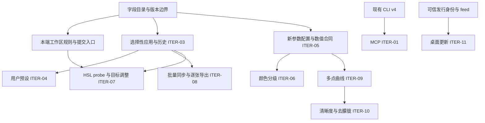

# 编辑迭代开发与验收总账

本轮覆盖第一阶段收尾、第二阶段全量及桌面更新，范围为 ITER-01～11。
用户已于 2026-10-21 要求启动开发，由本协调任务负责拆分、调度、复核和阶段集成。
不预设发布版本或日期；签名、发布、部署和后续 PR 合并按各自授权执行。

- 初始开发基线：`development@12cda1c67ddd1c58095831ff12a112fc1356da78`，已合入设计 PR [#105](https://github.com/dancancer/RawLab/pull/105)。
- 范围依据：[总需求](../../design/editing-iteration/requirements.md)、[总技术方案](../../design/editing-iteration/technical-design.md)。
- 工作区依据：[ITER-02 子需求](../../design/editor-workspace/requirements.md)、[技术子方案](../../design/editor-workspace/technical-design.md)、[r9 资产](../../design/editor-workspace/README.md)。
- 协作依据：[集成协作规范](../../process/integration-workflow.md)、[根项目约定](../../../AGENTS.md)。
- 第三批集成基线：`development@1031745c06968fa7d5ea7961f19f0eff002ad462`，已包含 #107～#118；各实现 PR 最新源提交均经独立评审和 CI 验证，远端 ancestry 已核实。[联合 CI](https://github.com/dancancer/RawLab/actions/runs/39617993292)已通过四端及汇总门禁，其范围限于工作流实际执行的套件。
- 第五批开发起点：`development@fcf90f0f2159c08caea55d86652bb82e6c8c46c7`，已包含 #106 的处理版本兼容契约及第四批 #119～#123；该源的[联合 CI](https://github.com/dancancer/RawLab/actions/runs/39736091998)最终 9 项成功。Android 首轮因 runner shutdown 中断，定向重跑通过，源码未改变。
- 第六批开发起点：`development@8f40dbcc688b87d7b05ee30092de3183aa4678c6`，第五批 #124～#128 已合入，最终源的[联合 CI](https://github.com/dancancer/RawLab/actions/runs/39774419810) 9 项成功；其范围限于实际执行的检查。
- 第六批收尾基线：本轮进行中 #129 合入 `development@4dfa8b3eb6e3de5d08f2afdbdfbbf15800a9e9ca`；四端同步后仅重验新核心及 iOS/Android 适配层影响的增量，既有 UI 证据按原源码与构建分别保留。
- 批次执行：[首批实现计划](first-batch-plan.md)、[第二批实现计划](second-batch-plan.md)、[第三批实现计划](third-batch-plan.md)、[第四批实现计划](fourth-batch-plan.md)、[第五批 S2b 计划](fifth-batch-plan.md)、[第六批 S3 计划](sixth-batch-plan.md)、[第七批 S4 计划](seventh-batch-plan.md)。S2a/S2b 已远端集成；S3 查看/对比/纯预览和 S4 RGB 已完成本地交付，设备与整体迭代验收边界分别保留。

本文件是跨 PR 的依赖、owner 和验收索引。单个 PR 的命令输出、测量与复现过程写入对应 PR 说明；本轮结束后将总账移入 `docs/archive/`。

## 状态含义

`排队` → `接入核对` → `开发中` → `待独立复核` → `待集成` → `已集成` → `已验收`。
有前置未满足的项标注具体前置；不将其删出范围。代码、设计批准和验收分别记录。
浏览器设计测试不是原生实现证据，某端通过不能将整项标成已验收。

## 交付与依赖

| 批次 | 迭代项与交付 | 前置 | 当前状态 | 验收 |
| --- | --- | --- | --- | --- |
| I0 | 字段目录、身份/版本、兼容策略、共享文件 owner | 当前源码与需求核对 | 来源目录已复核；选择性 payload v1 和四端 adapter 已按共享向量接入 | 来源/版本矩阵及 recipe-active/未选字段向量核验；新算法字段仍需独立合同 |
| I1-MCP | ITER-01，本地 stdio 五工具，先服务既有 v4 CLI | CLI 协商、路径和子进程生命周期 | 基础功能已集成；Mac/Windows 当前 CLI 本地对照与 Windows native 生命周期通过，补充实现 `b5d226d` 已本地集成，随阶段汇总 PR 交付 | IT-01，真实 CLI/MCP 输出对照 |
| I1-UI | ITER-02，六组、范围重置、原生输入/草稿/查看、移动 RGB | 先完成 Mac S1 规则与候选；再接四端 | S1/S2a/S2b 已集成，相关原生验证、独立复评和最终源联合 CI 完成，边界见对应批次；S3 四端实现、独立复评及约定原生增量已完成；S3/S4 本地交付见第六、七批索引，通过阶段汇总 PR 交付，尚未合入 `development` | AC-01～21、IT-02/16 |
| I2 | ITER-03，选择性复制/粘贴与会话历史 | I0 + 本端提交/草稿门控 | 四端实现、对应原生工作流和独立复核完成，随 draft [#134](https://github.com/dancancer/RawLab/pull/134) 待集成；实际验证与未覆盖项见 PR 和[接入计划](selective-transactions-plan.md) | IT-03/04；IT-15 仍属于跨功能联合门槛 |
| I3-P | ITER-04，独立用户预设 | I2 的 prepare/commit/history | 四端实现、共享格式复核和功能原生验证完成；用户要求解锁后统一补验 Mac 大字号，当前保留为本地依赖检查点；依赖 draft #134，见[预设接入计划](user-presets-plan.md)；尚未 push/提 PR | IT-05/15 |
| I3-T | ITER-05，黑白场/鲜艳度与新字段端到端 | 版本化数值合同、固定质量集、CPU reference | 数值合同、三后端和四端实现已接通，本地模型/native/构建检查完成；新工具实际 UI 按用户要求解锁后统一验收，见[接入计划](tone-controls-plan.md)；尚未 push/提 PR | IT-06/15，未关闭 |
| I4-G | ITER-06，三分区颜色分级 | I3-T 的新配置/数据链，单独质量准入 | 数值合同、三后端和四端数据链/色轮已接通，本地模型/native/构建检查及独立复核完成；实际 UI 待解锁后统一验收，见[接入计划](color-grading-plan.md)；尚未 push/提 PR | IT-07/15，未关闭 |
| I4-H | ITER-07，HSL 真实像素 probe、坐标与目标手势 | I1-UI + 核心 probe 合同；提交接 I2 | CPU probe 合同和四端接入已实现，本地模型/native/构建检查及独立复核完成；实际 UI 待解锁后统一验收，见[接入计划](hsl-target-plan.md)；尚未 push/提 PR | IT-08/15，未关闭 |
| I4-B | ITER-08，集合、同步、单张微调、逐张冻结导出 | I2；不等待全部新算法 | 四端集合/同步/微调与两次确认冻结已接入，模型和可执行的原生回归通过；实际界面待解锁后统一验收，见[接入计划](batch-selection-plan.md)；尚未 push/提 PR | IT-09/10/15，未关闭 |
| I5-Q | ITER-09，多点 PCHIP，保留 legacy S 曲线 | I3-T 的新参数配置、快照/Agent/导出接线 | 排队；合法性策略已明确 | IT-11/15 |
| I5-A | ITER-10，清晰度与去朦胧 | I5-Q 的配置/Agent 接口；各自数值合同、固定质量集、CPU reference | 数值合同待冻结 | IT-12/15 |
| IU | ITER-11，可信发行链、种子版、真实升级与恢复 | 两端发行身份、安装形态、可信 feed；真实发布另行授权 | 前置待核对 | IT-13/14 |
| IF | 同一集成源联合验收及发布源冻结 | 上述全部交付及逐端证据 | 未开始 | IT-01～16 + AC-01～21 |

I0 的来源目录退出条件是字段来源、单位/默认、格式版本事实和未决项均可追溯，并通过独立复核；它不等待整轮功能完成。payload 编码及逐端 adapter 的冻结是 I2 的单独前置，需以 recipe-active/未选字段向量证明唯一转换。IT-15/16 是 IF 的最终跨功能门槛，不作为来源目录的循环前置。

下图对应总技术方案的实施依赖；接口与数据的消费关系决定能否并行，不能仅按 ITER 编号启动任务。

共享接口的合入先于消费它的功能。构建/依赖、共享六语资源由下表指定的单一 owner 接入；首批 #108 由协调者在既有 CI 门槛内接入 MCP 协议测试及当前 Mac CLI 对照，没有共享资源变更。后续任务若新增此类依赖，必须先在本表登记对应 PR 和消费方，再开始跨端接入。

## 共享文件与当前 owner

owner 是当前阶段的唯一写入责任。未分派项由协调者保留写入权；子任务不得自行修改其他 owner 文件。

| 范围 | 当前 owner | 可写边界 | 交接规则 |
| --- | --- | --- | --- |
| 总账、批次计划、共享语义决定 | 协调者 | `docs/integration/editing-iteration/`；必要的规范勘误 | 决策关联需求/源码，修订后通知受影响执行者 |
| I0 字段目录 | 协调者；`field_contract` 来源核验 | `docs/design/editing-iteration/field-catalog.md` | 不新增通用 native DTO，不宣称尚未验证的跨端映射已冻结 |
| MCP v4 工具 | 协调者执行；`mcp_phase1` 接入核验 | `tools/mcp/` | CLI/C ABI 不改；协议缺口提交协调者另拆前置 |
| Mac S1、事务与本批 UI | Mac workspace worker；默认代理独立核验 | 第六批 T1：Editor 查看状态、PhotoCanvas、MacCanvasInput、查看/预览状态及 tests | 保留既有事务与 processing identity；不把模型完成当 UI 验收 |
| 核心 C ABI / EditRecipe / CLI / schema | 协调者保留，按算法批次另派一个 owner | `lutools/include/sony2fuji/`、`src/ffi/`、`src/cli/`、对应核心/测试 | 新配置 additive；#106 已接入含 processing 的 v5，后续新字段另按真实链路声明支持 |
| 核心算法 / Metal / GLES / D3D11 | 协调者保留 | `lutools/src/core/`、对应后端 | CPU 合同与质量先准入，不能各后端并行猜常量 |
| iOS 事务与本批 UI | iOS workspace worker；默认代理独立核验 | 第六批 T2：ZoomablePhoto、ContentView 查看/纯预览接线与受影响 model/UI tests | ContentView 保持 settings owner；保存成功后才提交草稿，精确保留记录 metadata，不改 codec |
| Android 事务与本批 UI | Android workspace worker；默认代理独立核验 | 第六批 T3：PhotoCanvas/PhotoZoom、Editor 查看/纯预览、reference cache 与 JVM/instrumentation | 保留工具 ID/JNI/codec；分开 draft-ready 与 changed Apply，真实 WB metadata 不因去重丢失 |
| Windows 事务与本批 UI | Windows workspace worker；默认代理独立核验 | 第六批 T4：PhotoCanvas、MainWindow 查看/参考/取消接线与 managed/WPF 回归 | 保留 save-first 和同 dialog retry；不改 JSON/Library 批量复制 |
| 共享本地化与无障碍 keys | 协调者保留 | `Shared/strings/` 及生成入口 | 功能 owner 提交 key/参数需求，单一资源 owner 写入 |
| 构建、CI、公共依赖与许可证 | 协调者；第五批 CI 绑定基础分支 | 根构建、`lutools/CMakeLists.txt`、`.github/`、`scripts/ci/`、共享依赖 | #108 的 MCP、#112 的 iOS 模型检查已集成；第三批已将 Windows transform-ui 加入门禁；第四批增加现有工作区及本地化 UI 入口和截图产物；第五批补 Mac parameter-value 与 iOS adjustment-scale 现有 runner，不降低既有检查 |

第一批分支：`feature/editing-iteration-coordination`、`feature/editing-mcp-v4`、`feature/editing-mac-workspace-rules`，均从初始开发基线创建独立 worktree。不存在把其他历史分支或降噪试验一起纳入本迭代的授权。

首批由协调线程实施，默认代理负责独立核验，已按 **#107 → #108 → #109** 合入；#108 与 #109 没有运行时依赖。第二批由 worker 分端实施，默认代理独立核验，协调线程处理共享文档、CI、冲突和最终验证。Mac 提交事务及其余三端均接合入后的 `development`，每个 owner 在派发前绑定独占路径。第二批 owner 和独占路径见上表及第二批计划，不拥有表外并发写入权。

第二批分支：`feature/editing-native-models-coordination`、`feature/editing-mac-reset-transactions`、`feature/editing-ios-reset-rules`、`feature/editing-android-reset-rules`、`feature/editing-windows-reset-rules`，创建基线为 `361c9949`。已按 **#110 → #111 → #112 → #113 → #114** 合入；每个源提交均经独立复核和 CI 验证。Mac 已覆盖本端构建与真实 DNG 草稿运行；iOS CI 编译 app/tests 并执行模型检查，Android CI 构建/JVM/lint/测试 APK，Windows CI 构建并运行选定 native/WPF/managed 套件。上述证据不等于三端新增事务、四端六组 UI 或设备/GPU 验收。

第三批复用干净独立 worktree，从 `bff2b860` 创建四个分支，已按 **#115 → #116 → #117 → #118** 合入。iOS 真实 simulator、Android 标准素材 instrumentation、Windows 实际 WPF/native 回归已通过；对应源与最终集成源 CI 均已通过。验证细节留在各 PR，设备/GPU缺口继续保留。

第四批从最新 `0fd52624` 创建基础资源分支及四端消费者分支，复用同一批干净 worktree。协调者独占共享六语/CI/总账，平台 worker 各自拥有第四批计划列出的UI和窄模型接线，默认代理独立评审。各消费者显式合入同一基础资源提交；远端先合入基础PR，再更新消费者并核验受影响组合。四端本地实现与独立复评已完成，Mac/iOS/Android 的实际界面及事务验证通过；Windows managed/WPF 构建、实际重置/草稿回归及六语两尺寸布局/截图已通过；长语言大字号下的零参数视口和窄窗直方图文字裁切已修复并独立复评。用户已于 2026-10-22 授权按基础资源→四端消费者顺序 push、创建五个 PR；各 PR 最新源提交的独立评审和 CI 全部通过（包括 Windows 实际 WPF 与截图）后，按顺序合入 development 并核实联合 CI。五个 PR 已建立；最新源的检查、合入和目标分支联合 CI 记录以对应 PR 与 Actions 为准。

第四批已按 **#119 → #120 → #121 → #122 → #123** 合入，最终源为 `fcf90f0f`。第五批继续由原四端 owner 负责各自输入 UI，协调者负责共享六语、CI 入口和总账，独占路径见第五批计划。消费者正式 CI 等共享前置合入后再启动；未合入依赖时保持 draft。实际 Windows 验证在本地交付阶段完成，不延迟到远端 CI 才首次验证。原生验证以 source/configuration 为边界，零源码变化的同步只做增量绑定，不重复全套实验。

第五批交付索引（2026-10-22）：四端本地实现消费同一资源基础 `08e275cb`，下表保留已验证的本地实现提交。用户已授权 push、建立五个目标为 `development` 的 PR、依次合入共享基础与各自验证通过的消费者，再核实最终联合 CI。五个 PR 已建立；消费者在基础合入后同步实际目标，源码不变的本地原生证据继续有效。各 PR 的当前 head、独立复评、合入与最终 CI 结果以其说明和 Actions 为准。

| 第五批 PR 与交付 | 本地实现提交 | 已有证据与保留边界 |
| --- | --- | --- |
| [#124](https://github.com/dancancer/RawLab/pull/124) 共享资源、CI 入口与协调 | `920f874e`，包含 `2d8c1f46`、`08e275cb` | 六语生成、占位符与 CI policy/actionlint 本地通过；消费者无共享文件重叠 |
| [#125](https://github.com/dancancer/RawLab/pull/125) Mac 参数输入 | `d15db205`；静态 reset 契约补正 `a38f6595` | 本批原生界面、模型/输入与六语布局验证及独立复评完成 |
| [#126](https://github.com/dancancer/RawLab/pull/126) iOS 参数输入 | `f52eac9b` | 本批 iPhone/iPad 模拟器验证及独立复评完成；额外 PhotoWorkflow 停在胶片横屏位置断言，后续返回/导出未到达，未据此判定本批产品回归 |
| [#127](https://github.com/dancancer/RawLab/pull/127) Android 参数输入 | `8f7fef0c` | 本批私有模拟器、实际 RAW、布局/旋转与独立复评完成；真实 TalkBack 与硬件 GPU 未验证 |
| [#128](https://github.com/dancancer/RawLab/pull/128) Windows 参数输入与本交付索引 | `a17d9551` | 本批实际 WPF/鼠标、六语布局与独立复评完成；额外默认 native 套件的镜头候选检查未通过，宽窗包含离屏 composition 验证 |

各平台证据按实际源码、构建和执行批次分别归属，不拼成一个 binary 的全量通过。移动真机、实际读屏和硬件 GPU 仍需后续验收。上表记录 S2b 的交付与既有验证边界；远端集成结果由链接的 PR/Actions 留存，S3/S4 及全工作流联合验收继续独立登记。

第六批 S3 本地交付索引（2026-10-23）：四端均包含收尾基线 `4dfa8b3e`，共用资源提交 `4745b24b`，由协调 merge `5eaff75c` 接入新核心。独立复评与原生证据按实际 source/configuration 分层保留；新核心只重验受影响组合，没有重跑 S2b 全矩阵。当前未 push、未建立 S3 PR，也没有 S3 Hosted CI 通过声明。

| 第六批交付 | 本地提交 | 当前证据与边界 |
| --- | --- | --- |
| 共享六语与协调 | `4745b24b`、`5eaff75c`；本索引提交由 Git 历史定位 | 共享资源生成/校验通过；四端消费同一资源基础，没有共享文件并发改写 |
| Mac 查看/对比 | `f43b7590` | 本地实现、独立复评、实际键鼠/菜单/六语及新核心 RAW/raster 增量完成；真实 VoiceOver 与更多硬件键盘布局未验证 |
| iOS 查看/对比/纯预览 | `f986bb4c` | iPhone/iPad 模拟器、纯预览视口、草稿/导入守卫、六语与最终标签避线增量完成；真机及真实 VoiceOver 未验证 |
| Android 查看/对比/纯预览 | `28c8be50` | 私有模拟器的跨 pane 手势、Back/后台、RAW/raster/retry、六语及短横屏标签增量完成；真机、TalkBack 与硬件 GPU 未验证 |
| Windows 查看/对比 | `06899f4` | 主验收集、六语、标签、Transform、外观、真实键鼠取消及外部 UIA 切图/重开/重启链完成；IME 与窗口外松键后的恢复问题已修复并复评；宽窗含离屏 composition，真实读屏与硬件 GPU 未验证 |

S3 的本地交付不等于 S4 RGB、四端真机/读屏/GPU 或整项 ITER 的联合验收。不同批次、二进制与原生核心的证据分别归属，不能合称单个最终包的全量通过；远端交付方式仍见第六批计划中的待定方案。

第七批 S4 交付索引（2026-10-23）：四端 RGB 统计及受影响工作流已完成本地实现、独立复评和原生回归，已合入 `feature/editing-rgb-integration`；具体提交和平台边界见[第七批计划](seventh-batch-plan.md#本地交付索引)。Windows MCP 平台验证也已补齐并本地集成，见下段；I2 及后续批次仍按依赖排队。

远端交付方式（2026-10-23）：用户已授权先汇总全部已完成提交，再由 `feature/editing-rgb-integration` 统一向 `development` 提 PR。四端 S3/S4、共享资源和 MCP 补充均已进入该分支；仅此聚合 PR 运行现有受影响平台矩阵。PR 的实时 head/base、检查和后续合入状态以 GitHub 为准；本次授权不包含聚合 PR 合入或发布。

MCP 平台补充交付（2026-10-23）：`feature/editing-mcp-windows-validation@b5d226d` 已本地集成。Windows 与 Mac 均以当前 CLI 运行完整 43 项测试且无跳过，Windows 另验证真实 RAW 处理中的取消与超时。最小生产修复使未配对 Unicode 代理字符跨平台统一返回 `invalid_argument`；测试夹具保留直接子进程语义，符号链接路径按实际系统与 CLI 对照。独立复评无遗留问题；运行证据按当前源码、CLI 和配置绑定，本地结果不称为 Hosted CI 通过。

| 首批 PR | 交付范围 | 集成状态 |
| --- | --- | --- |
| [#107](https://github.com/dancancer/RawLab/pull/107) | 本总账、字段目录与首批计划 | 已集成；payload 编码与逐端 adapter 另行冻结 |
| [#108](https://github.com/dancancer/RawLab/pull/108) | MCP v4 五工具与本地兼容验证 | 基础功能已集成；Windows 补充实现与本地实测见 `b5d226d`，随阶段汇总 PR 交付 |
| [#109](https://github.com/dancancer/RawLab/pull/109) | Mac S1 规则、完整重置候选与配方独立化 | 已集成；第二批接提交事务，UI 仍待接入 |

| 第二批 PR | 交付范围 | 集成状态 |
| --- | --- | --- |
| [#110](https://github.com/dancancer/RawLab/pull/110) | 第二批协调与字段来源固定 | 已集成，merge `df07d068` |
| [#111](https://github.com/dancancer/RawLab/pull/111) | Mac prepared reset 提交与 stale-state 守卫 | 已集成，merge `ef8c657b`；新 model 回归在 arm64/all，Intel 编译及 core/render 通过 |
| [#112](https://github.com/dancancer/RawLab/pull/112) | iOS S1 与现有模型 runner 接 CI | 已集成，merge `01889c77`；提交事务/真实 UI 回归由第三批补齐 |
| [#113](https://github.com/dancancer/RawLab/pull/113) | Android S1 规则与候选 | 已集成，merge `2c3a2d90`；提交事务/真实 instrumentation 由第三批补齐 |
| [#114](https://github.com/dancancer/RawLab/pull/114) | Windows S1 规则与候选 | 已集成，merge `bff2b860`；草稿保存失败 WPF 回归由第三批补齐 |

| 第三批 PR | 交付范围 | 集成状态 |
| --- | --- | --- |
| [#115](https://github.com/dancancer/RawLab/pull/115) | 三端事务协调与边界 | 已集成，merge `5c673dfc` |
| [#116](https://github.com/dancancer/RawLab/pull/116) | iOS reset/draft/source 事务 | 已集成，merge `d81ee6db` |
| [#117](https://github.com/dancancer/RawLab/pull/117) | Android reset/draft/receipt 事务 | 已集成，merge `9ec25efd` |
| [#118](https://github.com/dancancer/RawLab/pull/118) | Windows reset/draft 事务与实际 WPF 门禁 | 已集成，merge `1031745c` |

| 第四批 PR | 交付范围 | 验收边界 |
| --- | --- | --- |
| [#119](https://github.com/dancancer/RawLab/pull/119) | 六语资源、CI 入口与协作契约 | 基础资源先集成，消费者显式更新基线 |
| [#120](https://github.com/dancancer/RawLab/pull/120) | Mac 六组与范围重置 | 原生交互、模型、固定布局与六语截图通过 |
| [#121](https://github.com/dancancer/RawLab/pull/121) | iOS 六组与范围重置 | iPhone/iPad 模拟器交互及草稿回归通过，真机另列 |
| [#122](https://github.com/dancancer/RawLab/pull/122) | Android 六组与范围重置 | 实际 Compose/VM 回归、长语言/大字与末项可达性通过 |
| [#123](https://github.com/dancancer/RawLab/pull/123) | Windows 六组与范围重置 | 实际 WPF 与六语布局/截图通过；1440 宽窗为离屏内容合成，DPI/无障碍服务/硬件 GPU 另列 |

## 集成门槛

1. 任务先给出消费/产出接口、独占文件、回归与实际平台范围；先证明失败，再实现最小变更。
2. 执行者交付 diff、验证结果及明确未覆盖项；协调者核验关键调用链，并安排独立的需求/代码复核。执行者自报完成不等于验收。
3. 同一共享文件同阶段只允许一个 owner；跨线改动通过协调者交接，不复制出另一套版本/转换规则。
4. PR 目标为 `development`，合入前核实 exact head/base、冲突、CI 与授权；本地通过不称作 Hosted CI 通过。
5. 前置合入后立即更新依赖分支并重验受影响组合，不留到最后大合并。共享分支不自行 rebase/force-push。
6. 只在单项 IT/AC 和全部适用平台证据成立后标记已验收。缺设备、GPU 或发行条件须保留明确缺口。

## 当前协调决定

- 首批将 MCP v4 与 Mac S1 并行：两者不写同一源码文件，不依赖新算法；Mac S1 提供规则参照，并非宣布 Mac 独有语义为跨端合同。
- I0 的版本/范围/单位需以真实 native 模型核对；已有 v4 仅作最终 core 语义参考，不直接成为剪贴板格式。
- 新参数处理顺序、identity bypass 和质量准入遵守总技术方案 8.1～8.7；候选公式不是冻结结果。
- 第四批四端 17 工具六组导航/范围重置和第五批 S2b 输入均已集成；第六批 S3 与第七批 S4 已完成本地实现及约定回归，远端交付和保留的设备验收分别登记。
- 三端当前保存均同步执行；第三批保留该串行实现，以可返回成功/失败的候选保存边界满足草稿事务。普通重置沿原一次编辑入口，不能与草稿 save-first 混为同一策略。
- Android 的裁切/比例 ready 与可应用 changed 分开；reset/draft 只去除完全相同的重复保存，预览实际补入的 WB metadata 仍保存。
- Windows 旧目录应用已复用 I2 的 capture/prepare/CAS/history，并在异步枚举与预检前后检查 source/open/edit revision；ITER-08 集合同步额外冻结稳定来源身份，在 prepare/写入时拒绝来源与重复物理目标。历史基线中的缺少 source/edit guard 不再代表当前实现。
- 不改 r9 的 `approval` 或将整体 `implementation` 提前标为完成；首批纯模型接入也不是四端 UI 已落地。
- Mac 的既有 raster normalization 提取到 `Adjustments.resolvedForRaster`，`Engine` 和候选 core 校验共用；不复制第二套 WB/曝光规则，不改变持久化快照。
- MCP `validate_recipe` 保留 CLI 原始校验语义：引用文件可尚未存在、返回路径保持原表示；允许根限制仍适用。render/export 才要求实际输入和输出父目录存在。
- 本阶段不启用 updater、不做发行签名、不生成发布标签、不上传安装包。现有本地构建的 ad-hoc 签名不代表发布授权。

## 验收登记

ITER-02 及后续项尚未完成整项四端联合验收。MCP 已有 macOS 本地及 ARM/Intel Hosted CI 证据；本轮补齐 Windows 本地验证并对当前 Mac CLI 复验，Hosted CI 证据仍以对应远端源为准。下列验收项按已执行范围和保留缺口分别登记：

- IT-01：Mac/Windows 五工具真实 stdio、v4/v5 配方及像素等价、路径边界和无覆盖发布已本地验证；Windows native 取消/超时、进程退出及清理已补齐。Windows Hosted CI 尚未接入 MCP，当前补充提交随阶段汇总 PR 交付。
- IT-02：AC-01～21 四端分列；模型、UI、RGB/图像与设备证据不能混为一类。
- IT-03～05、09～10：保存失败、部分成功、草稿、同名异身份、后续修改冲突、旧任务兼容。
- IT-06～08、11～12：数值合同/fixture hash、CPU reference、GPU Auto/Force、固定质量样本及 preview/FINAL 对照。
- IT-13～14：真实旧版→种子版→新版、可信包与数据恢复；仅模拟 adapter 不满足真实安装验收。
- IT-15～16：同一 source 上所有路径参数一致、旧格式/未来版本、六语、大字号、无障碍和原始文件只读。
