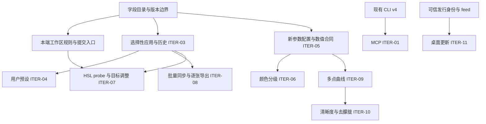

# 编辑迭代开发与验收总账

本轮覆盖第一阶段收尾、第二阶段全量及桌面更新，范围为 ITER-01～11。
用户已于 2026-10-21 要求启动开发，由本协调任务负责拆分、调度、复核和阶段集成。
不预设发布版本或日期；签名、发布、部署和后续 PR 合并按各自授权执行。

- 初始开发基线：`development@12cda1c67ddd1c58095831ff12a112fc1356da78`，已合入设计 PR [#105](https://github.com/dancancer/RawLab/pull/105)。
- 范围依据：[总需求](../../design/editing-iteration/requirements.md)、[总技术方案](../../design/editing-iteration/technical-design.md)。
- 工作区依据：[ITER-02 子需求](../../design/editor-workspace/requirements.md)、[技术子方案](../../design/editor-workspace/technical-design.md)、[r9 资产](../../design/editor-workspace/README.md)。
- 协作依据：[集成协作规范](../../process/integration-workflow.md)、[根项目约定](../../../AGENTS.md)。
- 当前集成基线：`development@bff2b8602b913a08676e04ab7f1109a148f68834`，已包含 #107～#114；各实现 PR 最新源提交均经独立评审和 CI 验证，远端 ancestry 已核实。该合入源的[联合 CI](https://github.com/dancancer/RawLab/actions/runs/39604481132)已通过四端及汇总门禁；其范围仍限于工作流实际执行的套件。
- 批次执行：[首批实现计划](first-batch-plan.md)、[第二批实现计划](second-batch-plan.md)、[第三批实现计划](third-batch-plan.md)。第二批已集成 Mac 提交事务及 iOS/Android/Windows S1 纯规则；第三批接三端提交与草稿保存事务，原生六组 UI 继续单独验收。

本文件是跨 PR 的依赖、owner 和验收索引。单个 PR 的命令输出、测量与复现过程写入对应 PR 说明；本轮结束后将总账移入 `docs/archive/`。

## 状态含义

`排队` → `接入核对` → `开发中` → `待独立复核` → `待集成` → `已集成` → `已验收`。
有前置未满足的项标注具体前置；不将其删出范围。代码、设计批准和验收分别记录。
浏览器设计测试不是原生实现证据，某端通过不能将整项标成已验收。

## 交付与依赖

| 批次 | 迭代项与交付 | 前置 | 当前状态 | 验收 |
| --- | --- | --- | --- | --- |
| I0 | 字段目录、身份/版本、兼容策略、共享文件 owner | 当前源码与需求核对 | 来源目录已复核；payload 编码/逐端 adapter 待冻结 | 来源/版本矩阵复核；payload 与 adapter 合同另设冻结门槛 |
| I1-MCP | ITER-01，本地 stdio 五工具，先服务既有 v4 CLI | CLI 协商、路径和子进程生命周期 | 已集成；ARM/Intel Mac 当前 CLI 对照通过，Windows MCP 实测待验收 | IT-01，真实 CLI/MCP 输出对照 |
| I1-UI | ITER-02，六组、范围重置、原生输入/草稿/查看、移动 RGB | 先完成 Mac S1 规则与候选；再接四端 | 四端 S1 与 Mac 提交事务已集成；第三批三端提交/草稿事务已完成本地验证与独立复核、待集成；六组 UI 待接入 | AC-01～21、IT-02/16 |
| I2 | ITER-03，选择性复制/粘贴与会话历史 | I0 + 本端提交/草稿门控 | 排队 | IT-03/04/15 |
| I3-P | ITER-04，独立用户预设 | I2 的 prepare/commit/history | 排队 | IT-05/15 |
| I3-T | ITER-05，黑白场/鲜艳度与新字段端到端 | 版本化数值合同、固定质量集、CPU reference | 数值合同待冻结 | IT-06/15 |
| I4-G | ITER-06，三分区颜色分级 | I3-T 的新配置/数据链，单独质量准入 | 数值合同待冻结 | IT-07/15 |
| I4-H | ITER-07，HSL 真实像素 probe、坐标与目标手势 | I1-UI + 核心 probe 合同；提交接 I2 | 排队 | IT-08/15 |
| I4-B | ITER-08，集合、同步、单张微调、逐张冻结导出 | I2；不等待全部新算法 | 排队 | IT-09/10/15 |
| I5-Q | ITER-09，多点 PCHIP，保留 legacy S 曲线 | I3-T 的新参数配置、快照/Agent/导出接线 | 排队；合法性策略已明确 | IT-11/15 |
| I5-A | ITER-10，清晰度与去朦胧 | I5-Q 的配置/Agent 接口；各自数值合同、固定质量集、CPU reference | 数值合同待冻结 | IT-12/15 |
| IU | ITER-11，可信发行链、种子版、真实升级与恢复 | 两端发行身份、安装形态、可信 feed；真实发布另行授权 | 前置待核对 | IT-13/14 |
| IF | 同一集成源联合验收及发布源冻结 | 上述全部交付及逐端证据 | 未开始 | IT-01～16 + AC-01～21 |

I0 的来源目录退出条件是字段来源、单位/默认、格式版本事实和未决项均可追溯，并通过独立复核；它不等待整轮功能完成。payload 编码及逐端 adapter 的冻结是 I2 的单独前置，需以 recipe-active/未选字段向量证明唯一转换。IT-15/16 是 IF 的最终跨功能门槛，不作为来源目录的循环前置。

下图对应总技术方案的实施依赖；接口与数据的消费关系决定能否并行，不能仅按 ITER 编号启动任务。

共享接口的合入先于消费它的功能。构建/依赖、共享六语资源由下表指定的单一 owner 接入；首批 #108 由协调者在既有 CI 门槛内接入 MCP 协议测试及当前 Mac CLI 对照，没有共享资源变更。后续任务若新增此类依赖，必须先在本表登记对应 PR 和消费方，再开始跨端接入。

## 共享文件与当前 owner

owner 是当前阶段的唯一写入责任。未分派项由协调者保留写入权；子任务不得自行修改其他 owner 文件。

| 范围 | 当前 owner | 可写边界 | 交接规则 |
| --- | --- | --- | --- |
| 总账、批次计划、共享语义决定 | 协调者 | `docs/integration/editing-iteration/`；必要的规范勘误 | 决策关联需求/源码，修订后通知受影响执行者 |
| I0 字段目录 | 协调者；`field_contract` 来源核验 | `docs/design/editing-iteration/field-catalog.md` | 不新增通用 native DTO，不宣称尚未验证的跨端映射已冻结 |
| MCP v4 工具 | 协调者执行；`mcp_phase1` 接入核验 | `tools/mcp/` | CLI/C ABI 不改；协议缺口提交协调者另拆前置 |
| Mac S1 与提交事务 | 已集成；协调者维护，原实现 `mac_reset_transactions` | `EditorModel.swift`、`EditorModel+Workflow.swift`、`EditorModel+Geometry.swift`、`EditModelTests.swift` | 后续 UI owner 另行交接；不把模型完成当 UI 验收 |
| 核心 C ABI / EditRecipe / CLI / schema | 协调者保留，按算法批次另派一个 owner | `lutools/include/sony2fuji/`、`src/ffi/`、`src/cli/`、对应核心/测试 | 新配置 additive；v5 真实贯通后才宣告支持 |
| 核心算法 / Metal / GLES / D3D11 | 协调者保留 | `lutools/src/core/`、对应后端 | CPU 合同与质量先准入，不能各后端并行猜常量 |
| iOS 提交与草稿保存 | `ios_reset_transactions` worker；默认代理独立核验 | 第三批 Task 1 的 VM/IO、ContentView/EditorDrafts 窄适配、project 注册及现有模型/真实 UI harness | ContentView 保持 settings owner；保存成功后才提交草稿，精确保留记录 metadata，不改 codec |
| Android 提交与草稿保存 | `android_reset_transactions` worker；默认代理独立核验 | 第三批 Task 2 的 editor state/VM/draft、现有 UI 回调及 JVM/instrumentation | 保留工具 ID/JNI/codec；分开 draft-ready 与 changed Apply，真实 WB metadata 不因去重丢失 |
| Windows 提交与草稿保存 | `windows_reset_transactions` worker；默认代理独立核验 | 第三批 Task 3 的 EditWorkflow/Transform、纯事务与 managed/WPF 回归 | 先保存候选再清草稿；不改旧 reset UI/JSON/Library 批量复制 |
| 共享本地化与无障碍 keys | 协调者保留 | `Shared/strings/` 及生成入口 | 功能 owner 提交 key/参数需求，单一资源 owner 写入 |
| 构建、CI、公共依赖与许可证 | 协调者；第三批 CI 绑定 Windows 分支 | 根构建、`lutools/CMakeLists.txt`、`.github/`、`scripts/ci/`、共享依赖 | #108 的 MCP、#112 的 iOS 模型检查已集成；第三批将现有 Windows transform-ui 加入门禁，不降低既有检查 |

第一批分支：`feature/editing-iteration-coordination`、`feature/editing-mcp-v4`、`feature/editing-mac-workspace-rules`，均从初始开发基线创建独立 worktree。不存在把其他历史分支或降噪试验一起纳入本迭代的授权。

首批由协调线程实施，默认代理负责独立核验，已按 **#107 → #108 → #109** 合入；#108 与 #109 没有运行时依赖。第二批由 worker 分端实施，默认代理独立核验，协调线程处理共享文档、CI、冲突和最终验证。Mac 提交事务及其余三端均接合入后的 `development`，每个 owner 在派发前绑定独占路径。第二批 owner 和独占路径见上表及第二批计划，不拥有表外并发写入权。

第二批分支：`feature/editing-native-models-coordination`、`feature/editing-mac-reset-transactions`、`feature/editing-ios-reset-rules`、`feature/editing-android-reset-rules`、`feature/editing-windows-reset-rules`，创建基线为 `361c9949`。已按 **#110 → #111 → #112 → #113 → #114** 合入；每个源提交均经独立复核和 CI 验证。Mac 已覆盖本端构建与真实 DNG 草稿运行；iOS CI 编译 app/tests 并执行模型检查，Android CI 构建/JVM/lint/测试 APK，Windows CI 构建并运行选定 native/WPF/managed 套件。上述证据不等于三端新增事务、四端六组 UI 或设备/GPU 验收。

第三批复用本任务已合入且干净的独立 worktree，从 `bff2b860` 新建 `feature/editing-native-transactions-coordination`、`feature/editing-ios-reset-transactions`、`feature/editing-android-reset-transactions`、`feature/editing-windows-reset-transactions`。平台 worker 实施、默认代理独立核验均已完成，协调者已复核关键调用链和最终源码对应的本地结果。iOS 真实 simulator 和 Android 约定素材的实际 instrumentation 已通过；Windows 目前为 managed 运行及 WPF 交叉编译，真实 WPF/native 仍待 CI。各提交与缺口见第三批计划。第二批的远端授权不自动扩展到第三批；第三批尚未 push/新建 PR，远端授权另行处理。

| 首批 PR | 交付范围 | 集成状态 |
| --- | --- | --- |
| [#107](https://github.com/dancancer/RawLab/pull/107) | 本总账、字段目录与首批计划 | 已集成；payload 编码与逐端 adapter 另行冻结 |
| [#108](https://github.com/dancancer/RawLab/pull/108) | MCP v4 五工具与本地兼容验证 | 已集成；Mac 当前源码 CLI 对照通过，Windows MCP 实测仍待验收 |
| [#109](https://github.com/dancancer/RawLab/pull/109) | Mac S1 规则、完整重置候选与配方独立化 | 已集成；第二批接提交事务，UI 仍待接入 |

| 第二批 PR | 交付范围 | 集成状态 |
| --- | --- | --- |
| [#110](https://github.com/dancancer/RawLab/pull/110) | 第二批协调与字段来源固定 | 已集成，merge `df07d068` |
| [#111](https://github.com/dancancer/RawLab/pull/111) | Mac prepared reset 提交与 stale-state 守卫 | 已集成，merge `ef8c657b`；新 model 回归在 arm64/all，Intel 编译及 core/render 通过 |
| [#112](https://github.com/dancancer/RawLab/pull/112) | iOS S1 与现有模型 runner 接 CI | 已集成，merge `01889c77`；提交事务/真实 UI 回归由第三批补齐 |
| [#113](https://github.com/dancancer/RawLab/pull/113) | Android S1 规则与候选 | 已集成，merge `2c3a2d90`；提交事务/真实 instrumentation 由第三批补齐 |
| [#114](https://github.com/dancancer/RawLab/pull/114) | Windows S1 规则与候选 | 已集成，merge `bff2b860`；草稿保存失败 WPF 回归由第三批补齐 |

## 集成门槛

1. 任务先给出消费/产出接口、独占文件、回归与实际平台范围；先证明失败，再实现最小变更。
2. 执行者交付 diff、验证结果及明确未覆盖项；协调者核验关键调用链，并安排独立的需求/代码复核。执行者自报完成不等于验收。
3. 同一共享文件同阶段只允许一个 owner；跨线改动通过协调者交接，不复制出另一套版本/转换规则。
4. PR 目标为 `development`，合入前核实 exact head/base、冲突、CI 与授权；本地通过不称作 Hosted CI 通过。
5. 前置合入后立即更新依赖分支并重验受影响组合，不留到最后大合并。共享分支不自行 rebase/force-push。
6. 只在单项 IT/AC 和全部适用平台证据成立后标记已验收。缺设备、GPU 或发行条件须保留明确缺口。

## 当前协调决定

- 首批将 MCP v4 与 Mac S1 并行：两者不写同一源码文件，不依赖新算法；Mac S1 提供规则参照，并非宣布 Mac 独有语义为跨端合同。
- I0 的版本/范围/单位需以真实 native 模型核对；已有 v4 仅作最终 core 语义参考，不直接成为剪贴板格式。
- 新参数处理顺序、identity bypass 和质量准入遵守总技术方案 8.1～8.7；候选公式不是冻结结果。
- Mac 的工具到六组映射仍随原生 UI 批次接入；第二批 Mac 只交付提交事务，不将现有旧八组视作新导航实现。
- 三端当前保存均同步执行；第三批保留该串行实现，以可返回成功/失败的候选保存边界满足草稿事务。普通重置沿原一次编辑入口，不能与草稿 save-first 混为同一策略。
- Android 的裁切/比例 ready 与可应用 changed 分开；reset/draft 只去除完全相同的重复保存，预览实际补入的 WB metadata 仍保存。
- Windows [目录复制路径](https://github.com/dancancer/RawLab/blob/bff2b8602b913a08676e04ab7f1109a148f68834/RawLabWindows/MainWindow/Library.cs#L259)在异步枚举前捕获快照，恢复后尚无 source/edit guard；可能覆盖等待期间更新的当前照片记录。此源码风险登记到 I2/ITER-08，需专门回归，不混入第三批重置事务。
- 不改 r9 的 `approval` 或将整体 `implementation` 提前标为完成；首批纯模型接入也不是四端 UI 已落地。
- Mac 的既有 raster normalization 提取到 `Adjustments.resolvedForRaster`，`Engine` 和候选 core 校验共用；不复制第二套 WB/曝光规则，不改变持久化快照。
- MCP `validate_recipe` 保留 CLI 原始校验语义：引用文件可尚未存在、返回路径保持原表示；允许根限制仍适用。render/export 才要求实际输入和输出父目录存在。
- 本阶段不启用 updater、不做发行签名、不生成发布标签、不上传安装包。现有本地构建的 ad-hoc 签名不代表发布授权。

## 验收登记

当前没有整项 ITER 的四端验收通过项。首批 MCP 已完成 macOS 本地及 ARM/Intel Hosted CI 当前 CLI 验证，Mac S1 完成纯模型、调用接线及 Mac 构建/模型验证；完整命令证据由对应实现 PR 登记。下列验收缺口继续保留：

- IT-01：五工具真实 stdio 调用、取消/超时、原子发布、路径边界、CLI/MCP 像素等价；Mac/Windows 分别记录。
- IT-02：AC-01～21 四端分列；模型、UI、RGB/图像与设备证据不能混为一类。
- IT-03～05、09～10：保存失败、部分成功、草稿、同名异身份、后续修改冲突、旧任务兼容。
- IT-06～08、11～12：数值合同/fixture hash、CPU reference、GPU Auto/Force、固定质量样本及 preview/FINAL 对照。
- IT-13～14：真实旧版→种子版→新版、可信包与数据恢复；仅模拟 adapter 不满足真实安装验收。
- IT-15～16：同一 source 上所有路径参数一致、旧格式/未来版本、六语、大字号、无障碍和原始文件只读。
