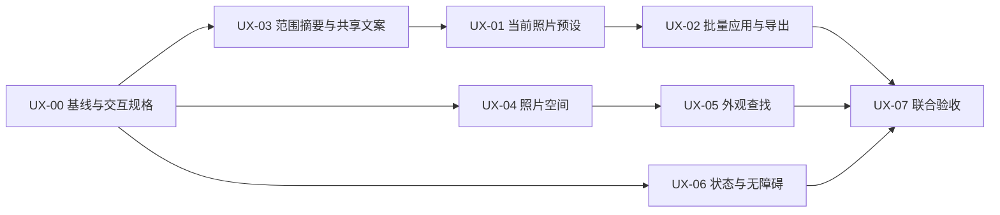

# RawLab UI/UX 优化总体执行规划

> **For agentic workers:** 本文件是跨 PR 的总体规划与协调入口。子项进入实施前，主控先形成对应设计、接口与验收任务包，再使用 `superpowers:subagent-driven-development` 或 `superpowers:executing-plans` 逐项执行。不得把下表中的方向直接当作完整实现规格。

**Goal:** 在保留 RawLab 既有照片编辑语义和原生界面体系的前提下，缩短预设与批量操作路径，改善照片空间、外观查找和状态可理解性，完成四端受影响流程的原生验收。

**Architecture:** 继续使用共享处理核心、现有调整传递、草稿、历史和导出事务。跨端先统一操作语义、范围摘要与文案，再由平台负责人接入原生界面；同一平台的编辑器入口按阶段顺序修改，不按审计问题拆成互相覆盖的并行实现。

**Tech Stack:** SwiftUI/AppKit、SwiftUI/UIKit、Kotlin/Jetpack Compose、C#/WPF、共享 Swift 数据与六语资源；共享 C++ 渲染核心保持现有契约。

**Spec:** [产品背景](../../../PRODUCT.md)、[现有设计体系](../../../DESIGN.md)、[紧凑调整栏与裁切精度](../../design/editor-workspace/compact-controls.md)、[编辑迭代需求](../../design/editing-iteration/requirements.md)、[HDR 四端对齐](../../design/hdr-photos/android-windows.md)。本文件第 2 节保存本轮审计到执行项的映射；详细的新交互由 UX-00 阶段形成。

**状态：M0 完成；M1 已通过 [PR #155](https://github.com/dancancer/RawLab/pull/155) 集成；M2 的 UX-01 已通过 [PR #156](https://github.com/dancancer/RawLab/pull/156) 集成；UX-02 批量流程正在实施，M3/M4 尚未完成。** 编写日期：2026-10-29。主控为提出本规划的协调会话。
用户已确认按此规划推进至全部完成，主控负责细化、分派、验证和协调交付。
目标集成分支为 `development`，不预设发布版本号或日期。

**范围调整（2026-10-30，用户明确要求）：** 后续不做系统大字号/辅助字号兼容，也不再运行大字号或系统文本缩放检查。后续以默认字号验收；已完成的大字号记录仅保留为历史证据。窄窗、长译文、正常设备 DPI 和交互检查继续按本规划执行。

## 1. 基线、范围与全局约束

- 审计基线：`development@25cf415521f316ea47db366c74a8b78c8d1561c2`。Mac 实际操作使用 0.9.1 build 16，其他三端以源码核验为主；待设备复现项不能直接标成已确认缺陷。
- 规划基线：`origin/development@d2661fc16d2949abb157dd60934eaceadd586d11`。此源已包含 Android/Windows HDR 接入，改变了预设、范围、批量和模式可用性。UX-00 必须核对这部分增量，不能沿用“只有 Apple 支持 HDR 编辑”的旧边界。
- 开工和阶段接入时再次刷新基线，记录实际 base/head。0.9/0.9.1 已交付的功能不是待开发清单；旧的圆形工具、范围标签等规则与紧凑控件约定冲突时，先按当前有效设计和源码核对。
- 原始照片只读；已有编辑、配方强度、自动曝光、逐照片白平衡、几何和镜头参数保持含义。界面优化不得重解释持久化值或改变默认渲染效果。
- 继续复用调整的 prepare/commit/history 和冻结批量事务。自动预检不产生编辑历史；成功应用才保存并形成可撤销操作，失败不能显示为已保存。
- 保存失败、脏草稿、缺失外观、版本不兼容、模式不支持、目标变化、部分成功都保留明确处理路径。缩短正常路径不等于取消这些检查。
- HDR 编辑能力、HDR 显示能力和当前编辑模式分开表达。普通 GPU Auto 保留 CPU 回退；AI 降噪仍只使用支持的硬件 GPU 后端，不增加 CPU 神经推理回退。
- 保留灰黄照片工作区、六组调整、桌面底部参数区和各平台原生控件。移动控件命中区域至少 44 pt / 48 dp。
- 六语资源只改 `Shared/strings` 来源并通过生成器更新；禁止手改生成的原生资源。更新设计文档只记录经确认的本轮变化，不顺手修复全部历史文档或 Impeccable 元数据。
- 本轮不包含新调色算法、RAW/HDR 格式扩展、云同步、通用图库、在线外观商店、整套主题重做或无关结构重构。收藏、智能推荐和复杂资源管理不作为首批外观查找交付的前置。
- 不启用 Impeccable hooks，不修改他人的工作目录、测试进程或用户照片库。原生验证使用隔离配置、临时素材和任务专属设备资源。

## 2. 审计问题到执行项

| ID | 本轮问题与证据层级 | 计划交付 | 完成判据 |
| --- | --- | --- | --- |
| UX-00 | 基线已变化；新交互尚未形成可执行规格 | 增量核对、关键流程图/原生布局方案、接口与资源清单、平台验收任务包 | 每项区分已确认问题、设计选择、待复现风险；冻结正常/异常/取消路径后才实施 |
| UX-01 | 单张预设套用仍进入目标管理与手工检查；Mac 实测，iOS/Android 源码确认 | 当前照片的快捷应用入口，照片持续可见；预设管理和多目标应用保留独立入口 | 无冲突单张操作无需手动“检查目标”；检查、成功、失败、撤销均有明确结果 |
| UX-02 | 逐张导出经过检查、冻结、任务窗口再开始；Mac 界面与源码确认 | 简化批量准备与启动；强化来源照片、选择数量和结果状态 | 普通路径完成输出设置后，一次明确的最终动作即可启动；取消、恢复、失败重试和逐张快照仍正确 |
| UX-03 | 默认通用字段范围庞大，“仅已修改”缺少即时摘要；Mac 实测、移动源码确认 | 所有范围模式的数量、分组和具体值摘要；覆盖与保留项说明 | 摘要与实际捕获/应用字段一致；自动项、配方强度与 HDR/SDR 差异不误导用户 |
| UX-04 | 窄 Mac 窗口中空文件树、参数区和直方图挤压照片；Mac 实测 | 小窗口照片空间预算、紧凑单值面板、直方图适配；其他端按实际问题接入 | 指定视口下照片可用于判断调整结果；没有浮层遮挡关键编辑区域；尊重用户手动布局选择 |
| UX-05 | 数十个外观依赖长横条查找，分类不可直接跳转，导入在末端；Mac 实测与源码确认 | 可见分类、搜索、最近使用和固定导入入口；保留现有包装图/名称 | 已知名称可直接找到；当前选择、来源和兼容状态清楚；新增/移除外观后选择稳定 |
| UX-06 | 不可用原因、配方非颜色选中态、辅助页溢出有缺口；部分仅源码风险 | 可理解的不可用状态、非颜色状态标记、辅助页面默认字号下的内容可达性与键盘/读屏收尾 | 对照原生矩阵实际验证；未复现项记录结果，不为静态猜测强行修改 |
| UX-07 | 单端或单项通过不能证明组合流程正确 | 同一集成源的四端流程验收、独立设计复评、余项归档 | 本轮必选范围均关闭；设备缺口单列，不能用编译/原型截图替代原生运行 |

所有问题优先按可复现的使用影响处理，不以审计总分或修改控件数量作为完成指标。

## 3. 执行方式与关键设计选择

采用“体验问题统一设计、平台负责人连续接入、共享文件单人维护”的方式。
直接按六个问题启动六个跨平台实现任务，会让预设、范围摘要、批量和布局同时修改相同编辑器入口；完全按平台各自设计，则容易形成四套操作语义。两种做法均不作为本轮默认。

以下是主控推荐的设计起点，UX-00 会以状态图和界面方案具体化；它们不是已完成或已批准的界面：

1. **当前照片预设：点选后自动检查并应用，可撤销。** 与现有胶片/配方操作保持一致，照片保持可见，成功后保存并形成一条历史。检查中取消不提交；出现草稿、缺外观或不兼容时进入明确处理。首批不另造一套“预览已变但未保存”的通用草稿系统；若细化时选择临时预览方案，必须先明确其取消、切图、历史与保存合同，再调整任务范围。
2. **多目标应用：保留确认页，自动完成普通预检。** 页面围绕来源、目标、将覆盖的调整和冲突组织；用户处理的是照片与调整，不是手动启动每个内部阶段。目标或源版本变化后旧预检结果失效，不能继续提交。
3. **批量导出：一个最终启动动作。** 正常路径由系统完成校验、冻结和启动，随后进入进度页。需要处理冲突时先给结果摘要；失败后保留选择和输出设置。只有确有排队用途时才单列“加入队列”，避免“确认”后还需再次寻找开始按钮。
4. **范围摘要：先给分组结果，再展开具体字段。** `全部 / 仅已修改 / 自定义` 均显示实际数量和含义；说明几何/镜头是否包含、哪些目标值会保留。相机自动项按目标解析，不能把源照片的派生值包装成固定值复制。
5. **空间与外观查找：保留现有视觉身份。** 小视口优先保护照片与当前参数，给用户可发现的紧凑/展开方式。外观分类基于已有稳定身份与来源；搜索和最近使用不写入照片编辑格式，最近使用仅在成功应用后更新。

UX-00 必须产出三个可评审结果：单张预设正常/异常流程、批量选择到完成流程、桌面窄窗与手机横竖屏布局。每个结果同时写明状态、主动作、返回/取消、保存边界和无障碍表达。
照片最小可用空间、浮层避让和具体控件高度在对应布局方案中量化，并配当前原生截图对照；未确定这些规则时，不让实现者凭感觉修改尺寸。
同时在本索引增加“平台 × UX 项”适用/必验表，逐格记录问题是否仍存在、需要实现或仅需验证、验收环境与负责人。Windows 的预设/范围流程及新基线的四端 HDR 必须进入核对，不能因上轮缺少实机观察而排除。

## 4. 阶段与依赖

| 阶段 | 主要范围 | 允许并行的工作 | 阶段退出条件 |
| --- | --- | --- | --- |
| M0 细化 | UX-00；对新基线复核全部问题，落实原生验证环境 | 四端只读增量核对、关键流程/布局设计 | 状态图、字段摘要规则、写入 owner、验收场景和资源均明确；主控完成方案复核 |
| M1 基础 | UX-03、共享六语来源；已确认且不改流程的 UX-06 小项 | 不同平台独立接入；UX-04/05 可继续设计 | 摘要和语义向量一致，基础 PR 按授权集成；消费者切到新基线 |
| M2 核心流程 | UX-01 后 UX-02；Mac 先验证可用路径，再由四端连续接入 | 共享语义确定后四端可并行；同平台预设/批量入口串行 | 当前照片应用、同步、逐张微调、批量输出及失败恢复在受影响端实际跑通 |
| M3 工作区 | UX-04 后 UX-05 | 不冲突的设计/测试准备可与 M2 并行；同平台文件由同一 owner 顺序提交 | 窄窗/长文案与外观增长场景验证通过，保持照片编辑状态 |
| M4 收口 | UX-06 剩余项、UX-07 | 平台独立核验，主控协调共享设备与集成版本 | 同一集成源联合矩阵、独立复评与增量审计完成；未覆盖项有明确处理决定 |

箭头表达默认接入顺序，不要求把全部变化堆成一个大 PR。独立状态修复可先交付；涉及相同平台入口的变更必须按 owner 的队列执行。
前置尚未进入已授权集成基线时，依赖项可做设计和测试准备，不能把分支上的独立结果记成联合通过。

## 5. 主控、会话和文件所有权

使用 subagent 处理有边界的探索与独立复核，主控负责实现和最终验证。当前可用默认子代理被角色指令限制为只读，因此平台源码由主控按阶段串行维护；不让只读子代理承担写入任务。需要长期保留的平台环境或持续交接时，再按用户授权创建独立会话并登记。首批实施树为 `feature/ui-ux-foundation`。

| 角色 | 责任与独占写入范围 | 首次分派时要明确的内容 |
| --- | --- | --- |
| 主控 | 本规划、任务包、依赖/状态表、方案取舍、阶段集成和最终验收；统一维护本轮设计文档变更 | 当前 base、交付顺序、范围变化、跨平台差异、各门禁证据 |
| 共享语义/资源负责人 | `Shared/AdjustmentTransfer.swift` 等确需变化的共享表示、`Shared/strings/common/catalog.json`、四个平台资源来源及生成输出 | 摘要规则、资源 key/占位符、共享测试向量；其他 owner 只提交接入请求 |
| Mac 负责人 | `RawLabMac/Sources/Editor/View`、相关 EditorModel、Export、Looks、Inputs 与本端测试 | 当前照片/预设/批量呈现，布局和键盘；相同文件按阶段串行 |
| iOS 负责人 | `RawLab/RawLab/UI`、相关 ViewModel/Models 与本端测试 | iPhone/iPad、Dynamic Type、原生返回与草稿；消费共享 Swift 语义 |
| Android 负责人 | `RawLabAndroid/` 的 editor/batch/presets/adjustments 及本端测试 | HDR/SDR 能力、系统 Back、IME、默认字号与窗口；不重启共享 ADB |
| Windows 负责人 | `RawLabWindows/` 的窗口、预设/传递/批量呈现与本端测试 | 正常设备 DPI、键盘/UIA、HDR 原生窗口叠层 |
| 独立复核者 | 只读核验最新 diff、任务验收和真实原生结果，不修改实现或配置 | 绑定 source/base；给出具体问题或通过范围，不能只转述实现者结论 |

跨端语义以语言无关的字段/范围/HDR 合同和共享测试样例为准，不以 Swift 实现作为其他端已接入的证明。共享负责人维护合同及 `Shared/fixtures/` 中适用的传递/预设向量；Android 的 `adjustments/AdjustmentTransfer.kt`、Windows 的 `AdjustmentTransfer.cs` 和各端预设存储由平台负责人实现等价适配。UX-03 合同与样例固定后，四端分别通过同一组输入/期望结果，再接 UX-01/02。

以下入口是阶段写入锁的最小集合，UX-00 在任务包中补齐具体文件、owner、预期 PR 和依赖 head：

| 冲突入口 | 可能重叠的子项 | 调度规则 |
| --- | --- | --- |
| Mac `EditorView.swift`、EditorModel 的 AdjustmentTransfer/AdjustmentPresets/BatchSelection 扩展 | UX-01/02/03/04/06 | Mac owner 按阶段串行接入，不能由两个实现代理同时修改 |
| iOS `ContentView.swift`、`ContentView+AdjustmentTransfer.swift`、`ContentView+Panels.swift`、相关 ViewModel | UX-01/02/03/04/06 | iOS owner 维护入口，工具或布局小项提交定向接入请求 |
| Android `MainActivity.kt`、`EditorScreen.kt`、`EditorViewModel.kt`、`AdjustmentTransferSheet.kt` | UX-01/02/03/04/06 | Android owner 统一接入，保留新 HDR 模式、异步准备和取消规则 |
| Windows `MainWindow.xaml`、MainWindow 下的 Tools/AdjustmentCommands/AdjustmentPresets/BatchSelection | UX-01/02/03/04/06 | Windows owner 维护窗口与状态入口，布局任务不能覆盖流程接线 |
| `Shared/strings/common/catalog.json`、`Shared/strings/platforms/*.json` 和生成输出 | 全部可见文案/无障碍项 | 共享资源 owner 合并 key 请求并生成；消费者先接资源提交，再改调用；每批记录资源 head |

最多同时六个子代理。实际并发按文件和设备资源决定，不为凑并发而拆任务。
macOS/iOS 的原生 UI 操作需要独占其测试窗口/模拟器；同一环境中的视觉检查不能由多个代理同时驱动。
其他任务已有 worktree、配置和进程不属于本轮清理对象。

每次分派的任务包必须包含：目标和不做项、前置与精确 base SHA、唯一写入 owner/路径、需要读取的设计和合同、正常/异常状态表、测试入口、实际 UI 验收、交付证据格式及授权边界。
子项返回后由主控核对 diff 和关键证据，再交独立复核；任务结束后复用或释放代理，不长期空转。

## 6. 已确认的接入点与子计划边界

以下是当前文件地图，不是要求整片重构。细化后每个任务包列出精确的修改和测试文件。

| 范围 | 主要接入点 |
| --- | --- |
| 共享范围/预设 | `Shared/AdjustmentTransfer.swift`、`Shared/AdjustmentPresetStore.swift`、`Shared/BatchSelectionSession.swift`、`Shared/strings/` |
| Mac 预设/范围/批量 | `RawLabMac/Sources/Editor/View/AdjustmentPresetView.swift`、`AdjustmentTransferView.swift`、`AdjustmentScopeEditor.swift`；`RawLabMac/Sources/Export/BatchSelectionView.swift`、`BatchExportView.swift`；对应 EditorModel 扩展 |
| Mac 空间/外观 | `RawLabMac/Sources/Editor/View/EditorView.swift`、`AdjustmentPanelLayout.swift`、`RawLabMac/Sources/Looks/FilmDock.swift`、`RawLabMac/Sources/Inputs/HorizontalPicker.swift` |
| iOS | `RawLab/RawLab/UI/Editor/IOSAdjustmentPresetView.swift`、`IOSAdjustmentTransferView.swift`、`IOSAdjustmentScopeEditor.swift`；`UI/Export/IOSBatchSelectionView.swift`、`UI/EditorState/EditorLayout.swift`、`UI/Panels/LookPanels.swift` |
| Android | `RawLabAndroid/app/src/main/java/com/rawlab/android/editor/ui/AdjustmentPresetSheet.kt`、`AdjustmentTransferSheet.kt`、`AdjustmentDock.kt`、`EditorScreen.kt`；`batch/ui/BatchSelectionScreen.kt`、`BatchExportScreen.kt` |
| Windows | `RawLabWindows/AdjustmentPresetDialogs.cs`、`AdjustmentTransferPresentation.cs`、`BatchSelectionWindow.cs`、`BatchExportWindow.xaml`、`MainWindow.xaml`、`MainWindow/Tools.cs`、`EditorAppearance.cs` |

预设、范围和批量共用的入口由本端同一负责人维护。共享表示、六语来源、生成文件和设计基线只允许指定 owner 写入。
本轮原则上不改 C ABI、数值算法和构建依赖；确有必要时由主控先说明原因、影响与回归范围，再增设独立前置项。

## 7. Review Focus 与验收矩阵

| 风险类别 | 必须验证的行为 | 归属 |
| --- | --- | --- |
| 自动预检期间切图、改范围、重复点击、关闭或后台 | 陈旧结果丢弃，不对另一张照片应用，不创建重复历史/任务；取消不落盘 | UX-01/02/03 |
| RAW/普通 SDR/gain-map HDR、缺外观、未来版本和不支持字段 | 模式与能力说明准确；按目标解析自动项；不静默丢字段、不伪装全部成功 | UX-01/02/03/06 |
| 脏几何/镜头草稿、保存失败和部分成功 | 应用/放弃/继续编辑可达；失败保留可恢复状态；撤销只处理实际成功目标 | UX-01/02/06 |
| 窄窗口、默认字号、六语、键盘/读屏和系统返回 | 主动作与完整值可达，焦点可恢复，照片空间和草稿动作不被挤掉 | UX-04/05/06 |
| 100+ 目标、外观增长、暂停/恢复、输出失败或任务重入 | 列表按需构建，窗口保持可操作；冻结后的结果不受后续编辑影响，不重复输出已成功项 | UX-02/05/07 |

### 原生界面矩阵

- **Mac：** 默认 1320×850 窗口与 950pt 宽/最小内容高度场景；有/无文件树，直方图展开/收起，单值/HSL/曲线/几何，中文及长译文；实际键鼠、保存/取消/撤销与 VoiceOver 相关状态。
- **iOS：** 至少一台 iPhone 和一台 iPad 的专属模拟器；窄竖屏、横屏、iPad 分屏、默认字号；原生数值输入、返回/关闭、相册/文件、草稿及 VoiceOver。真实触觉和物理 HDR 亮度另列设备门槛。
- **Android：** 320/360/412dp 窄窗、横向宽窗和多窗口；默认字号、长译文、IME、Back/TalkBack、RAW/SDR/HDR 流程；任务使用独立 ADB 端口和明确 serial。
- **Windows：** 1024×720 与常用桌面尺寸；100/150/200% 显示 DPI，系统文字使用默认大小；长译文、Tab/Enter/Escape、Narrator/UIA、HDR/SDR 画布与叠层。RDP 不作为物理 HDR/GPU 证据。
- **共同组合：** 1 张/多张照片，已有/无预设，取消、失败、重试、重开，部分字段保留、逐张微调后导出；保持旧记录和渲染结果。100+ 目标单列性能观察，不以静态循环推断实测卡顿。

没有设备或工具链的格子记录 `NOT RUN` 与具体条件；未进入的后续步骤记录 `NOT REACHED`，不以静态检查、模拟器、原型或编译成功替代。
适用/必验表中的必验项只要仍为 `NOT RUN`、`NOT REACHED`、失败或证据不属于当前受影响源，该平台子项就不能标记“已验收”，UX-07 也不能关闭。可继续推进不依赖它的工作，但不能用标注缺口代替完成门槛。
真正不适用的格子必须给出产品/代码依据，由主控复核；需要延期且会改变本轮完成条件的覆盖，由用户明确调整范围。物理 HDR 亮度、硬件 GPU 等未改变的既有设备限制独立保留，不能混写成本轮新增 UI 已通过实机验证。

### 测试与 CI

复用现有入口并按实际改动增加有针对性的回归，不机械新增整套测试框架：

- 共享：`bash Shared/tests/adjustment-presets.sh`、`bash Shared/tests/batch-selection.sh`、`python3 scripts/localization/generate.py --check`；HDR/范围相关改动补对应共享向量。
- Mac：`RawLabMac/tests/adjustment-preset-application.sh`、`adjustment-transfer-session.sh`、`batch-selection-model.sh` 及 `compact-controls-presentation.sh`；呈现快照补充实际应用交互，不能替代后者。
- iOS：`RawLab/tests/adjustment-transfer-session.sh`、`batch-export.sh` 与现有 Preset/Editor/Batch UI 套件；执行方式、fixture 和 UDID 在任务包中固定。
- Android：Gradle 单元测试及 `AdjustmentPresetUITest`、`AdjustmentTransferUITest`、`EditorParameterViewportTest`、`BatchSelectionWorkflowTest` 等对应仪器测试；延续已合入 HDR 测试。
- Windows：现有 editing 模型、`AdjustmentPresetUiChecks`、`BatchSelectionUiChecks`、`EditorReview` 和外部 UIA 检查；具体 `run-v08.ps1 -Only ...` 参数由平台任务包按当前 runner 支持项固定。

遵循[验证 SOP](../../process/ci.md)：UI 改动提交前运行受影响的本地 UI 检查；普通 PR 运行 contracts 和受影响平台 models；完整构建/native 按具体风险手动触发。UI 编译不是 UI 执行。
基线变化只重验受影响组合，已有证据保留真实源码版本。发布、热修复的完整门禁不在普通 UI PR 中重复运行。

## 8. 分支、集成、证据和授权

- 每个可独立验收的功能 PR 从最新 `origin/development` 建 `feature/<scope>` 和独立 worktree。共享前置先落地，依赖分支接入新基线；已共享分支不自行改写历史。
- 具体分派时记录原实现 owner、分支、base/head、前置 PR、写入路径与运行资源。跨平台接口变化先由主控和共享负责人确认，冲突解决后必须复核语义。
- 交付状态依次为 `待细化 → 待前置 → 实施中 → 待原生验证 → 待独立复核 → 待集成 → 已集成 → 已验收`。每项分别记录设计、代码和验收状态；子代理自报完成不关闭整项。
- 本轮当前授权覆盖总体规划，以及后续由主控细化分派和推进。上一次 PRODUCT.md 的提交/push/合并授权已完成，不自动扩展到本轮 UI PR；本轮 commit、push、创建 PR、合入和发布按用户对相应阶段的明确授权与项目规则执行。
- 获得相应交付授权后尽早建 draft PR，检查同源 PR 避免重复；合入前核对源 SHA、目标分支、冲突与当前 CI，不绕过保护。主控合入后核实远端包含关系和 development push 结果。
- 本索引只记录跨 PR 状态、依赖和证据链接。每个 PR 的实际命令、source/base、截图、测量、失败和未覆盖项写在该 PR；测试照片、日志、构建和截图不入库。
- 临时文件用系统临时目录或主工作区 `.cache/tmp/<task>/`；可复用依赖用 `.cache/shared/`。只清理本任务拥有的进程和产物；隔离 Mac 测试应用退出后，不再次通过 CUA 查询使其无隔离重启。
- 本轮完成后，主控复跑原生审计，按实际影响记录改善和余项；跨 PR 过程索引移入 `docs/archive/`，长期交互合同保留在 `docs/design/`。

## 9. 参考设计的使用范围

已查看的 Mobbin 参考均为 iOS 画面，只借用与本轮问题相关的结构，不将整套外观或业务流程直接复制到其他平台：

| 参考 | 可用于细化的部分 |
| --- | --- |
| [VSCO 分类滤镜](https://mobbin.com/screens/9ee6d804-b981-4a88-b3ae-8b0e85d7bebe) | 照片持续可见、分类与短外观列表；用于 UX-01/05 |
| [Apple Photos 调整](https://mobbin.com/screens/0efba7f9-e477-45f7-b0fa-54eb4ecff72d) | 当前操作层级、取消/完成位置；用于 UX-01/04 |
| [VSCO HSL](https://mobbin.com/screens/6d8bfdaf-9142-4a54-ac46-ab3efed21d33) | 照片与复杂工具的同屏空间分配；用于 UX-04 |
| [Lapse 多照片选择](https://mobbin.com/flows/b17c4e97-d0f2-4b7f-8b58-09cb65b5a7e6) | 选择数量、缩略图勾选与批量动作的关系；用于 UX-02 |

## 10. 当前状态与下一步

- [x] 保存总体目标、范围、依赖、职责、关键风险和验收框架。
- [x] 记录规划基线相对审计基线新增的 Android/Windows HDR 接入。
- [x] 用户确认总体规划，首批范围为 UX-03 及 UX-01 前置。
- [x] 完成四端增量核对；[交互合同](interaction-contract.md)记录流程、布局、摘要与必验矩阵。
- [x] 形成 [M1 范围摘要基础计划](foundation-plan.md)，共享资源先行；M2 的具体实现包随接口固定。
- [x] 完成 M1 四端代码接入与独立复核修正；摘要、预览守卫和六语来源已有定向回归。
- [x] 形成 [M2 当前照片预设实施计划](quick-presets-plan.md)；前置集成前只做设计与验证准备。
- [x] M1 四端受影响原生检查；Mac 最终窗口检查已补齐，iOS、Android、Windows 已通过。完整组合流程仍由 M4 验收，未将本阶段结果扩展为整轮通过。
- [x] M1 基础 [PR #155](https://github.com/dancancer/RawLab/pull/155) 按授权合入 `development@a6626f483cda246e9688a0b049b6ec10f3e1325a`；M2 以此为基线。
- [x] M2 的 UX-01 当前照片快捷预设完成四端实现、独立复核与受影响原生验证；普通应用自动预检，支持取消、重试、精准事务撤销和 HDR。
- [x] M2 的 UX-01 [PR #156](https://github.com/dancancer/RawLab/pull/156) 已按授权合入 `development@a3d6bded14f963cd8f5f44c11109c747bb978adc`。
- [x] 按 [UX-02 批量流程计划](batch-flow-plan.md) 完成自动预检、一次启动及四端目标级原生验证。
- [ ] UX-02 按阶段授权提交、push、创建 PR 并集成。
- [ ] 按阶段实施、独立复核、原生验证和已授权集成推进。

UX-02 实现、独立复核及四端目标级验证完成，等待阶段交付；M3 工作区/外观检索正在独立工作区实施，M4 联合验收未关闭。具体命令、截图、失败诊断和源码 hash 保留在本轮临时验证目录，阶段交付时写入 PR，不入库为单 PR 验证流水。
