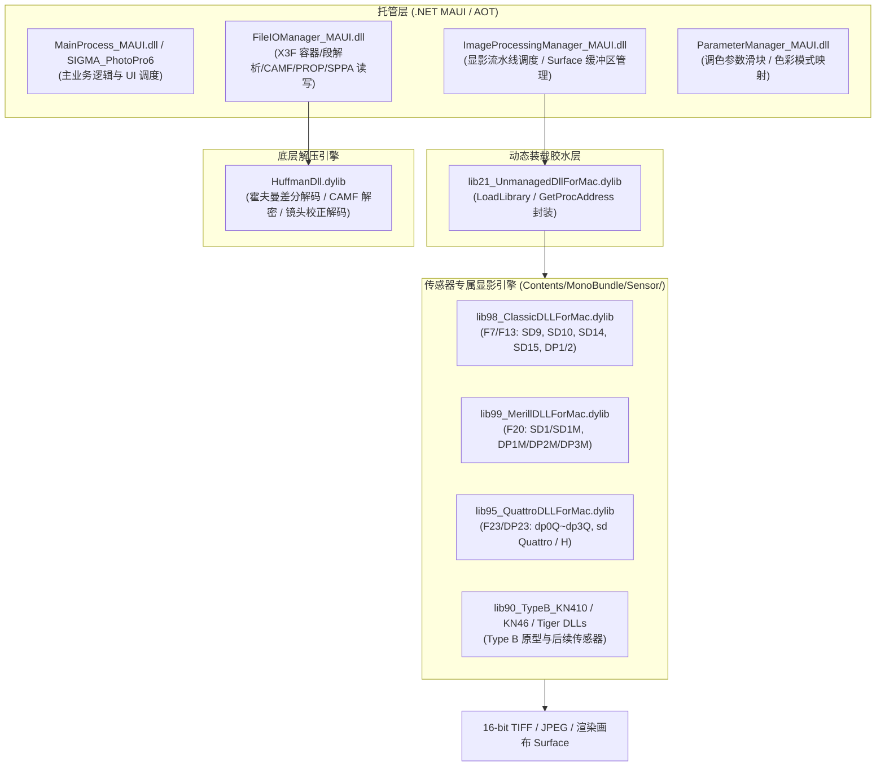
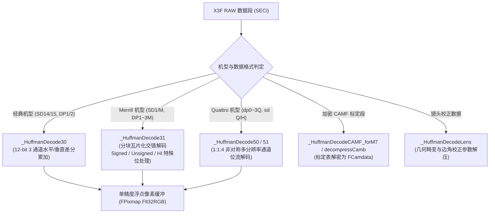

# SIGMA Photo Pro (SPP) X3F 文件解码与显影核心流水线逆向分析报告

## 1. 概述与分析目标

适马（SIGMA）Foveon X3 传感器采用垂直三层硅光电二极管吸收入射光（顶层吸收蓝光、中层吸收绿光、底层吸收红光），其原始数据封装在 `.X3F` 格式容器中。由于物理硅吸收光谱严重重叠、三层感光特性各异，且各代机型（经典 F7/F13、Merrill F20、Quattro F23/DP23）物理构造存在显著演进，开源解析器（如 dcraw、早期 LibRaw 及 x3f_tools）往往仅实现了基础差分霍夫曼解压，导致出现“高光死白偏色、暗部噪点发绿、中频色彩杂斑”等现象。

本报告基于 macOS 平台官方 **SIGMA Photo Pro 6.8.x (`SIGMA_PhotoPro6.app`)** 原生二进制、共享动态库及运行时日志进行逆向分析，全面解构其文件容器、解码状态机及传感器专属显影流水线。

---

## 2. 系统分层架构

SPP 6 在 macOS 平台采用 **.NET MAUI / MacCatalyst AOT** 托管宿主与**底层 C/C++ 共享动态库**深度混合的架构：



### 关键组件职责

1. **`FileIOManager_MAUI.dll`**：负责按字节解析 X3F 容器结构，包括 `FOVb` 文件头、`SECd` 倒置段目录、`SECp` 属性表、`SECc` 标定段、`SECi` 图像段和 `SECs` 用户调整参数。
2. **`ImageProcessingManager_MAUI.dll`**：通过 `SelectDllCapabilityData` 判定机型传感器代际枚举（`E_SENSOR_F7`、`E_SENSOR_F13`、`E_SENSOR_F20`、`E_SENSOR_F23`、`E_SENSOR_DP23`），动态挂载对应传感器 DLL，并绑定 `ProcDelegateRequestProcess`、`ProcDelegateInitSurface` 等回调函数。
3. **`HuffmanDll.dylib`**：专职高吞吐差分霍夫曼解压、`CAMb` 标定块解密、`Lens` 镜头数据提取。
4. **`Sensor/` 显影动态库**：各传感器硬件架构的完整图像处理引擎，负责坏点修复、暗角去阴影、色彩矩阵解算、Retinex 填充光与双边滤波降噪。

---

## 3. X3F 容器格式与倒置段目录结构

X3F 属于非 TIFF 架构的专用块容器，核心特性是**文件头在首、目录表在尾**：

```
+-------------------------------------------------------------+
| Header (魔数 'FOVb' 0x62564F46, 版本号, 宽高, 旋转标志, 目录偏移) |
+-------------------------------------------------------------+
| SECi - 嵌入缩略图 / 预览图 (Thumbnail / Preview JPEG)        |
+-------------------------------------------------------------+
| SECp - 属性参数段 (Property Section: ASCII 拍摄参数与温度)   |
+-------------------------------------------------------------+
| SECc - 硬件标定数据段 (CAMF Section: 加密压缩的校准矩阵/阴影表) |
+-------------------------------------------------------------+
| SECi - RAW 图像数据段 (IMA2 Header + 差分霍夫曼压缩位流)     |
+-------------------------------------------------------------+
| SECs - SPP 专有调色参数段 (SPPA Section: 后期调整参数 IFD)   |
+-------------------------------------------------------------+
| SECd - 目录段 (Directory Section: 记录上述各段的偏移量与长度)   |
+-------------------------------------------------------------+
```

### 3.1 头部与字段解析
- **魔数**：`FOVb`（`0x62564F46`），若为电影 DNG / 多帧容器则为 `FOVi`。
- **文件版本号**：`0x00020000` (v2.0)、`0x00020001` (v2.1)、`0x00020002` (v2.2)、`0x00030000` (v3.0)、`0x00040000` (v4.0)。
- **核心字段**：`Columns`、`Rows`、`Rotation`、`UniqueIdentifier`、`ProcessVersion`。

### 3.2 关键段类型与功能
1. **`SECp` (Property Section)**：
   - 使用 ASCII 键值对存储拍摄参数。
   - 特殊关键标签：
     - `TAG_PROP_DARKTEMP` / `TAG_PROP_IMAGERTEMP`：传感器暗电流温度与成像器温度。Foveon 硅层的暗电流和热噪声随温度呈非线性剧增，SPP 显影时会根据该温度调用动态暗电流补偿表。
     - `TAG_PROP_CAMMODEL` / `TAG_PROP_CAMMANUF`：机型与厂商标识。
     - `TAG_PROP_ISO`、`TAG_PROP_WB_DESC`、`TAG_PROP_CM_DESC`：感光度、预设白平衡、机内色彩模式。
2. **`SECc` (CAMF / CAMb Section)**：
   - 存储相机硬件级标定数据（Camera Calibration File）。
   - 包含色彩解混矩阵（Color Correction Matrix, CCM）、不同光圈下的镜头暗角与边缘色差补偿网格（Spatial Gain Maps / Color Shading Tables）、高光保护增益（`colorDQ`）、坏点列表（Bad Pixel Table）。
   - CAMF 数据段本身采用差分霍夫曼加密，需经 `HuffmanDecodeCAMF_forM7` 或 `decompressCamb` 解密后转换为内存中的 `FCamdata` 结构。
3. **`SECi` (Image Section - RAW)**：
   - 以 `IMA2` 头部起始，包含色彩通道数（3 通道）、实际有效感光区与黑电平边框裁剪区域。
   - 紧随其后的是分通道或交错的霍夫曼位流。
4. **`SECs` (SPPA Section - Sigma Photo Pro Adjustment)**：
   - 用户在 SPP 中对单张照片所做的调整（曝光增益、对比度、Fill Light、高光/暗部微调、白平衡色温/色调偏移等）直接以 TIFF IFD 结构追加到 X3F 文件尾部，保证原片 RAW 位流不被破坏。

---

## 4. RAW 图像差分霍夫曼解码体系 (`HuffmanDll.dylib`)

SPP 根据机型代际采用不同的霍夫曼解压流水线：



### 4.1 `HuffmanDecode30` (经典 1:1:1 传感器: SD14 / SD15 / DP1 / DP2)
- 原始数据精度为 12-bit（取值范围 0~4095）。
- 霍夫曼码表包含 13 个差分幅度类别（0~12，类比 JPEG DC 编码）。
- 解码时由 `ReadChannel` 执行位流分析：
  - 读取大端字并进行字节翻转（`rev w25, w25`）；
  - 移位匹配霍夫曼码长与前缀码；
  - 提取差分绝对值与符号位；
  - 对行内前一像素进行累加（水平预测）；首像素依赖垂直邻域预测；
  - 解码出的整数实时转换为 IEEE 754 单精度浮点数（`scvtf s0, w26`），交错存入 3 通道内存。

### 4.2 `HuffmanDecode31` (Merrill F20 传感器: SD1 / Merrill)
- 对应 4800×3200（4600 万总像素）庞大数据量。
- 引入瓦片分块（Tiled）与多线程并行读取：
  - 调用 `setUpParameters` 装载 `SpecialPixInfo` 结构；
  - 区分标准感光度与高感度位流，分流至 `decompressUnsignedRaw` / `decompressHIUnsignedRaw` / `decompressSignedRaw` / `decompressHISignedRaw`；
  - 独立解析高位截断与扩展量化位，直接为下游高噪点抑制阶段保留额外动态余量。

### 4.3 `HuffmanDecode50` / `51` (Quattro F23/DP23 传感器)
- Quattro 传感器顶层为高分辨率（约 2000 万像素），中层与底层为低分辨率（约 500 万像素）。
- 霍夫曼解码器在此处处理非对称行长，分别生成顶层全尺寸蓝光缓冲与中下层 1/4 尺寸绿红缓冲。

---

## 5. 官方核心显影处理流水线 (7 阶段深度剖析)

在完成原始浮点数解码后，SPP 驱动底层的 `lib95_QuattroDLL` / `lib99_MerillDLL` 进行多阶段图像处理。其关键阶段与独门特殊处理如下：

### 阶段 0：硬件校准与缺陷修复 (`priProcessPreprocessStage`)
1. **高光保护点校正 (`HLPs Correction` / `CorrectHLPixel`)**：
   - Foveon 垂直感光特性导致表层硅在强光下首先饱和，深层硅仍在线性响应。SPP 首先扫描并标记硬件级的饱和溢出点（Highlight Protection Pixels），防止无效电荷污染邻近像元。
2. **固定模式坏点与簇缺陷修复 (`FPPD & Bad Pixel Correction` / `DoRepairPix`)**：
   - 结合 CAMF 中的出厂坏点表与实时局部中值滤波，分别对色度与亮度通道进行坏点修复，并消除成团的簇状缺陷（Cluster Defect）。
3. **Quattro 1:1:4 转换 (`114 to 111 convertion`)**：
   - **全尺寸渲染**：利用顶层超高密度的梯度引导中下层色彩通道进行边缘导向插值；
   - **合并模式 (`DoBinningSat`, `Downscale2x2`)**：将顶层像元按 2×2 合并，输出色彩纯净度更高的全采样图像。
4. **光圈/焦距插值镜头阴影校正 (`ApplyLUT&ColorShadingGain` / `InterpFStop`)**：
   - Foveon 芯片由于厚度较大，对斜射光入射极其敏感，画面四周易产生强烈的暗角与“红绿圈”（Color Shading）。
   - SPP 根据 EXIF 读取拍摄时的实际光圈与焦距，在 CAMF 预设的离散网格中调用 `InterpFStop` 执行双线性空间插值，实时生成空间增益图，并分别乘以亮度与色度通道。
5. **跨层高光细节重建 (`Highlight Restoration` / `HLPsRestoCorr`)**：
   - 若只有顶层饱和，而中层或底层未饱和，SPP 利用未饱和层的像素梯度按比例反向推导顶层高频细节；
   - 配合 **双曲正切查找表 (`MakeTanhLUT`)** 对高光极值进行平滑曲线压缩，彻底规避“死白断阶”和“高光粉红斑”。

### 阶段 1：适马灵魂黑科技 —— X3 Fill Light (`priProcessStage1`)
- **算法核心**：基于**多尺度 Retinex 感知模型**（`Retinex.cpp`、`CreateRetinxMap`、`DoBinningRtnx`、`PyramidFilter`）。
- **执行过程**：
  - 构造大尺度高斯金字塔降采样，计算全局与局部照度分量；
  - 通过 `GenerateRetinexLogGain` 在对数域计算阴影局部自适应提升增益；
  - 引入 **离散小波变换 (`Do_DWT_forward`)**，保证暗部细节大幅拉升的同时，**完全抑制大反差物体边缘的光晕（Halo）与全局反差坍塌**。

### 阶段 2：色彩科学与解混矩阵 (`priProcessStage2`)
1. **白平衡增益 (`XDo_WB_Gain`)**：
   - 读取 CAMF 标定的基准增益与用户色温/色调微调，对三层原始通道应用平衡倍率。
2. **硅吸收响应解混矩阵 (`F23ColorMixing` / `ApplyMatrx` / `ValidateCCM`)**：
   - 硅分色光谱高度重叠（绿通道吸收了部分红光，蓝通道包含绿光），通过 3×3 或 3×4 矩阵进行强解混运算，将三层电荷响应转换至标准色度基底。
3. **动态饱和度防溢出限制 (`CreateSatMap` / `MakeSatMapMin` / `MakeSatMapX`)**：
   - 强解混矩阵会极大放大噪点并导致高饱和色彩溢出。SPP 实时生成饱和度监测图（Saturation Map），在边缘与高饱和区自适应衰减解混增益。

### 阶段 2B：高级降噪与质感重塑 (`priProcessStage2B`)
1. **YUV 空间色度中值滤波 (`XDoUV_Filter` / `XDoYUVMedian`)**：
   - Foveon 最饱受诟病的是中低频红绿杂斑（Color Blotching）。SPP 将图像转换至亮度-色度分离空间，在 UV 色度平面执行大半径中值与形态学去噪，在彻底消除色斑的同时保留 Y 通道锐度。
2. **历史自适应双边滤波 (`HistBilateralFilter` / `RawBlendColorDQ`)**：
   - 边缘保护滤波，平滑平坦区域的微小色噪。
3. **胶片晶粒逆向合成 (`InsertGrains` / `DoBuildGrain`)**：
   - 针对过度降噪带来的塑料涂抹感，SPP 根据拍摄 ISO 和曝光补偿参数，动态合成微细胶片微晶颗粒并叠加入高光与阴影过渡区，恢复 Foveon 独特的硬朗胶片质感。

### 阶段 3：局部对比度与锐化 (`priProcessStage3`)
1. **局部对比度增强 (LCE: `F23LCE_GPU` / `F23LCEThrd`)**：
   - 提供硬件 OpenCL 与多线程 CPU 两种路径，强化微反差与质感立体感。
2. **多轴色彩独立校正 (`MultiAxisCC`)**：
   - 类似 3D LUT 的多轴独立色相、饱和度、明度微调模型，控制各机内色彩模式（Standard, Vivid, Neutral, Portrait, Landscape, Monochrome 等）。
3. **多频段细节锐化 (`SharpenF23` / `ColorSharpenF23`)**：
   - 分离亮度锐化与色彩边缘，防止反差边缘产生白边。
4. **卷积神经网络超分辨率重建 (`SRCNN_upscale`)**：
   - Quattro 库内嵌轻量级 SRCNN 卷积神经网络，用于大幅面插值或超精细预览时的高频纹理智能合成。

### 阶段 4：最终色彩空间转换与封包 (`priProcessStage4`)
- 将内部浮点三维色彩空间投影至输出色彩空间（sRGB、Adobe RGB 或 ProPhoto RGB）。
- 应用最终伽马曲线，依据输出指令打包为 16-bit 线性 TIFF 或 8-bit sRGB 屏幕位图。

### 特别模式：SFD (Super Fine Detail) 7 帧包围合成 (`priProcessF23ComposeStage`)
- 适马机身连拍 7 张不同曝光（-3EV 到 +3EV）的 X3F 序列。
- SPP 在预处理后进入 `priProcessF23ComposeStage`：
  - **运动检测**：提取位移与运动物体遮罩（`FillGhostMap`）；
  - **加权融合**：利用小波自适应加权（`SFDComposeWFA`），消除运动伪影并输出超高动态范围、完全无噪点的纯净画质。

---

## 6. 对 RawLab / 开源解算的工程实现建议

| 维度 | 第三方开源工具常见缺陷 | SPP 官方实现标准 | RawLab 架构建议 |
| :--- | :--- | :--- | :--- |
| **容器解包** | 假设 TIFF IFD 结构，直接顺序扫描容易丢失段 | 逆向读取文件尾 `SECd` 目录段，按段解包 `SECp`/`SECc`/`SECi`/`SECs` | 在 `lutools` 中将 X3F 解包器与通用的 TIFF/DNG 解包器解耦，实现专用的倒置目录扫描。 |
| **标定数据** | 忽略 CAMF 或仅读取默认基础矩阵 | 霍夫曼解密 CAMF，获取完整的光圈插值暗角表、坏点表与高光增益 | 引入 `decompressCamb` 逻辑，解析 CAMF 中的光圈多维插值暗角补偿网格。 |
| **高光表现** | 出现大面积死白断阶、洋红色或青色偏色 | `HLPs` 标记 + 跨未饱和通道梯度重建 + $\tanh$ 软滚降 | 在去马赛克/重建前加入高光通道饱和检测与跨通道互补重建模块。 |
| **暗部提亮** | 阴影噪点爆炸，画面灰蒙且有光晕 | 多尺度 Retinex 模型 + 小波变换对数增益 (X3 Fill Light) | 在调色核心中引入 Retinex 局部对数增益算法，作为 RawLab 填充光特性的核心实现。 |
| **降噪机制** | 全局高斯/小波平滑导致分辨率大幅下降 | YUV 空间色度中值滤波彻底消除色斑 + 保留 Y 亮度锐度 + 注入胶片颗粒 | 针对 Foveon 传感器将降噪前置于 YUV 色度通道，避免在 RGB 空间直接平滑。 |
